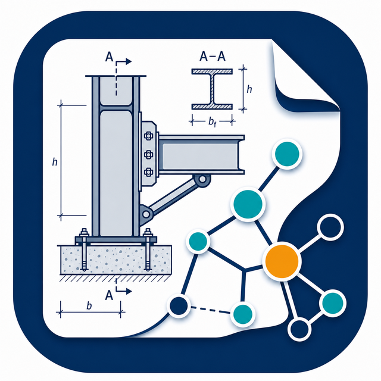

# Introduction

{ .adiro-banner }

ADIRO (*AEC Drawing Information Representation Ontologies*) is a set of ontologies for AEC (*Architecture, Engineering, and Construction*) drawing representation, designed to support machine learning tasks, in particular information extraction workflows.

The ontologies include concepts for drawing metadata, common symbols, domain-common symbols, and domain-specific symbols. They can be used to represent the information in AEC drawings, to make them machine-readable, and to support the creation of graph databases and knowledge graphs.

[:fontawesome-brands-github: View on GitHub](https://github.com/BuroHappoldMachineLearning/ADIRO){ .md-button }

## Documentation

-   :material-file-document-check-outline: __Ontology Requirements (ORSD)__

    Ontology Requirements Specification Document: purpose, scope, intended users and uses, and the functional/non-functional requirements.

    [:octicons-arrow-right-24: ORSD](specification/ORSD_v1.4.md)

-   :material-clipboard-list-outline: __Use Cases__

    Use case catalogue (UC-01 through UC-07), prioritization matrix, and current ORSD status across all use cases.

    [:octicons-arrow-right-24: Use Cases](specification/use-cases/README.md)

## Available Ontologies

-   ### [Adiro Provenance](adiro_provenance.html)

    Foundational, domain-neutral module for provenance. It lets any value inferred from a drawing be recorded as an assertion that carries its own source, confidence, and how it was produced, aligned to W3C PROV-O. The drawing modules import it.

    Source: [`adiro_provenance.ttl`](adiro_provenance.ttl)

    [{ .ontocanvas-icon } Open in OntoCanvas](https://burohappoldmachinelearning.github.io/OntoCanvas/?onto=https://w3id.org/adiro/adiro_provenance.html){ .md-button target=_blank }

-   ### [Adiro Geometry](adiro_geometry.html)

    Foundational, domain-neutral module for geometry. It records where something sits on a drawing page as a bounding box, read against an explicit coordinate frame. Each box carries its own provenance and confidence. It reuses GeoSPARQL, is imported by the drawing modules, and is shared across use cases.

    *Imports: adiro_provenance*

    Source: [`adiro_geometry.ttl`](adiro_geometry.ttl)

    [{ .ontocanvas-icon } Open in OntoCanvas](https://burohappoldmachinelearning.github.io/OntoCanvas/?onto=https://w3id.org/adiro/adiro_geometry.html){ .md-button target=_blank }

-   ### [Adiro Drawing Metadata](adiro_drawing_metadata.html)

    The core drawing vocabulary. It describes the structure of a drawing sheet: its layouts, title block, revisions, and the fields read from them. It imports the provenance module (which also holds the file, the page and the agents) and the geometry module (where a title block's region is located), and the discipline modules build on it.

    *Imports: adiro_geometry, adiro_provenance*

    Source: [`adiro_drawing_metadata.ttl`](adiro_drawing_metadata.ttl)

    [{ .ontocanvas-icon } Open in OntoCanvas](https://burohappoldmachinelearning.github.io/OntoCanvas/?onto=https://w3id.org/adiro/adiro_drawing_metadata.html){ .md-button target=_blank }

-   ### [Adiro Common Symbols](adiro_common_symbols.html)

    Reusable symbols that appear across disciplines, such as dimensions, grids, levels, and reference symbols. Every symbol is a kind of drawing element from the drawing-metadata module. The discipline modules build on these shared symbols.

    *Imports: adiro_drawing_metadata*

    Source: [`adiro_common_symbols.ttl`](adiro_common_symbols.ttl)

    [{ .ontocanvas-icon } Open in OntoCanvas](https://burohappoldmachinelearning.github.io/OntoCanvas/?onto=https://w3id.org/adiro/adiro_common_symbols.html){ .md-button target=_blank }

-   ### [Adiro Domain Common](adiro_domain_common.html)

    Concepts shared by several engineering domains. It sits between the common symbols and the discipline-specific modules, holding abstractions that more than one domain reuses, so they are defined once.

    *Imports: adiro_drawing_metadata*

    Source: [`adiro_domain_common.ttl`](adiro_domain_common.ttl)

    [{ .ontocanvas-icon } Open in OntoCanvas](https://burohappoldmachinelearning.github.io/OntoCanvas/?onto=https://w3id.org/adiro/adiro_domain_common.html){ .md-button target=_blank }

-   ### [Adiro Facade Domain](adiro_facade_domain.html)

    Facade-engineering concepts and symbols, such as curtain-wall systems and glazing units. It is a discipline-specific module at the end of the dependency chain, building on the shared drawing, symbol, and domain vocabularies.

    *Imports: adiro_domain_common, adiro_drawing_metadata*

    Source: [`adiro_facade_domain.ttl`](adiro_facade_domain.ttl)

    [{ .ontocanvas-icon } Open in OntoCanvas](https://burohappoldmachinelearning.github.io/OntoCanvas/?onto=https://w3id.org/adiro/adiro_facade_domain.html){ .md-button target=_blank }

