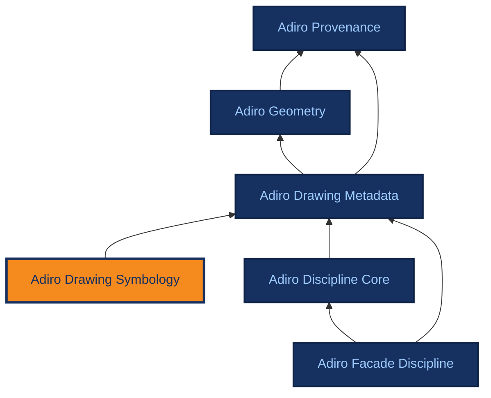

# Adiro Drawing Symbology

Version 5.0.1 (latest)

<ul>
<li><a href="./" class="adiro-version-current" aria-current="page">5.0.1 (latest)</a></li>
<li><a href="../adiro_common_symbols/">adiro_common_symbols 5.0.1</a></li>
<li><a href="../adiro_common_symbols/5.0.0/">adiro_common_symbols 5.0.0</a></li>
<li><a href="../aec_common_symbols/">aec_common_symbols 4.0.1</a></li>
<li><a href="../aec_common_symbols/4.0.0/">aec_common_symbols 4.0.0</a></li>
<li><a href="../aec_common_symbols/3.0.1/">aec_common_symbols 3.0.1</a></li>
<li><a href="../aec_common_symbols/3.0.0/">aec_common_symbols 3.0.0</a></li>
<li><a href="../aec_common_symbols/2.0.0/">aec_common_symbols 2.0.0</a></li>
<li><a href="../aec_common_symbols/1.0.0/">aec_common_symbols 1.0.0</a></li>
</ul>

[{ .ontocanvas-icon } Open in OntoCanvas](https://burohappoldmachinelearning.github.io/OntoCanvas/?onto=https://w3id.org/adiro/adiro_drawing_symbology.html){ .md-button target=_blank }
[:material-file-document-outline: TTL source](https://w3id.org/adiro/adiro_drawing_symbology.ttl){ .md-button }
[:material-file-code: pyLODE HTML](https://w3id.org/adiro/adiro_drawing_symbology.html){ .md-button }

The symbols and marks a drawing uses, shared by every discipline: reusable symbols and text that appear across disciplines, such as dimensions, grids, levels and references to another layout or drawing: the graphical reference symbol, the inline and standalone reference expressions, and the occurrences of drawing and layout identifiers they are made of. Every one is a kind of drawing element from the drawing-metadata module. The discipline modules build on them.

- **IRI:** `https://w3id.org/adiro/adiro_drawing_symbology`
- **Versioned IRI:** `https://w3id.org/adiro/adiro_drawing_symbology/5.0.1`
- **Imports:** `adiro_drawing_metadata`

## Interactive view

<iframe src="https://burohappoldmachinelearning.github.io/OntoCanvas/?onto=https://w3id.org/adiro/adiro_drawing_symbology.html" title="Adiro Drawing Symbology in OntoCanvas" loading="lazy" style="width: 100%; height: 480px; border: 1px solid var(--md-default-fg-color--lightest); border-radius: 4px;"></iframe>

## Dependencies

Arrows point from an ontology to the ontologies it imports; the current ontology is highlighted.

## Classes

### Dimension {#Dimension}

A dimension line or dimension annotation on a drawing, indicating measurements or distances.

- **IRI:** `https://w3id.org/adiro/adiro_drawing_symbology#Dimension`
- **Sub class of:** [`admeta:DrawingElement`](adiro_drawing_metadata.md#DrawingElement)

*Example images:*

### Drawing identifier mention {#DrawingIdentifierMention}

One evidenced occurrence of drawing-identifier text on a source drawing, distinct from the [DrawingSheet](adiro_drawing_metadata.md#DrawingSheet) that the text may denote.

- **IRI:** `https://w3id.org/adiro/adiro_drawing_symbology#DrawingIdentifierMention`
- **Comment:** Source-text evidence and an immutable source identity are admission requirements for exported UC-03 mentions. Precise localisation is required for navigation, not for an independently accepted resolution to a [DrawingSheet](adiro_drawing_metadata.md#DrawingSheet): an unlocalisable text block may retain its accepted [denotesDrawingSheet](#denotesDrawingSheet) edge without a fabricated bounding box or clickable link. Unresolved candidates remain in extraction evidence; no geometry cardinality axiom is imposed. The text it records is a drawing's identification number (ISO 7200:2004 §5.1.3). Where a project uses its file information container ID as the drawing number, a drawing identifier mention may reproduce that ID; the UK National Annex to BS EN ISO 19650-2:2018 (2021 revision), NA.2.2 and Figure NA.1, describes the composition of that ID.
- **Sub class of:** [`admeta:DrawingElement`](adiro_drawing_metadata.md#DrawingElement)

*Example images:*

### Grid {#Grid}

A grid line or grid system used for alignment and reference in architectural drawings.

- **IRI:** `https://w3id.org/adiro/adiro_drawing_symbology#Grid`
- **Comment:** Not the grid reference system of ISO 5457:1999 §4.4, which divides the sheet into lettered and numbered fields; Grid is the building's grid of lines.
- **Sub class of:** [`admeta:DrawingElement`](adiro_drawing_metadata.md#DrawingElement)

*Example images:*

### Inline Layout and Drawing Reference {#InlineLayoutDrawingReference}

A complete inline textual expression relating layout identifier(s) to a drawing identifier, such as '1, 3, 5 & 7/S601'.

- **IRI:** `https://w3id.org/adiro/adiro_drawing_symbology#InlineLayoutDrawingReference`
- **Comment:** The component mentions retain their own identities; accepted [Layout](adiro_drawing_metadata.md#Layout) targets are connected separately by [inlineReferencesLayout](#inlineReferencesLayout). Expected composition: one [DrawingIdentifierMention](#DrawingIdentifierMention) and at least one [LayoutIdentifierMention](#LayoutIdentifierMention), attached with contains; this is checked as an application-profile condition, not asserted as an OWL restriction. Corresponds to the designation of a view or section supplemented by a slash and the drawing number, which ISO 128-3:2022 Annex F, F.4, allows. ISO shows one designation per reference; ADIRO also allows several layouts on one drawing.
- **Sub class of:** [Reference expression](#ReferenceExpression)

*Example images:*

### Layout identifier mention {#LayoutIdentifierMention}

One evidenced occurrence of layout-identifier text (a short identifier, such as a number, a letter or a sheet-grid coordinate), distinct from a target [Layout](adiro_drawing_metadata.md#Layout).

- **IRI:** `https://w3id.org/adiro/adiro_drawing_symbology#LayoutIdentifierMention`
- **Comment:** A complete inline reference may contain several such occurrences, attached with contains; no target is inferred from matching text alone. The text it records is the designation of a view in ISO 128-3:2022 §4.1.
- **Sub class of:** [`admeta:DrawingElement`](adiro_drawing_metadata.md#DrawingElement)

*Example images:*

### Reference expression {#ReferenceExpression}

A complete source reference expression, whether graphical, inline or a standalone drawing-identifier reference.

- **IRI:** `https://w3id.org/adiro/adiro_drawing_symbology#ReferenceExpression`
- **Comment:** This superclass groups those forms for queries; it does not require a second individual around any of them. ISO 7519:2025 §4.3.1 asks that a set of drawings reference the views and details that give further information, and allows hyperlinks to other drawings, files or digital objects, and ISO 128-3:2022 §5.1 allows the designation on a construction drawing to be complemented by a reference to other drawings; neither records whether a reference has been resolved to its target, which ADIRO records as a separate accepted edge.
- **Sub class of:** [`admeta:DrawingElement`](adiro_drawing_metadata.md#DrawingElement)

### ReferenceSymbol {#ReferenceSymbol}

A symbol drawn on a [Layout](adiro_drawing_metadata.md#Layout) that references another Layout (on the same or a different [DrawingSheet](adiro_drawing_metadata.md#DrawingSheet)).

- **IRI:** `https://w3id.org/adiro/adiro_drawing_symbology#ReferenceSymbol`
- **Comment:** Replaces the earlier Callout class. Typical instances include Detail Markers, Section Markers, and Elevation Markers. The marker type is not modelled — it is derivable from the target [Layout](adiro_drawing_metadata.md#Layout)'s [LayoutContentType](adiro_drawing_metadata.md#LayoutContentType). Corresponds to a view designation with its reference arrow or cutting-plane line in ISO 128-3:2022 (§4.1, §4.12, §6.2.1 to §6.2.4) and to a callout in ISO 7519:2025 §4.3.1.
- **Sub class of:** [Reference expression](#ReferenceExpression)

*Example images:*

### Standalone Drawing Reference {#StandaloneDrawingReference}

A drawing-identifier occurrence that itself constitutes a complete reference to a drawing. An entry naming a drawing in a drawing index is one.

- **IRI:** `https://w3id.org/adiro/adiro_drawing_symbology#StandaloneDrawingReference`
- **Comment:** One individual is both the [DrawingIdentifierMention](#DrawingIdentifierMention) and the [ReferenceExpression](#ReferenceExpression): no duplicate wrapper, self-directed contains edge or second geometry is needed. An ungrouped mention is not automatically standalone merely because its parent has not been identified. Corresponds to a reference to another drawing in ISO 9431:1990 §5.2.4, and more generally to the references between the drawings of a set in ISO 7519:2025 §4.3.1. That an identifier standing alone is a complete reference is ADIRO's rule, not a requirement of either standard.
- **Sub class of:**
    - [Drawing identifier mention](#DrawingIdentifierMention)
    - [Reference expression](#ReferenceExpression)

*Example images:*

## Object Properties

### denotesDrawingSheet {#denotesDrawingSheet}

The [DrawingSheet](adiro_drawing_metadata.md#DrawingSheet) that one occurrence of a drawing number on a drawing has been accepted as naming.

- **IRI:** `https://w3id.org/adiro/adiro_drawing_symbology#denotesDrawingSheet`
- **Comment:** It does not assert that a [Layout](adiro_drawing_metadata.md#Layout) target or an output-PDF navigation link was resolved. A mention is expected to have at most one accepted [DrawingSheet](adiro_drawing_metadata.md#DrawingSheet); this is an application-profile condition, not an OWL functional axiom, because a functional axiom would make a reasoner merge two drawings instead of reporting the conflict.
- **Domain:** [Drawing identifier mention](#DrawingIdentifierMention)
- **Range:** [`admeta:DrawingSheet`](adiro_drawing_metadata.md#DrawingSheet)

### hasReferenceSymbol {#hasReferenceSymbol}

A [ReferenceSymbol](#ReferenceSymbol) drawn on this [Layout](adiro_drawing_metadata.md#Layout).

- **IRI:** `https://w3id.org/adiro/adiro_drawing_symbology#hasReferenceSymbol`
- **Comment:** A Layout may contain several. To navigate from a symbol back to the [Layout](adiro_drawing_metadata.md#Layout) it is drawn on, use the SPARQL inverse path ^adsym:hasReferenceSymbol - ADIRO declares no named inverse properties and no owl:inverseOf axioms (see GitHub issue #21).
- **Sub property of:** [`admeta:contains`](adiro_drawing_metadata.md#contains)
- **Domain:** [`admeta:Layout`](adiro_drawing_metadata.md#Layout)
- **Range:** [ReferenceSymbol](#ReferenceSymbol)

### inlineReferencesLayout {#inlineReferencesLayout}

An accepted target [Layout](adiro_drawing_metadata.md#Layout) of an inline reference to layouts and a drawing.

- **IRI:** `https://w3id.org/adiro/adiro_drawing_symbology#inlineReferencesLayout`
- **Comment:** Multiple supported targets may be asserted; unresolved members do not acquire target edges.
- **Domain:** [Inline Layout and Drawing Reference](#InlineLayoutDrawingReference)
- **Range:** [`admeta:Layout`](adiro_drawing_metadata.md#Layout)

### referencesLayout {#referencesLayout}

The target [Layout](adiro_drawing_metadata.md#Layout) that this [ReferenceSymbol](#ReferenceSymbol) points to.

- **IRI:** `https://w3id.org/adiro/adiro_drawing_symbology#referencesLayout`
- **Comment:** The target is Layout-level, not DrawingSheet-level. To find the symbols pointing AT a [Layout](adiro_drawing_metadata.md#Layout), use the SPARQL inverse path ^adsym:referencesLayout - ADIRO declares no named inverse properties and no owl:inverseOf axioms (see GitHub issue #21). In ISO 128-3:2022 §4.1 a reference and the view it points to are linked only by carrying the same designation; ADIRO records the accepted target as an edge.
- **Domain:** [ReferenceSymbol](#ReferenceSymbol)
- **Range:** [`admeta:Layout`](adiro_drawing_metadata.md#Layout)
