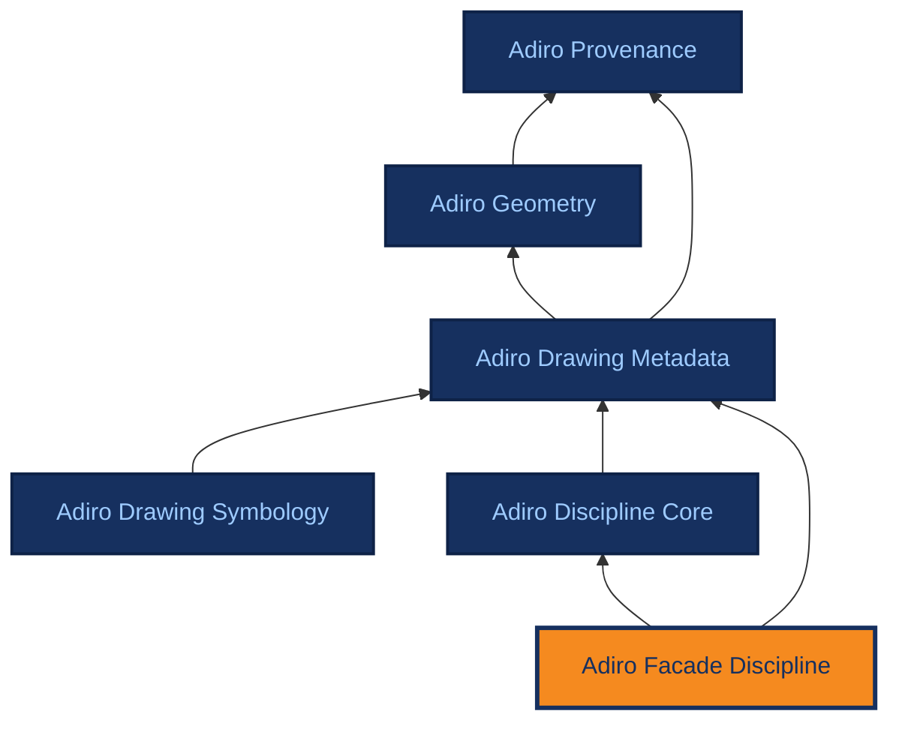

# Adiro Facade Discipline

Version 4.0.1 (latest)

<ul>
<li><a href="./" class="adiro-version-current" aria-current="page">4.0.1 (latest)</a></li>
<li><a href="../adiro_facade_domain/">adiro_facade_domain 4.0.1</a></li>
<li><a href="../adiro_facade_domain/4.0.0/">adiro_facade_domain 4.0.0</a></li>
<li><a href="../aec_facade_domain/">aec_facade_domain 3.0.1</a></li>
<li><a href="../aec_facade_domain/3.0.0/">aec_facade_domain 3.0.0</a></li>
<li><a href="../aec_facade_domain/2.0.2/">aec_facade_domain 2.0.2</a></li>
<li><a href="../aec_facade_domain/2.0.1/">aec_facade_domain 2.0.1</a></li>
<li><a href="../aec_facade_domain/2.0.0/">aec_facade_domain 2.0.0</a></li>
<li><a href="../aec_facade_domain/1.0.0/">aec_facade_domain 1.0.0</a></li>
</ul>

[{ .ontocanvas-icon } Open in OntoCanvas](https://burohappoldmachinelearning.github.io/OntoCanvas/?onto=https://w3id.org/adiro/adiro_facade_discipline.html){ .md-button target=_blank }
[:material-file-document-outline: TTL source](https://w3id.org/adiro/adiro_facade_discipline.ttl){ .md-button }
[:material-file-code: pyLODE HTML](https://w3id.org/adiro/adiro_facade_discipline.html){ .md-button }

Facade-engineering concepts and symbols, such as curtain-wall systems and glazing units. It is a discipline-specific module at the end of the dependency chain, building on the shared drawing, symbology, and discipline-core vocabularies.

- **IRI:** `https://w3id.org/adiro/adiro_facade_discipline`
- **Versioned IRI:** `https://w3id.org/adiro/adiro_facade_discipline/4.0.1`
- **Imports:** `adiro_discipline_core`, `adiro_drawing_metadata`

## Interactive view

<iframe src="https://burohappoldmachinelearning.github.io/OntoCanvas/?onto=https://w3id.org/adiro/adiro_facade_discipline.html" title="Adiro Facade Discipline in OntoCanvas" loading="lazy" style="width: 100%; height: 480px; border: 1px solid var(--md-default-fg-color--lightest); border-radius: 4px;"></iframe>

## Dependencies

Arrows point from an ontology to the ontologies it imports; the current ontology is highlighted.

## Classes

### Add-on {#AddOn}

- **IRI:** `https://w3id.org/adiro/adiro_facade_discipline#AddOn`
- **Sub class of:** [Frame type](#FrameType)

### Backing wall {#BackingWall}

- **IRI:** `https://w3id.org/adiro/adiro_facade_discipline#BackingWall`
- **Sub class of:** [Panel component](#PanelComponent)

### Blockwork {#Blockwork}

- **IRI:** `https://w3id.org/adiro/adiro_facade_discipline#Blockwork`
- **Sub class of:** [Roof cladding](#RoofCladding)

### Board {#Board}

- **IRI:** `https://w3id.org/adiro/adiro_facade_discipline#Board`
- **Sub class of:** [Panel component](#PanelComponent)

### Bracket {#Bracket}

Connection element that fixes a facade component, such as a curtain-wall frame or a cladding panel, back to the building structure and carries its loads; a type of point component.

- **IRI:** `https://w3id.org/adiro/adiro_facade_discipline#Bracket`
- **Sub class of:** [Point component](#PointComponent)

*Example images:*

### Breather {#BreatherMembrane}

- **IRI:** `https://w3id.org/adiro/adiro_facade_discipline#BreatherMembrane`
- **Sub class of:** [Membrane](#Membrane)

### Capped {#Capped}

- **IRI:** `https://w3id.org/adiro/adiro_facade_discipline#Capped`
- **Sub class of:** [Glazing retention](#GlazingRetention)

### Capping {#Capping}

- **IRI:** `https://w3id.org/adiro/adiro_facade_discipline#Capping`
- **Sub class of:** [Linear component](#LinearComponent)

### Cast-in channel {#CastInChannel}

- **IRI:** `https://w3id.org/adiro/adiro_facade_discipline#CastInChannel`
- **Sub class of:** [Fixing](#Fixing)

### Cavity barrier {#CavityBarrier}

Barrier fitted in a ventilated cavity to limit the spread of fire and smoke through the cavity; modelled here as a kind of gasket.

- **IRI:** `https://w3id.org/adiro/adiro_facade_discipline#CavityBarrier`
- **Sub class of:** [Gasket](#Gasket)

### Cavity wall system {#CavityWallSystem}

- **IRI:** `https://w3id.org/adiro/adiro_facade_discipline#CavityWallSystem`
- **Sub class of:** [Facade system](#FacadeSystem)

### Cementboard {#Cementboard}

- **IRI:** `https://w3id.org/adiro/adiro_facade_discipline#Cementboard`
- **Sub class of:** [Board](#Board)

### Channel {#Channel}

- **IRI:** `https://w3id.org/adiro/adiro_facade_discipline#Channel`
- **Sub class of:** [Gasket](#Gasket)

### Closed state {#ClosedState}

- **IRI:** `https://w3id.org/adiro/adiro_facade_discipline#ClosedState`
- **Sub class of:** [Cavity barrier](#CavityBarrier)

### Curtain wall system {#CurtainWallSystem}

- **IRI:** `https://w3id.org/adiro/adiro_facade_discipline#CurtainWallSystem`
- **Sub class of:** [Facade system](#FacadeSystem)

### Curved {#Curved}

- **IRI:** `https://w3id.org/adiro/adiro_facade_discipline#Curved`
- **Sub class of:** [Facade shape](#FacadeShape)

### CW frame member {#CWFrameMember}

- **IRI:** `https://w3id.org/adiro/adiro_facade_discipline#CWFrameMember`
- **Sub class of:** [Linear component](#LinearComponent)

### CW frame member properties {#CWFrameMemberProperties}

Specific properties of curtain wall frame members

- **IRI:** `https://w3id.org/adiro/adiro_facade_discipline#CWFrameMemberProperties`

### CW system {#CWSystem}

- **IRI:** `https://w3id.org/adiro/adiro_facade_discipline#CWSystem`
- **Sub class of:** [CW frame member properties](#CWFrameMemberProperties)

### Dead Load Bracket {#DeadLoadBracket}

Dead load bracket

- **IRI:** `https://w3id.org/adiro/adiro_facade_discipline#DeadLoadBracket`
- **Sub class of:** [Bracket](#Bracket)

### DGU {#DGU}

Double glazing unit: two panes of glass held apart by a spacer around a sealed gap. The gap gives the glazing its thermal and acoustic performance.

- **IRI:** `https://w3id.org/adiro/adiro_facade_discipline#DGU`
- **Sub class of:** [Facade cladding](#FacadeCladding)

*Example images:*

### Double laminated {#DoubleLaminated}

- **IRI:** `https://w3id.org/adiro/adiro_facade_discipline#DoubleLaminated`
- **Sub class of:** [Glazing properties](#GlazingProperties)

### EPDM {#EPDM}

- **IRI:** `https://w3id.org/adiro/adiro_facade_discipline#EPDM`
- **Sub class of:** [Membrane](#Membrane)

### Extruded {#Extruded}

- **IRI:** `https://w3id.org/adiro/adiro_facade_discipline#Extruded`
- **Sub class of:** [Frame type](#FrameType)

### Fabricated {#Fabricated}

- **IRI:** `https://w3id.org/adiro/adiro_facade_discipline#Fabricated`
- **Sub class of:** [Frame type](#FrameType)

### Facade cladding {#FacadeCladding}

- **IRI:** `https://w3id.org/adiro/adiro_facade_discipline#FacadeCladding`
- **Sub class of:** [Panel component](#PanelComponent)

### Facade component {#FacadeComponent}

Component of a facade system; a type of drawing element

- **IRI:** `https://w3id.org/adiro/adiro_facade_discipline#FacadeComponent`
- **Sub class of:** [`metadata:DrawingElement`](adiro_drawing_metadata.md#DrawingElement)

### Facade secondary structure {#FacadeSecondaryStructure}

- **IRI:** `https://w3id.org/adiro/adiro_facade_discipline#FacadeSecondaryStructure`
- **Sub class of:** [Linear component](#LinearComponent)

### Facade shape {#FacadeShape}

- **IRI:** `https://w3id.org/adiro/adiro_facade_discipline#FacadeShape`
- **Sub class of:** [`dcore:GeometricProperties`](adiro_discipline_core.md#GeometricProperties)

### Facade system {#FacadeSystem}

Facade system - part of support type; a type of drawing element

- **IRI:** `https://w3id.org/adiro/adiro_facade_discipline#FacadeSystem`
- **Sub class of:** [`metadata:DrawingElement`](adiro_drawing_metadata.md#DrawingElement)
- **Restrictions:** [`metadata:contains`](adiro_drawing_metadata.md#contains) some [Facade component](#FacadeComponent)

### Faceted {#Faceted}

- **IRI:** `https://w3id.org/adiro/adiro_facade_discipline#Faceted`
- **Sub class of:** [Facade shape](#FacadeShape)

### Fin {#Fin}

- **IRI:** `https://w3id.org/adiro/adiro_facade_discipline#Fin`
- **Sub class of:** [Linear component](#LinearComponent)

### Firestop {#Firestop}

Linear seal that closes a gap in a fire-rated construction, such as the joint between a facade and a floor slab, to slow the passage of fire and smoke; a type of linear component.

- **IRI:** `https://w3id.org/adiro/adiro_facade_discipline#Firestop`
- **Sub class of:** [Linear component](#LinearComponent)

*Example images:*

### Fixing {#Fixing}

- **IRI:** `https://w3id.org/adiro/adiro_facade_discipline#Fixing`
- **Sub class of:** [Point component](#PointComponent)

### Flipper {#Flipper}

- **IRI:** `https://w3id.org/adiro/adiro_facade_discipline#Flipper`
- **Sub class of:** [Gasket](#Gasket)

### Frame type {#FrameType}

- **IRI:** `https://w3id.org/adiro/adiro_facade_discipline#FrameType`
- **Sub class of:** [CW frame member properties](#CWFrameMemberProperties)

### Gasket {#Gasket}

Compressible strip, typically elastomeric, fitted between facade parts to seal the joint against air and water; a type of linear component.

- **IRI:** `https://w3id.org/adiro/adiro_facade_discipline#Gasket`
- **Sub class of:** [Linear component](#LinearComponent)

*Example images:*

### Glazing properties {#GlazingProperties}

Specific properties of glazing elements

- **IRI:** `https://w3id.org/adiro/adiro_facade_discipline#GlazingProperties`

### Glazing retention {#GlazingRetention}

- **IRI:** `https://w3id.org/adiro/adiro_facade_discipline#GlazingRetention`
- **Sub class of:** [CW frame member properties](#CWFrameMemberProperties)

### GRC {#GRC}

- **IRI:** `https://w3id.org/adiro/adiro_facade_discipline#GRC`
- **Sub class of:** [Precast system](#PrecastSystem)

### Helping hand {#HelpingHandBracket}

Helping hand bracket

- **IRI:** `https://w3id.org/adiro/adiro_facade_discipline#HelpingHandBracket`
- **Sub class of:** [Bracket](#Bracket)

### Hollow gasket shape {#HollowGasketShape}

- **IRI:** `https://w3id.org/adiro/adiro_facade_discipline#HollowGasketShape`
- **Sub class of:** [Gasket](#Gasket)

### Insulation {#Insulation}

- **IRI:** `https://w3id.org/adiro/adiro_facade_discipline#Insulation`
- **Sub class of:** [Panel component](#PanelComponent)

### Laminated {#Laminated}

- **IRI:** `https://w3id.org/adiro/adiro_facade_discipline#Laminated`
- **Sub class of:** [Glazing properties](#GlazingProperties)

### Linear component {#LinearComponent}

Element category - linear facade component

- **IRI:** `https://w3id.org/adiro/adiro_facade_discipline#LinearComponent`
- **Sub class of:** [Facade component](#FacadeComponent)

### Localised penetration {#LocalisedPenetration}

- **IRI:** `https://w3id.org/adiro/adiro_facade_discipline#LocalisedPenetration`
- **Sub class of:** [Point component](#PointComponent)

### Louvre {#Louvre}

Fixed or adjustable slatted opening that lets air pass while keeping out rain and direct view; a type of linear component.

- **IRI:** `https://w3id.org/adiro/adiro_facade_discipline#Louvre`
- **Sub class of:** [Linear component](#LinearComponent)

### Masonry {#Masonry}

- **IRI:** `https://w3id.org/adiro/adiro_facade_discipline#Masonry`
- **Sub class of:** [Facade cladding](#FacadeCladding)

### Membrane {#Membrane}

- **IRI:** `https://w3id.org/adiro/adiro_facade_discipline#Membrane`
- **Sub class of:** [Panel component](#PanelComponent)

### Mineral wool {#MineralWool}

Insulation made of spun mineral fibres. In a facade it limits heat loss and, being non-combustible, supports fire performance, typically behind spandrel panels; a type of insulation.

- **IRI:** `https://w3id.org/adiro/adiro_facade_discipline#MineralWool`
- **Sub class of:** [Insulation](#Insulation)

*Example images:*

### Monolithic {#Monolithic}

- **IRI:** `https://w3id.org/adiro/adiro_facade_discipline#Monolithic`
- **Sub class of:** [Glazing properties](#GlazingProperties)

### Mullion {#Mullion}

Vertical frame member of a curtain wall. It carries the glazing or panels and passes wind load to the building structure; a type of curtain-wall frame member.

- **IRI:** `https://w3id.org/adiro/adiro_facade_discipline#Mullion`
- **Sub class of:** [CW frame member](#CWFrameMember)

*Example images:*

### O-gasket {#OGasket}

- **IRI:** `https://w3id.org/adiro/adiro_facade_discipline#OGasket`
- **Sub class of:** [Hollow gasket shape](#HollowGasketShape)

### Open state {#OpenState}

- **IRI:** `https://w3id.org/adiro/adiro_facade_discipline#OpenState`
- **Sub class of:** [Cavity barrier](#CavityBarrier)

### Other insulation {#OtherInsulation}

- **IRI:** `https://w3id.org/adiro/adiro_facade_discipline#OtherInsulation`
- **Sub class of:** [Insulation](#Insulation)

### P-gasket {#PGasket}

- **IRI:** `https://w3id.org/adiro/adiro_facade_discipline#PGasket`
- **Sub class of:** [Hollow gasket shape](#HollowGasketShape)

### Panel component {#PanelComponent}

Element category - panel-type facade component

- **IRI:** `https://w3id.org/adiro/adiro_facade_discipline#PanelComponent`
- **Sub class of:** [Facade component](#FacadeComponent)

### Planar {#Planar}

- **IRI:** `https://w3id.org/adiro/adiro_facade_discipline#Planar`
- **Sub class of:** [Facade shape](#FacadeShape)

### Plasterboard {#Plasterboard}

- **IRI:** `https://w3id.org/adiro/adiro_facade_discipline#Plasterboard`
- **Sub class of:** [Board](#Board)

### Point component {#PointComponent}

Element category - point-type facade component

- **IRI:** `https://w3id.org/adiro/adiro_facade_discipline#PointComponent`
- **Sub class of:** [Facade component](#FacadeComponent)

### Precast concrete {#PrecastConcrete}

- **IRI:** `https://w3id.org/adiro/adiro_facade_discipline#PrecastConcrete`
- **Sub class of:** [Facade cladding](#FacadeCladding)

### Precast restraint {#PrecastRestraintBracket}

Precast restraint bracket

- **IRI:** `https://w3id.org/adiro/adiro_facade_discipline#PrecastRestraintBracket`
- **Sub class of:** [Bracket](#Bracket)

### Precast system {#PrecastSystem}

- **IRI:** `https://w3id.org/adiro/adiro_facade_discipline#PrecastSystem`
- **Sub class of:** [Facade system](#FacadeSystem)

### Profiled metal {#ProfiledMetal}

- **IRI:** `https://w3id.org/adiro/adiro_facade_discipline#ProfiledMetal`
- **Sub class of:** [Facade cladding](#FacadeCladding)

### Push-in {#PushIn}

- **IRI:** `https://w3id.org/adiro/adiro_facade_discipline#PushIn`
- **Sub class of:** [Solid gasket shape](#SolidGasketShape)

### Rail {#Rail}

- **IRI:** `https://w3id.org/adiro/adiro_facade_discipline#Rail`
- **Sub class of:** [Facade secondary structure](#FacadeSecondaryStructure)

### Rainscreen {#RainscreenSystem}

- **IRI:** `https://w3id.org/adiro/adiro_facade_discipline#RainscreenSystem`
- **Sub class of:** [Facade system](#FacadeSystem)

### Reflvet {#Reflvet}

- **IRI:** `https://w3id.org/adiro/adiro_facade_discipline#Reflvet`
- **Sub class of:** [Gasket](#Gasket)

### Roof cladding {#RoofCladding}

- **IRI:** `https://w3id.org/adiro/adiro_facade_discipline#RoofCladding`
- **Sub class of:** [Panel component](#PanelComponent)

### Screw {#Screw}

- **IRI:** `https://w3id.org/adiro/adiro_facade_discipline#Screw`
- **Sub class of:** [Fixing](#Fixing)

### Sealant {#Sealant}

Soft material applied wet into a joint between facade parts. It cures to seal the joint against air and water; a type of linear component.

- **IRI:** `https://w3id.org/adiro/adiro_facade_discipline#Sealant`
- **Sub class of:** [Linear component](#LinearComponent)

*Example images:*

### Semi Unitised Curtain Wall {#SemiUnitisedCurtainWall}

Semi-unitised curtain wall

- **IRI:** `https://w3id.org/adiro/adiro_facade_discipline#SemiUnitisedCurtainWall`
- **Sub class of:** [Curtain wall system](#CurtainWallSystem)

### Serrated/Sawtooth {#SerratedSawtooth}

- **IRI:** `https://w3id.org/adiro/adiro_facade_discipline#SerratedSawtooth`
- **Sub class of:** [Facade shape](#FacadeShape)

### SFS {#SFS}

Steel Frame System

- **IRI:** `https://w3id.org/adiro/adiro_facade_discipline#SFS`
- **Sub class of:** [Backing wall](#BackingWall)

### Shelf angle {#ShelfAngle}

Angle section fixed to the edge of a floor slab. It supports facade elements, such as spandrel insulation or a panel, along the slab edge; a type of facade secondary structure.

- **IRI:** `https://w3id.org/adiro/adiro_facade_discipline#ShelfAngle`
- **Sub class of:** [Facade secondary structure](#FacadeSecondaryStructure)

*Example images:*

### Silicone {#Silicone}

- **IRI:** `https://w3id.org/adiro/adiro_facade_discipline#Silicone`
- **Sub class of:** [Sealant](#Sealant)

### Slide-in {#SlideIn}

- **IRI:** `https://w3id.org/adiro/adiro_facade_discipline#SlideIn`
- **Sub class of:** [Solid gasket shape](#SolidGasketShape)

### Small panels {#SmallPanels}

- **IRI:** `https://w3id.org/adiro/adiro_facade_discipline#SmallPanels`
- **Sub class of:** [Facade cladding](#FacadeCladding)

### Solid gasket shape {#SolidGasketShape}

- **IRI:** `https://w3id.org/adiro/adiro_facade_discipline#SolidGasketShape`
- **Sub class of:** [Gasket](#Gasket)

### SSG (Structural silicone glazing) {#SSG}

- **IRI:** `https://w3id.org/adiro/adiro_facade_discipline#SSG`
- **Sub class of:** [Glazing retention](#GlazingRetention)

### Stick {#Stick}

- **IRI:** `https://w3id.org/adiro/adiro_facade_discipline#Stick`
- **Sub class of:** [CW system](#CWSystem)

### Stick Curtain Wall {#StickCurtainWall}

Stick curtain wall

- **IRI:** `https://w3id.org/adiro/adiro_facade_discipline#StickCurtainWall`
- **Sub class of:** [Curtain wall system](#CurtainWallSystem)

### TGU {#TGU}

Triple Glazed Unit

- **IRI:** `https://w3id.org/adiro/adiro_facade_discipline#TGU`
- **Sub class of:** [Facade cladding](#FacadeCladding)

### Timber cassette {#TimberCassette}

- **IRI:** `https://w3id.org/adiro/adiro_facade_discipline#TimberCassette`
- **Sub class of:** [Roof cladding](#RoofCladding)

### Toggle {#Toggle}

- **IRI:** `https://w3id.org/adiro/adiro_facade_discipline#Toggle`
- **Sub class of:** [Glazing retention](#GlazingRetention)

### Transom {#Transom}

Horizontal frame member of a curtain wall. It spans between mullions and carries the glazing or panels above and below it; a type of curtain-wall frame member.

- **IRI:** `https://w3id.org/adiro/adiro_facade_discipline#Transom`
- **Sub class of:** [CW frame member](#CWFrameMember)

*Example images:*

### UMPC {#UMPC}

- **IRI:** `https://w3id.org/adiro/adiro_facade_discipline#UMPC`
- **Sub class of:** [Precast system](#PrecastSystem)

### Unitised {#Unitised}

- **IRI:** `https://w3id.org/adiro/adiro_facade_discipline#Unitised`
- **Sub class of:** [CW system](#CWSystem)

### Unitised Curtain Wall {#UnitisedCurtainWall}

Unitised curtain wall

- **IRI:** `https://w3id.org/adiro/adiro_facade_discipline#UnitisedCurtainWall`
- **Sub class of:** [Curtain wall system](#CurtainWallSystem)

### VCL (Vapour control layer) {#VCL}

- **IRI:** `https://w3id.org/adiro/adiro_facade_discipline#VCL`
- **Sub class of:** [Insulation](#Insulation)

### Waterproofing {#WaterproofingMembrane}

- **IRI:** `https://w3id.org/adiro/adiro_facade_discipline#WaterproofingMembrane`
- **Sub class of:** [Membrane](#Membrane)

### Wedge {#Wedge}

- **IRI:** `https://w3id.org/adiro/adiro_facade_discipline#Wedge`
- **Sub class of:** [Solid gasket shape](#SolidGasketShape)

### Welded bolt {#WeldedBolt}

- **IRI:** `https://w3id.org/adiro/adiro_facade_discipline#WeldedBolt`
- **Sub class of:** [Fixing](#Fixing)

### Window system {#WindowSystem}

- **IRI:** `https://w3id.org/adiro/adiro_facade_discipline#WindowSystem`
- **Sub class of:** [Linear component](#LinearComponent)

### Wood fibre {#WoodFibre}

- **IRI:** `https://w3id.org/adiro/adiro_facade_discipline#WoodFibre`
- **Sub class of:** [Insulation](#Insulation)

### Zig-zag {#ZigZag}

- **IRI:** `https://w3id.org/adiro/adiro_facade_discipline#ZigZag`
- **Sub class of:** [Facade shape](#FacadeShape)
