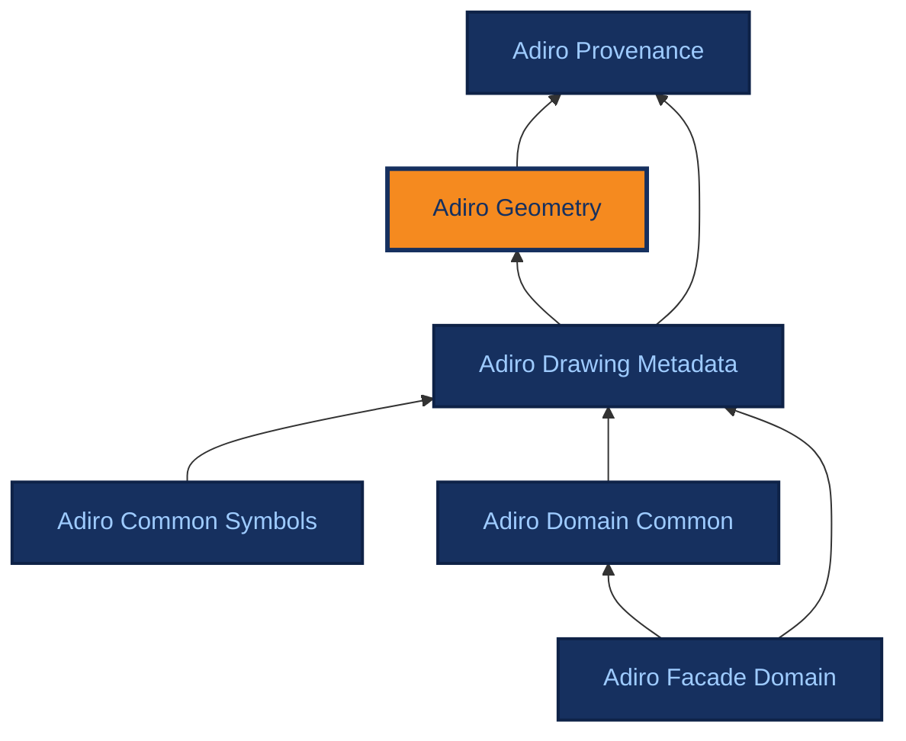

# Adiro Geometry

Version 2.0.0 (latest)

<ul>
<li><a href="./" class="adiro-version-current" aria-current="page">2.0.0 (latest)</a></li>
<li><a href="../aec_geometry/">aec_geometry 2.0.0</a></li>
<li><a href="../aec_geometry/1.0.1/">aec_geometry 1.0.1</a></li>
<li><a href="../aec_geometry/1.0.0/">aec_geometry 1.0.0</a></li>
</ul>

[{ .ontocanvas-icon } Open in OntoCanvas](https://alelom.github.io/OntoCanvas/?onto=https://w3id.org/adiro/adiro_geometry.html){ .md-button target=_blank }
[:material-file-document-outline: TTL source](https://w3id.org/adiro/adiro_geometry.ttl){ .md-button }
[:material-file-code: pyLODE HTML](https://w3id.org/adiro/adiro_geometry.html){ .md-button }

Foundational, domain-neutral module for geometry. It records where something sits on a drawing page as a bounding box, read against an explicit coordinate frame. Each box carries its own provenance and confidence. It reuses GeoSPARQL, is imported by the drawing modules, and is shared across use cases.

- **IRI:** `https://w3id.org/adiro/adiro_geometry`
- **Versioned IRI:** `https://w3id.org/adiro/adiro_geometry/2.0.0`
- **Imports:** `adiro_provenance`

## Interactive view

<iframe src="https://alelom.github.io/OntoCanvas/?onto=https://w3id.org/adiro/adiro_geometry.html" title="Adiro Geometry in OntoCanvas" loading="lazy" style="width: 100%; height: 480px; border: 1px solid var(--md-default-fg-color--lightest); border-radius: 4px;"></iframe>

## Dependencies

Arrows point from an ontology to the ontologies it imports; the current ontology is highlighted.

## Classes

### Bounding Box {#BoundingBox}

A rectangular region on a drawing page that locates something there, whether a model detected it or a person marked it - e.g. a title-block field's caption or value. Its coordinates are held as an xyxy string (bboxXYXY) and are meaningless without the CoordinateFrame it points at (inCoordinateFrame), which fixes the unit, coordinate space, origin, axes, page and exact PDF. A BoundingBox is itself an InferredEntity: it carries its own provenance (aprov:hasInferenceMeta - a detector, or a human annotator, told apart by aprov:inferredBy) and its own confidence (aprov:hasConfidence, the detector's score, absent for a hand-drawn box), which is DISTINCT from the confidence in a value read at that box. A subclass of GeoSPARQL geo:Geometry so it is recognised as a spatial shape.

- **IRI:** `https://w3id.org/adiro/adiro_geometry#BoundingBox`
- **Sub class of:**
    - [Geometry](#Geometry)
    - `aprov:InferredEntity`

### Coordinate Frame {#CoordinateFrame}

A page of a file read in one coordinate convention: the named coordinate space, the unit and the profile that defines it (the datatype properties below), for the page it describes (describesPage). A page can have more than one frame (the primary page_display_pt in points, and px for raster evidence), and each states only its convention: what is true of the page itself (its number, file, rotation and size) is on the adiro_provenance:FilePage. Not an InferredEntity: a declared coordinate context, not a detection with its own confidence.

- **IRI:** `https://w3id.org/adiro/adiro_geometry#CoordinateFrame`

### Geometry {#Geometry}

Local typing stub for GeoSPARQL's Geometry class (authoritative definition at the rdfs:isDefinedBy IRI), declared here so reasoning stays offline. Used as the supertype of BoundingBox so an ADIRO box is recognised as a spatial shape; ADIRO adopts no GeoSPARQL CRS or spatial-query profile (deferred, GitHub issue #36).

- **IRI:** `http://www.opengis.net/ont/geosparql#Geometry`

## Object Properties

### describesPage {#describesPage}

The page (an aprov:FilePage) that this coordinate frame reads. The frames of a drawing are reached through its page: the path isOnPage / ^describesPage from the drawing, in adiro_drawing_metadata.

- **IRI:** `https://w3id.org/adiro/adiro_geometry#describesPage`
- **Domain:** [Coordinate Frame](#CoordinateFrame)
- **Range:** `aprov:FilePage`

### hasBoundingBox {#hasBoundingBox}

The bounding box that locates a region on a drawing page. In UC-01 this is the title block's own region (a adiro_drawing_metadata:Titleblock, like every MetadataContainer, may have a hasBoundingBox): the field values are read from within that single region and are not themselves individually localised. No rdfs:domain is asserted, so the same property serves any locatable region or element - e.g. UC-03 reference symbols, when that work extends this module.

- **IRI:** `https://w3id.org/adiro/adiro_geometry#hasBoundingBox`
- **Range:** [Bounding Box](#BoundingBox)

### inCoordinateFrame {#inCoordinateFrame}

The CoordinateFrame that interprets this geometry's coordinates. Required for a geometry to mean anything: the same xyxy numbers denote different regions in different frames, so equal coordinates alone never establish that two geometries are the same region.

- **IRI:** `https://w3id.org/adiro/adiro_geometry#inCoordinateFrame`
- **Domain:** [Geometry](#Geometry)
- **Range:** [Coordinate Frame](#CoordinateFrame)

## Datatype Properties

### bboxXYXY {#bboxXYXY}

The rectangle as a string "[xmin, ymin, xmax, ymax]" in the coordinate frame's convention (xmin/ymin the top-left corner, xmax/ymax the bottom-right, under page_display_pt). The xyxy ordering is aligned to the Croissant cr:BoundingBox 'XYXY' format token, so an ADIRO box can be mapped to Croissant/CV formats by an exporter - ADIRO stores a page-point xyxy string, whereas Croissant expects a four-number array with a format declaration (background: GitHub issue #91). Interpret only together with inCoordinateFrame.

- **IRI:** `https://w3id.org/adiro/adiro_geometry#bboxXYXY`
- **Domain:** [Bounding Box](#BoundingBox)
- **Range:** `xsd:string`

### coordinateSpace {#coordinateSpace}

The named coordinate convention that fixes the origin and axes. Primary: 'page_display_pt' - top-left origin, x rightwards, y downwards, in points. Native PDF user space and rendered-image pixels are different spaces and must be named as such; do not interchange the names.

- **IRI:** `https://w3id.org/adiro/adiro_geometry#coordinateSpace`
- **Domain:** [Coordinate Frame](#CoordinateFrame)
- **Range:** `xsd:string`

### profileRef {#profileRef}

Reference to the versioned coordinate profile that defines the named coordinateSpace in full (origin, axes and unit), so the convention is pinned rather than only implied by the space's name.

- **IRI:** `https://w3id.org/adiro/adiro_geometry#profileRef`
- **Domain:** [Coordinate Frame](#CoordinateFrame)
- **Range:** `xsd:string`

### unit {#unit}

The unit of the coordinate values: 'pt' for the primary page_display_pt space (1 pt = 1/72 inch), 'px' for raster/pixel evidence. Display-page coordinates in pt are independent of rendering DPI.

- **IRI:** `https://w3id.org/adiro/adiro_geometry#unit`
- **Domain:** [Coordinate Frame](#CoordinateFrame)
- **Range:** `xsd:string`
