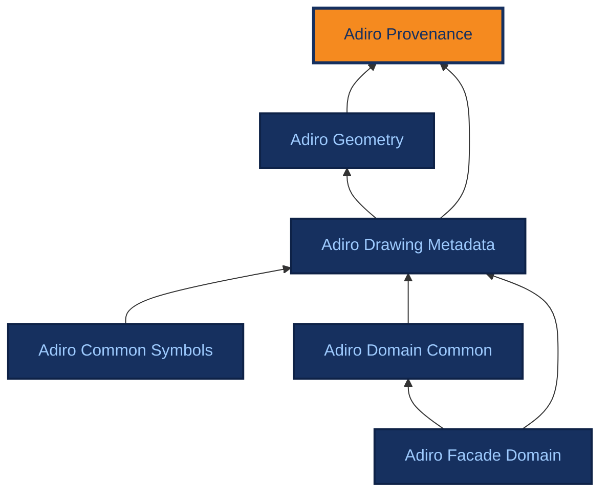

# Adiro Provenance

Version 2.2.0 (latest)

<ul>
<li><a href="./" class="adiro-version-current" aria-current="page">2.2.0 (latest)</a></li>
<li><a href="2.1.0/">2.1.0</a></li>
<li><a href="2.0.0/">2.0.0</a></li>
<li><a href="../aec_provenance/">aec_provenance 1.1.0</a></li>
<li><a href="../aec_provenance/1.0.1/">aec_provenance 1.0.1</a></li>
<li><a href="../aec_provenance/1.0.0/">aec_provenance 1.0.0</a></li>
</ul>

[{ .ontocanvas-icon } Open in OntoCanvas](https://burohappoldmachinelearning.github.io/OntoCanvas/?onto=https://w3id.org/adiro/adiro_provenance.html){ .md-button target=_blank }
[:material-file-document-outline: TTL source](https://w3id.org/adiro/adiro_provenance.ttl){ .md-button }
[:material-file-code: pyLODE HTML](https://w3id.org/adiro/adiro_provenance.html){ .md-button }

Foundational, domain-neutral module for provenance. It lets any value inferred from a drawing be recorded as an assertion that carries its own source, confidence, and how it was produced, aligned to W3C PROV-O. The drawing modules import it.

- **IRI:** `https://w3id.org/adiro/adiro_provenance`
- **Versioned IRI:** `https://w3id.org/adiro/adiro_provenance/2.2.0`

## Interactive view

<iframe src="https://burohappoldmachinelearning.github.io/OntoCanvas/?onto=https://w3id.org/adiro/adiro_provenance.html" title="Adiro Provenance in OntoCanvas" loading="lazy" style="width: 100%; height: 480px; border: 1px solid var(--md-default-fg-color--lightest); border-radius: 4px;"></iframe>

## Dependencies

Arrows point from an ontology to the ontologies it imports; the current ontology is highlighted.

## Classes

### Acceptance Status {#AcceptanceStatus}

Whether an assertion was taken into the direct properties of its subject: Pending (not yet decided), Accepted or Rejected. Only an Accepted assertion that has a value is promoted by mapsToFieldProperty.

- **IRI:** `https://w3id.org/adiro/adiro_provenance#AcceptanceStatus`
- **One of:**
    - [Pending](#Pending)
    - [Accepted](#Accepted)
    - [Rejected](#Rejected)

### Activity {#Activity}

Typing stub for the PROV-O term of the same name, declared locally so this module stays self-contained and the reasoning CI resolves offline. A stub is a name, not a definition: the authoritative axioms live at the source that rdfs:isDefinedBy points at. Disjoint with prov:Entity in PROV-O - see prov:Entity above.

- **IRI:** `http://www.w3.org/ns/prov#Activity`

### Agent {#Agent}

Typing stub for the PROV-O term of the same name, declared locally so this module stays self-contained and the reasoning CI resolves offline. A stub is a name, not a definition: the authoritative axioms live at the source that rdfs:isDefinedBy points at.

- **IRI:** `http://www.w3.org/ns/prov#Agent`

### Assertion Outcome {#AssertionOutcome}

What a search for a field found, when it found no value: Empty, Illegible, NotPrinted, NotFound or Failed. An assertion that has a value needs no outcome (the value is its outcome), and an assertion has a value or an outcome, never both. A TextReading that read no text has an outcome from the same list (hasReadingOutcome).

- **IRI:** `https://w3id.org/adiro/adiro_provenance#AssertionOutcome`
- **One of:**
    - [Empty](#Empty)
    - [Illegible](#Illegible)
    - [Not printed](#NotPrinted)
    - [Not found](#NotFound)
    - [Failed](#Failed)

### Configuration {#Configuration}

The settings a step of an extraction used, kept as text (configurationContent): a prompt, rendering settings, size limits, model parameters. ADIRO does not model what is inside, so any setting can be recorded without a new term. A configuration is identified by its content: the same content used on thousands of pages should be one individual. A step records that it used a configuration with prov:used; where the configuration varies from page to page, as a prompt can, the InferenceMeta of that page records it. A resolution is not a configuration: coordinates depend on it, so it is recorded on the coordinate frame it gives (resolutionDpi, in adiro_geometry).

- **IRI:** `https://w3id.org/adiro/adiro_provenance#Configuration`
- **Sub class of:** [Entity](#Entity)

### Document (ISO 21597-1) {#Document}

Typing stub for the ISO 21597-1 (ICDD) term Document, edition 1: an abstract reference to a document inside or outside a container. A stub is a name, not a definition: the authoritative axioms live at the source that rdfs:isDefinedBy points at.

- **IRI:** `https://standards.iso.org/iso/21597/-1/ed-1/en/Container#Document`

### Drawing File {#DrawingFile}

A reference to a document in which drawings are stored: not the bytes, but what identifies and locates them (name, media type, content hash, where it was obtained from, where it is stored, when and by whom it was made and last changed, how many pages it has). The content hash is its identity; the storage location is a fact that changes when the file is moved, and more than one is allowed (copies), while the source location is where the file came from. A subclass of the ISO 21597-1 Document, which is likewise a reference.

- **IRI:** `https://w3id.org/adiro/adiro_provenance#DrawingFile`
- **Sub class of:**
    - [Document (ISO 21597-1)](#Document)
    - [Entity](#Entity)

### Entity {#Entity}

Typing stub for the PROV-O term of the same name, declared locally so this module stays self-contained and the reasoning CI resolves offline. A stub is a name, not a definition: the authoritative axioms live at the source that rdfs:isDefinedBy points at. PROV-O declares prov:Entity owl:disjointWith prov:Activity, which is why the alignment below is seated carefully: a FieldAssertion is the Entity produced, an InferenceMeta is the Activity that produced it, and nothing may be both.

- **IRI:** `http://www.w3.org/ns/prov#Entity`

### Field Assertion {#FieldAssertion}

A single reified assertion that some source makes a value-claim about a field kind. Reifying the claim (rather than attaching the value straight to a subject) lets each printed occurrence carry its own provenance - which region asserted it (assertedBy), what produced it (hasInferenceMeta), and with what confidence (hasConfidence) - independently of the value it states. The value is a literal (hasLiteralValue) for datatype-valued fields or an entity (hasValueEntity) for object-valued fields. An assertion has a value or, when none was found, an outcome (hasOutcome); it is promoted to a direct statement on its subject only once it is Accepted (hasAcceptance), by tooling and never by reasoning. Conflicting assertions across sources are surfaced, not silently merged, and a later one that replaces an earlier says so with supersedes. A kind of InferredEntity, so it carries the shared provenance/confidence; in PROV-O terms the prov:Entity an extraction produced, which is why the PROV alignment is seated across two classes rather than all on one.

- **IRI:** `https://w3id.org/adiro/adiro_provenance#FieldAssertion`
- **Sub class of:** [Inferred Entity](#InferredEntity)

### File Page {#FilePage}

One page of one DrawingFile, counted from 1; a single-page or raster file has page 1. It holds what is true of the page itself: its number, the file it belongs to, its rotation and its display size in points. A drawing is linked to the page it is on, and a coordinate frame reads the page in one coordinate convention.

- **IRI:** `https://w3id.org/adiro/adiro_provenance#FilePage`
- **Sub class of:** [Entity](#Entity)

### Inference Meta {#InferenceMeta}

Provenance metadata for an inferred or extracted assertion: what produced it (inferredBy / inferredWith), the source it was derived from (inferredFrom), and when (inferredAt). Modelled as a separate object so several assertions can share one inference record and so provenance can be added without touching the value. Analogous to DANO's DrawingElementMeta, but aligned to PROV-O: this is the prov:Activity that produced the assertion, NOT a prov:Entity. PROV-O declares those two owl:disjointWith, so the distinction is load-bearing rather than stylistic. In an extraction run, each step (detecting a region, reading text, extracting fields) is an InferenceMeta with the model that step used, and is part of the run (dcterms:isPartOf), itself a prov:Activity; the Configuration a step used (a prompt, rendering settings) is recorded with prov:used. A step may record when it started (prov:startedAtTime) as well as when it ended (inferredAt), so its processing time is known; a run records prov:endedAtTime only when it completed its work, and a run that continues an interrupted one is prov:wasInformedBy it.

- **IRI:** `https://w3id.org/adiro/adiro_provenance#InferenceMeta`
- **Sub class of:** [Activity](#Activity)

### Inferred Entity {#InferredEntity}

Anything ADIRO infers or extracts that carries its own provenance and confidence - the shared superclass of everything an inference/extraction step produces as a first-class, provenance-bearing individual. A field-value claim (FieldAssertion, here) is one; a spatial localisation (a BoundingBox, in adiro_geometry) is another. It exists so that hasInferenceMeta and hasConfidence apply uniformly to any such product, not only to a field-value claim: a detected box is an inferred entity with its own producer and score, distinct from the confidence in the value read at that box. In PROV-O terms this is the prov:Entity an inference activity generated. The producing step can be a model or a person: a human annotation (a box drawn by hand, a field typed in) is an inference step performed by a person, recorded with inferredBy that person (an aprov:Person) and no inferredWith, and it carries a confidence only if one is given. A model's output and a person's label are told apart by who inferredBy is.

- **IRI:** `https://w3id.org/adiro/adiro_provenance#InferredEntity`
- **Sub class of:** [Entity](#Entity)

### Organisation {#Organisation}

A legal entity: the client, the originator, a legal owner or a responsible department named on a drawing, or the organisation that made or saved a file. Modelled as a class rather than a string so that one organisation recurring across many drawings is a single individual, which is what makes cross-drawing questions answerable.

- **IRI:** `https://w3id.org/adiro/adiro_provenance#Organisation`
- **Sub class of:**
    - [Organisation (ISO 21597-1)](#Organisation)
    - [Party](#Party)

### Organisation (ISO 21597-1) {#Organisation}

Typing stub for the ISO 21597-1 (ICDD) term Organisation, edition 1. A stub is a name, not a definition: the authoritative axioms live at the source that rdfs:isDefinedBy points at.

- **IRI:** `https://standards.iso.org/iso/21597/-1/ed-1/en/Container#Organisation`

### Party {#Party}

A person or an organisation: whoever made, saved or is named on something. Abstract: every party is exactly a Person or an Organisation, never both and never neither (their disjoint union), as in ISO 21597-1. Software that produced a file is not a party; a PROV activity records it.

- **IRI:** `https://w3id.org/adiro/adiro_provenance#Party`
- **Sub class of:**
    - [Agent](#Agent)
    - [Party (ISO 21597-1)](#Party)

### Party (ISO 21597-1) {#Party}

Typing stub for the ISO 21597-1 (ICDD) term Party, edition 1: the generalisation of an organisation and a person. A stub is a name, not a definition: the authoritative axioms live at the source that rdfs:isDefinedBy points at.

- **IRI:** `https://standards.iso.org/iso/21597/-1/ed-1/en/Container#Party`

### Person {#Person}

A named individual: a person named on a drawing (the author, a checker, an approver) or who made or saved a file. Transcribed as printed, so possibly only initials. The role is expressed by the property that points to the person, not by subclassing.

- **IRI:** `https://w3id.org/adiro/adiro_provenance#Person`
- **Sub class of:**
    - [Party](#Party)
    - [Person (ISO 21597-1)](#Person)

### Person (ISO 21597-1) {#Person}

Typing stub for the ISO 21597-1 (ICDD) term Person, edition 1. A stub is a name, not a definition: the authoritative axioms live at the source that rdfs:isDefinedBy points at.

- **IRI:** `https://standards.iso.org/iso/21597/-1/ed-1/en/Container#Person`

### Step Kind {#StepKind}

What a step of an extraction did: RegionDetection, TextRecognition or FieldExtraction. A closed list, so a new kind of step is a new value and not a new class. It tells steps apart when they use the same model, and it tells what a step looked for when it found nothing: a page that a region detection used, with no region found on it, was searched and has none, unless the step failed (an errorMessage on the step).

- **IRI:** `https://w3id.org/adiro/adiro_provenance#StepKind`
- **One of:**
    - [Region detection](#RegionDetection)
    - [Text recognition](#TextRecognition)
    - [Field extraction](#FieldExtraction)

### Text Reading {#TextReading}

The text a step read from one region, such as a title block, or from a whole page (isReadingOf), as it is printed and whether or not any of it was read as a field, so a drawing can be found by any word on it. The text is readText, with the language as the literal's language tag when it is known. A reading that read nothing has an outcome instead (hasReadingOutcome): the region holds no text (Empty), it cannot be read (Illegible), or the step failed (Failed, with its errorMessage). A kind of InferredEntity: each reading has the step that produced it (hasInferenceMeta), so two runs that read the same region keep two readings.

- **IRI:** `https://w3id.org/adiro/adiro_provenance#TextReading`
- **Sub class of:** [Inferred Entity](#InferredEntity)

## Object Properties

### acceptedBy {#acceptedBy}

The agent that accepted or rejected this assertion: a person for a review, or a software agent for a pipeline rule.

- **IRI:** `https://w3id.org/adiro/adiro_provenance#acceptedBy`
- **Domain:** [Field Assertion](#FieldAssertion)
- **Range:** [Agent](#Agent)

### assertedAbout {#assertedAbout}

The subject the claim is ABOUT - the thing a validated assertion is promoted onto. Distinct from assertedBy, which records where the claim was read FROM: a drawn-by name is read from a title-block region (assertedBy) but is a claim about a particular DrawingRevision (assertedAbout), and a sheet has many revisions, so the subject cannot be recovered from the region alone. Without it, mapsToFieldProperty names a property but nothing names the individual to hang it on, and promotion is not expressible. No rdfs:range is asserted: the subjects differ per field kind - Titleblock, DrawingSheet, DrawingRevision, DrawingPackage, Project - and a narrower range would entail those subjects are of a type they are not.

- **IRI:** `https://w3id.org/adiro/adiro_provenance#assertedAbout`
- **Domain:** [Field Assertion](#FieldAssertion)

### assertedBy {#assertedBy}

The source that makes this assertion - typically the drawing region it was read from (e.g. a Titleblock or a Layout). This is the provenance that lets the same field kind asserted by different regions be distinguished (e.g. a sheet's scale read from the title block versus the same sheet's scale read from a general note), which a fixed domain on a per-field property cannot express.

- **IRI:** `https://w3id.org/adiro/adiro_provenance#assertedBy`
- **Domain:** [Field Assertion](#FieldAssertion)

### assertsFieldKind {#assertsFieldKind}

The field kind (a SKOS concept in a field-kind scheme, e.g. a title-block field such as Scale or Client) that this assertion is about. Keeping the kind as a referenced concept - rather than a bespoke property per field - is what lets names/synonyms live on the concept and keeps the number of relationships small.

- **IRI:** `https://w3id.org/adiro/adiro_provenance#assertsFieldKind`
- **Domain:** [Field Assertion](#FieldAssertion)
- **Range:** `skos:Concept`

### belongsToFile {#belongsToFile}

The DrawingFile that a FilePage is a page of. To go from a file to its pages, use the inverse path ^aprov:belongsToFile (ADIRO declares no named inverse properties).

- **IRI:** `https://w3id.org/adiro/adiro_provenance#belongsToFile`
- **Domain:** [File Page](#FilePage)
- **Range:** [Drawing File](#DrawingFile)

### fileCreatedBy {#fileCreatedBy}

The party that made the file in the storage system, usually whoever saved it. Not the drawing's author, which is isAuthoredBy in adiro_drawing_metadata; a close match to, not the same as, Dublin Core creator and ICDD createdBy.

- **IRI:** `https://w3id.org/adiro/adiro_provenance#fileCreatedBy`
- **Domain:** [Drawing File](#DrawingFile)
- **Range:** [Party](#Party)

### fileModifiedBy {#fileModifiedBy}

A party that modified the file in the storage system. More than one is allowed.

- **IRI:** `https://w3id.org/adiro/adiro_provenance#fileModifiedBy`
- **Domain:** [Drawing File](#DrawingFile)
- **Range:** [Party](#Party)

### hasAcceptance {#hasAcceptance}

Whether this assertion was taken into the direct properties of its subject (an AcceptanceStatus). An assertion with no acceptance recorded is as good as Pending.

- **IRI:** `https://w3id.org/adiro/adiro_provenance#hasAcceptance`
- **Domain:** [Field Assertion](#FieldAssertion)
- **Range:** [Acceptance Status](#AcceptanceStatus)

### hasInferenceMeta {#hasInferenceMeta}

Links an inferred entity (a FieldAssertion, a BoundingBox, ...) to the InferenceMeta describing what produced it, from where, and when. Aligned to prov:wasGeneratedBy: the entity (a prov:Entity) was generated by the inference (a prov:Activity).

- **IRI:** `https://w3id.org/adiro/adiro_provenance#hasInferenceMeta`
- **Sub property of:** [wasGeneratedBy](#wasGeneratedBy)
- **Domain:** [Inferred Entity](#InferredEntity)
- **Range:** [Inference Meta](#InferenceMeta)

### hasOutcome {#hasOutcome}

What the search for this field found, when it found no value (an AssertionOutcome). An assertion with a hasLiteralValue or a hasValueEntity has no outcome.

- **IRI:** `https://w3id.org/adiro/adiro_provenance#hasOutcome`
- **Domain:** [Field Assertion](#FieldAssertion)
- **Range:** [Assertion Outcome](#AssertionOutcome)

### hasReadingOutcome {#hasReadingOutcome}

Why a TextReading holds no text (an AssertionOutcome): the region holds none (Empty), it cannot be read (Illegible), or the step failed (Failed). A reading with readText has no outcome. A property of its own rather than hasOutcome, whose domain is FieldAssertion: a reading is not a claim about a field.

- **IRI:** `https://w3id.org/adiro/adiro_provenance#hasReadingOutcome`
- **Domain:** [Text Reading](#TextReading)
- **Range:** [Assertion Outcome](#AssertionOutcome)

### hasStepKind {#hasStepKind}

What kind of step of an extraction this InferenceMeta is (a StepKind): a region detection, a text recognition or a field extraction.

- **IRI:** `https://w3id.org/adiro/adiro_provenance#hasStepKind`
- **Domain:** [Inference Meta](#InferenceMeta)
- **Range:** [Step Kind](#StepKind)

### hasValueEntity {#hasValueEntity}

For object-valued field kinds, the entity that is the asserted value - e.g. a Person or Organisation. Used instead of hasLiteralValue when the field references a thing rather than states a string, which is what makes cross-sheet questions ('everything checked by X') answerable.

- **IRI:** `https://w3id.org/adiro/adiro_provenance#hasValueEntity`
- **Domain:** [Field Assertion](#FieldAssertion)

### inferredBy {#inferredBy}

The actor, organisation or software that produced this inference: a person (an aprov:Person) when a human annotated, a software agent when a model predicted. Aligned to prov:wasAssociatedWith - the agent the inference activity was associated with.

- **IRI:** `https://w3id.org/adiro/adiro_provenance#inferredBy`
- **Sub property of:** [wasAssociatedWith](#wasAssociatedWith)
- **Domain:** [Inference Meta](#InferenceMeta)
- **Range:** [Agent](#Agent)

### inferredFrom {#inferredFrom}

The source the value was derived from - e.g. the origin file, page or region. Aligned to prov:used - the activity used this source.

- **IRI:** `https://w3id.org/adiro/adiro_provenance#inferredFrom`
- **Sub property of:** [used](#used)
- **Domain:** [Inference Meta](#InferenceMeta)

### inferredWith {#inferredWith}

The algorithm or model (ideally with version) used to produce this inference. Distinct from inferredBy, which names the responsible actor; inferredWith names the tool. Aligned to prov:used - the activity used this model.

- **IRI:** `https://w3id.org/adiro/adiro_provenance#inferredWith`
- **Sub property of:** [used](#used)
- **Domain:** [Inference Meta](#InferenceMeta)

### isPartOf {#isPartOf}

Typing stub for the DCMI Metadata Terms property of the same name, declared locally so this module stays self-contained and the reasoning CI resolves offline. A stub is a name, not a definition: the authoritative definition lives at the source that rdfs:isDefinedBy points at. ADIRO uses it between the steps of an extraction run and the run: each step (an InferenceMeta, such as detecting the title block or reading its text) is part of the run (a prov:Activity) it was performed in.

- **IRI:** `http://purl.org/dc/terms/isPartOf`

### isReadingOf {#isReadingOf}

What a TextReading read: a region, such as a title block (metadata:Titleblock), or a whole page (a FilePage). No range is declared, because the regions are defined by the modules that use this one.

- **IRI:** `https://w3id.org/adiro/adiro_provenance#isReadingOf`
- **Domain:** [Text Reading](#TextReading)

### supersedes {#supersedes}

The earlier assertion that this one replaces about the same field of the same subject: a person's correction of a model's value, or a later value after a not-found. It takes effect when this assertion is accepted: until then the earlier one stays in force, and an accepted assertion replaces every one it supersedes, directly or through others. The earlier one stays as a record. Explicit, so a query does not depend on timestamps.

- **IRI:** `https://w3id.org/adiro/adiro_provenance#supersedes`
- **Domain:** [Field Assertion](#FieldAssertion)
- **Range:** [Field Assertion](#FieldAssertion)

### used {#used}

Typing stub for the PROV-O term of the same name, declared locally so this module stays self-contained and the reasoning CI resolves offline. A stub is a name, not a definition: the authoritative axioms live at the source that rdfs:isDefinedBy points at. (rdfs:domain prov:Activity, rdfs:range prov:Entity)

- **IRI:** `http://www.w3.org/ns/prov#used`

### wasAssociatedWith {#wasAssociatedWith}

Typing stub for the PROV-O term of the same name, declared locally so this module stays self-contained and the reasoning CI resolves offline. A stub is a name, not a definition: the authoritative axioms live at the source that rdfs:isDefinedBy points at. (rdfs:domain prov:Activity, rdfs:range prov:Agent)

- **IRI:** `http://www.w3.org/ns/prov#wasAssociatedWith`

### wasDerivedFrom {#wasDerivedFrom}

Typing stub for the PROV-O term of the same name, declared locally so this module stays self-contained and the reasoning CI resolves offline. A stub is a name, not a definition: the authoritative axioms live at the source that rdfs:isDefinedBy points at. (rdfs:domain prov:Entity, rdfs:range prov:Entity). ADIRO uses it between two DrawingFiles: a file made from another one (a format conversion, a page split out of a PDF) was derived from it, and only the original records a sourceLocation.

- **IRI:** `http://www.w3.org/ns/prov#wasDerivedFrom`

### wasGeneratedBy {#wasGeneratedBy}

Typing stub for the PROV-O term of the same name, declared locally so this module stays self-contained and the reasoning CI resolves offline. A stub is a name, not a definition: the authoritative axioms live at the source that rdfs:isDefinedBy points at. (rdfs:domain prov:Entity, rdfs:range prov:Activity)

- **IRI:** `http://www.w3.org/ns/prov#wasGeneratedBy`

### wasInformedBy {#wasInformedBy}

Typing stub for the PROV-O term of the same name, declared locally so this module stays self-contained and the reasoning CI resolves offline. A stub is a name, not a definition: the authoritative axioms live at the source that rdfs:isDefinedBy points at. (rdfs:domain prov:Activity, rdfs:range prov:Activity). ADIRO uses it between two extraction runs: a run that continues an interrupted one was informed by it, because it used what the earlier run recorded to decide what to skip. It links two runs, each a whole; a step is part of its run (dcterms:isPartOf), not informed by it.

- **IRI:** `http://www.w3.org/ns/prov#wasInformedBy`

## Datatype Properties

### acceptedAt {#acceptedAt}

When this assertion was accepted or rejected.

- **IRI:** `https://w3id.org/adiro/adiro_provenance#acceptedAt`
- **Domain:** [Field Assertion](#FieldAssertion)
- **Range:** `xsd:dateTime`

### acceptedUnder {#acceptedUnder}

An IRI naming the versioned policy under which this assertion was accepted: a confidence-threshold rule of the pipeline, or the annotation protocol and mapping version of a ground-truth campaign. The threshold itself lives in the policy, not on each assertion, so a policy can be re-evaluated later.

- **IRI:** `https://w3id.org/adiro/adiro_provenance#acceptedUnder`
- **Domain:** [Field Assertion](#FieldAssertion)
- **Range:** `xsd:anyURI`

### capturedCaption {#capturedCaption}

The caption/label text exactly as printed on the drawing for this assertion (e.g. 'Verfasser', 'Dwg. Desc.'). Retained even when the field kind is uncertain, so the ground truth of what was on the sheet is never lost and mapping can be revisited later.

- **IRI:** `https://w3id.org/adiro/adiro_provenance#capturedCaption`
- **Domain:** [Field Assertion](#FieldAssertion)
- **Range:** `xsd:string`

### configurationContent {#configurationContent}

The content of a Configuration, as text: the prompt as sent, or the settings serialised in the format the step reads them in, kept verbatim so a step can be repeated with exactly the same settings. It is published with the data, so it carries no credentials: keys, tokens and private endpoints are removed before it is recorded.

- **IRI:** `https://w3id.org/adiro/adiro_provenance#configurationContent`
- **Domain:** [Configuration](#Configuration)
- **Range:** `xsd:string`

### contentHash {#contentHash}

The hash of the bytes of the file, as a hexadecimal string. It identifies the content: two files with the same hash and algorithm are the same bytes, wherever they are stored, and a hash that no longer matches means an extraction was made from other bytes.

- **IRI:** `https://w3id.org/adiro/adiro_provenance#contentHash`
- **Domain:** [Drawing File](#DrawingFile)
- **Range:** `xsd:string`

### displayHeightPt {#displayHeightPt}

The effective height of the page in points after the recorded page mapping (rotation and cropping); supports bounds checks on coordinates. The measured size of this page of this file, not the paper format the drawing is meant for (sheetSize).

- **IRI:** `https://w3id.org/adiro/adiro_provenance#displayHeightPt`
- **Domain:** [File Page](#FilePage)
- **Range:** `xsd:decimal`

### displayWidthPt {#displayWidthPt}

The effective width of the page in points after the recorded page mapping (rotation and cropping); supports bounds checks on coordinates. The measured size of this page of this file, not the paper format the drawing is meant for (sheetSize).

- **IRI:** `https://w3id.org/adiro/adiro_provenance#displayWidthPt`
- **Domain:** [File Page](#FilePage)
- **Range:** `xsd:decimal`

### endedAtTime {#endedAtTime}

Typing stub for the PROV-O term of the same name, declared locally so this module stays self-contained and the reasoning CI resolves offline. A stub is a name, not a definition: the authoritative axioms live at the source that rdfs:isDefinedBy points at. (rdfs:domain prov:Activity, rdfs:range xsd:dateTime). ADIRO's own :inferredAt declares rdfs:range xsd:dateTime, so the precision is asserted where it belongs - on the term this suite owns.

- **IRI:** `http://www.w3.org/ns/prov#endedAtTime`

### errorMessage {#errorMessage}

The error that stopped a step, as the step reported it. On an inferred entity whose outcome is Failed (a reading, a field assertion), it is the error that stopped the step producing it. On a step (an InferenceMeta), it says that the step itself failed before it produced anything, so a page it used was not searched: a region detection that timed out is a failure, not a page with no region on it. It is published with the data, so credentials, keys and private addresses are removed before it is recorded.

- **IRI:** `https://w3id.org/adiro/adiro_provenance#errorMessage`
- **Domain:** ([Inferred Entity](#InferredEntity) or [Inference Meta](#InferenceMeta))
- **Range:** `xsd:string`

### fileCreatedAt {#fileCreatedAt}

When the file was created, as the storage system records it. Not the drawing's issue date (issueDate).

- **IRI:** `https://w3id.org/adiro/adiro_provenance#fileCreatedAt`
- **Domain:** [Drawing File](#DrawingFile)
- **Range:** `xsd:dateTime`

### fileModifiedAt {#fileModifiedAt}

When the file was last modified, as the storage system records it.

- **IRI:** `https://w3id.org/adiro/adiro_provenance#fileModifiedAt`
- **Domain:** [Drawing File](#DrawingFile)
- **Range:** `xsd:dateTime`

### fileName {#fileName}

The name of the file, with its extension, as the storage system gives it.

- **IRI:** `https://w3id.org/adiro/adiro_provenance#fileName`
- **Domain:** [Drawing File](#DrawingFile)
- **Range:** `xsd:string`

### fileSize {#fileSize}

The size of the file in bytes.

- **IRI:** `https://w3id.org/adiro/adiro_provenance#fileSize`
- **Domain:** [Drawing File](#DrawingFile)
- **Range:** `xsd:nonNegativeInteger`

### hasConfidence {#hasConfidence}

Confidence of the inference behind an inferred entity, as a decimal in [0,1]: the score a model gives, or, for a human annotation, absent (or 1 when the annotator is taken as certain). Applies to any InferredEntity - the confidence in a field-value claim (FieldAssertion) and the confidence in a detected localisation (a BoundingBox in adiro_geometry) are separate values, each carried on the individual it belongs to. Carried on the individual rather than on a triple, which keeps confidence in the graph without requiring RDF-star or statement reification. The range is an OWL 2 datatype restriction on xsd:decimal with minInclusive 0 and maxInclusive 1, so the [0,1] bound is asserted rather than only described in prose. Note this cannot fire in CI today: the reasoning gate runs over the T-Box in src/ and the repository holds no instance data, so the bound becomes enforceable when an A-Box exists (GitHub issue #22).

- **IRI:** `https://w3id.org/adiro/adiro_provenance#hasConfidence`
- **Domain:** [Inferred Entity](#InferredEntity)
- **Range:** _anonymous class_

### hashAlgorithm {#hashAlgorithm}

The algorithm that produced the contentHash, for example sha256.

- **IRI:** `https://w3id.org/adiro/adiro_provenance#hashAlgorithm`
- **Domain:** [Drawing File](#DrawingFile)
- **Range:** `xsd:string`

### hasLiteralValue {#hasLiteralValue}

For datatype-valued field kinds, the literal value asserted, kept verbatim (not normalised, expanded or translated at extraction time).

- **IRI:** `https://w3id.org/adiro/adiro_provenance#hasLiteralValue`
- **Domain:** [Field Assertion](#FieldAssertion)
- **Range:** `rdfs:Literal`

### inferredAt {#inferredAt}

The time the inference was produced. Aligned to prov:endedAtTime - when the inference activity ended.

- **IRI:** `https://w3id.org/adiro/adiro_provenance#inferredAt`
- **Sub property of:** [endedAtTime](#endedAtTime)
- **Domain:** [Inference Meta](#InferenceMeta)
- **Range:** `xsd:dateTime`

### mediaType {#mediaType}

The IANA media type of the file, for example application/pdf or image/tiff.

- **IRI:** `https://w3id.org/adiro/adiro_provenance#mediaType`
- **Domain:** [Drawing File](#DrawingFile)
- **Range:** `xsd:string`

### pageCount {#pageCount}

The number of pages of the file: 1 for a single-page or raster file.

- **IRI:** `https://w3id.org/adiro/adiro_provenance#pageCount`
- **Domain:** [Drawing File](#DrawingFile)
- **Range:** `xsd:positiveInteger`

### pageNumber {#pageNumber}

The number of the page within its file, counted from 1; a single-page or raster file has page 1. A page can be written as an address with the page fragment of RFC 3778 (the file's address followed by #page=3), which counts from 1 as well. A zero-based index, where a program needs one, is this number minus one.

- **IRI:** `https://w3id.org/adiro/adiro_provenance#pageNumber`
- **Domain:** [File Page](#FilePage)
- **Range:** `xsd:positiveInteger`

### pdfRotationDeg {#pdfRotationDeg}

The rotation recorded for the page, in degrees. The page_display_pt coordinates of a coordinate frame already include the recorded page mapping, so this is for interpretation and validation: do not apply the rotation to the coordinates again.

- **IRI:** `https://w3id.org/adiro/adiro_provenance#pdfRotationDeg`
- **Domain:** [File Page](#FilePage)
- **Range:** `xsd:integer`

### readText {#readText}

The text a TextReading read, as printed, in reading order. The language, when known, is the literal's language tag ("Erdgeschoss"@de); text whose language is not known is a plain string.

- **IRI:** `https://w3id.org/adiro/adiro_provenance#readText`
- **Domain:** [Text Reading](#TextReading)
- **Range:** `rdfs:Literal`

### sourceLocation {#sourceLocation}

Where the file was obtained from: the address its bytes were fetched from, such as a public archive's download address, or the address in an organisation's own storage when that is the only known origin. Unlike storageLocation, it does not change when copies are moved. A file made from another file (converted, split into pages) records its origin through prov:wasDerivedFrom to that file, not a sourceLocation of its own.

- **IRI:** `https://w3id.org/adiro/adiro_provenance#sourceLocation`
- **Domain:** [Drawing File](#DrawingFile)
- **Range:** `xsd:anyURI`

### sourcePage {#sourcePage}

The page at the file's origin that describes it, such as a catalogue record or a landing page, which is often a more lasting address than the file's own sourceLocation.

- **IRI:** `https://w3id.org/adiro/adiro_provenance#sourcePage`
- **Domain:** [Drawing File](#DrawingFile)
- **Range:** `xsd:anyURI`

### startedAtTime {#startedAtTime}

Typing stub for the PROV-O term of the same name, declared locally so this module stays self-contained and the reasoning CI resolves offline. A stub is a name, not a definition: the authoritative axioms live at the source that rdfs:isDefinedBy points at. (rdfs:domain prov:Activity, rdfs:range xsd:dateTime). ADIRO uses it for when an extraction run started, and for when a step of a run started: a step records when it ended with inferredAt, so a step that records both has a processing time, the difference.

- **IRI:** `http://www.w3.org/ns/prov#startedAtTime`

### storageLocation {#storageLocation}

Where a copy of the file is stored: an address in a document-management or cloud storage system, or a path as a file address. More than one is allowed, and a location changes when the file is moved; the contentHash is what stays the same. It may be a relative reference (RFC 3986, such as crops/page-1-titleblock.png), resolved against the root of the dataset the data belongs to, which the data does not record: a dataset that is moved keeps its relative locations. A public release accepts only absolute addresses on its allowed hosts, so a relative location is resolved before release.

- **IRI:** `https://w3id.org/adiro/adiro_provenance#storageLocation`
- **Domain:** [Drawing File](#DrawingFile)
- **Range:** `xsd:anyURI`

## Annotation Properties

### expectedRange {#expectedRange}

On a field-kind concept: the expected type of its asserted value - a datatype (e.g. xsd:string, xsd:date) for literal-valued fields, or a class (e.g. Person, Organisation) for object-valued fields. Signals whether an assertion of this kind uses hasLiteralValue or hasValueEntity.

- **IRI:** `https://w3id.org/adiro/adiro_provenance#expectedRange`

### mapsToFieldProperty {#mapsToFieldProperty}

On a field-kind concept: the canonical ADIRO property that an accepted assertion (hasAcceptance Accepted) of this field kind, one that has a value, is promoted to (the bridge from the reified assertion to a direct statement on the subject). The subject is the assertion's assertedAbout, so a promotion is: ?a assertedAbout ?subject ; assertsFieldKind ?k . ?k mapsToFieldProperty ?p  =>  ?subject ?p <value>. Annotation only - the promotion is performed by tooling on acceptance, not by reasoning.

- **IRI:** `https://w3id.org/adiro/adiro_provenance#mapsToFieldProperty`

## Named Individuals

### Accepted {#Accepted}

Taken in, by a pipeline rule (a confidence threshold, named by acceptedUnder) or by a person. An accepted assertion that has a value is promoted to a direct property.

- **IRI:** `https://w3id.org/adiro/adiro_provenance#Accepted`
- **Type:** [Acceptance Status](#AcceptanceStatus)

### Empty {#Empty}

The field is printed on the drawing but holds no value (a blank cell). The ground-truth observation status 'empty'.

- **IRI:** `https://w3id.org/adiro/adiro_provenance#Empty`
- **Type:** [Assertion Outcome](#AssertionOutcome)

### Failed {#Failed}

The step did not complete: an error, a timeout or an unreadable input stopped it, so it searched nothing and says nothing about the drawing. It is retried. The error is recorded with errorMessage. Not a ground-truth observation status: it is the extraction's own.

- **IRI:** `https://w3id.org/adiro/adiro_provenance#Failed`
- **Type:** [Assertion Outcome](#AssertionOutcome)

### Field extraction {#FieldExtraction}

A step that turns text or an image into the values of fields (the title, the author, the drawing number), each recorded as a FieldAssertion.

- **IRI:** `https://w3id.org/adiro/adiro_provenance#FieldExtraction`
- **Type:** [Step Kind](#StepKind)

### Illegible {#Illegible}

The field is printed on the drawing but cannot be read. The ground-truth observation status 'illegible'.

- **IRI:** `https://w3id.org/adiro/adiro_provenance#Illegible`
- **Type:** [Assertion Outcome](#AssertionOutcome)

### Not found {#NotFound}

A model searched where the field is expected and matched nothing. Not confirmed: the field may be missing from the drawing or merely missed, so it is retried or reviewed; it says nothing yet about the drawing.

- **IRI:** `https://w3id.org/adiro/adiro_provenance#NotFound`
- **Type:** [Assertion Outcome](#AssertionOutcome)

### Not printed {#NotPrinted}

The drawing does not print the field at all, confirmed by a person (a reviewer or a ground-truth label). The ground-truth observation status 'absent'. For a field every drawing must have, such as the author, this is a defect of the drawing and not of the extraction.

- **IRI:** `https://w3id.org/adiro/adiro_provenance#NotPrinted`
- **Type:** [Assertion Outcome](#AssertionOutcome)

### Pending {#Pending}

Not yet accepted or rejected: the assertion is the extraction's record and its value is not yet a direct property.

- **IRI:** `https://w3id.org/adiro/adiro_provenance#Pending`
- **Type:** [Acceptance Status](#AcceptanceStatus)

### Region detection {#RegionDetection}

A step that finds regions on a page, such as the title block, and gives each its bounding box.

- **IRI:** `https://w3id.org/adiro/adiro_provenance#RegionDetection`
- **Type:** [Step Kind](#StepKind)

### Rejected {#Rejected}

Decided against: the assertion stays as a record but is not promoted.

- **IRI:** `https://w3id.org/adiro/adiro_provenance#Rejected`
- **Type:** [Acceptance Status](#AcceptanceStatus)

### Text recognition {#TextRecognition}

A step that reads the text of a region or of a whole page, as it is printed, into a TextReading.

- **IRI:** `https://w3id.org/adiro/adiro_provenance#TextRecognition`
- **Type:** [Step Kind](#StepKind)
