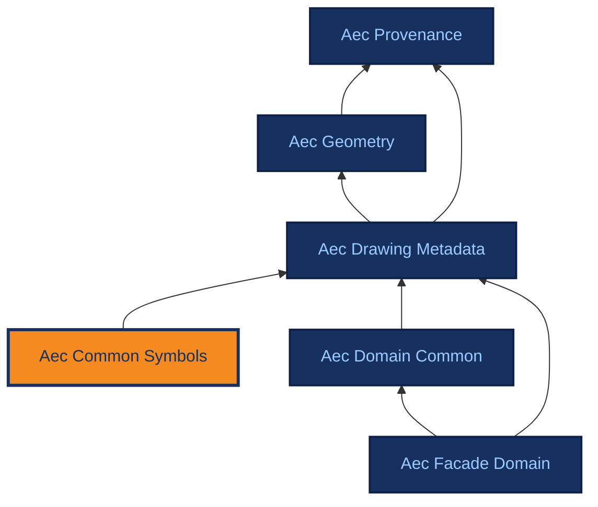

---
search:
  exclude: true
---

# Aec Common Symbols

Version 4.0.1 (adiro_common_symbols 5.0.0 available)

<ul>
<li><a href="../adiro_common_symbols/">adiro_common_symbols 5.0.0 (latest)</a></li>
<li><a href="./" class="adiro-version-current" aria-current="page">4.0.1 (final)</a></li>
<li><a href="4.0.0/">4.0.0</a></li>
<li><a href="3.0.1/">3.0.1</a></li>
<li><a href="3.0.0/">3.0.0</a></li>
<li><a href="2.0.0/">2.0.0</a></li>
<li><a href="1.0.0/">1.0.0</a></li>
</ul>

[{ .ontocanvas-icon } Open in OntoCanvas](https://alelom.github.io/OntoCanvas/?onto=https://w3id.org/adiro/aec_common_symbols.html){ .md-button target=_blank }
[:material-file-document-outline: TTL source](https://w3id.org/adiro/aec_common_symbols.ttl){ .md-button }
[:material-file-code: pyLODE HTML](https://w3id.org/adiro/aec_common_symbols.html){ .md-button }

!!! warning "Deprecated"

    This module is deprecated and receives no further changes. It is replaced by [`adiro_common_symbols`](adiro_common_symbols.md), which continues its version numbering. Every release of it stays published at its own IRI.

Reusable symbols that appear across disciplines, such as dimensions, grids, levels, and reference symbols. Every symbol is a kind of drawing element from the drawing-metadata module. The discipline modules build on these shared symbols.

- **IRI:** `https://w3id.org/adiro/aec_common_symbols`
- **Versioned IRI:** `https://w3id.org/adiro/aec_common_symbols/4.0.1`
- **Imports:** `aec_drawing_metadata`

## Interactive view

<iframe src="https://alelom.github.io/OntoCanvas/?onto=https://w3id.org/adiro/aec_common_symbols.html" title="Aec Common Symbols in OntoCanvas" loading="lazy" style="width: 100%; height: 480px; border: 1px solid var(--md-default-fg-color--lightest); border-radius: 4px;"></iframe>

## Dependencies

Arrows point from an ontology to the ontologies it imports; the current ontology is highlighted.

## Classes

### Dimension {#Dimension}

A dimension line or dimension annotation on a drawing, indicating measurements or distances.

- **IRI:** `https://w3id.org/adiro/aec_common_symbols#Dimension`
- **Sub class of:** `metadata:DrawingElement`

*Example images:*

### Grid {#Grid}

A grid line or grid system used for alignment and reference in architectural drawings.

- **IRI:** `https://w3id.org/adiro/aec_common_symbols#Grid`
- **Sub class of:** `metadata:DrawingElement`

*Example images:*

### ReferenceSymbol {#ReferenceSymbol}

A symbol drawn on a Layout that references another Layout (on the same or a different DrawingSheet). Replaces the earlier Callout class. Typical instances include Detail Markers, Section Markers, and Elevation Markers. The marker type is not modelled — it is derivable from the target Layout's LayoutContentType.

- **IRI:** `https://w3id.org/adiro/aec_common_symbols#ReferenceSymbol`
- **Sub class of:** `metadata:ReferenceExpression`

*Example images:*

## Object Properties

### hasReferenceSymbol {#hasReferenceSymbol}

A Layout contains one or more ReferenceSymbols. To navigate from a symbol back to the Layout it is drawn on, use the SPARQL inverse path ^csymbol:hasReferenceSymbol - ADIRO declares no named inverse properties and no owl:inverseOf axioms (see GitHub issue #21).

- **IRI:** `https://w3id.org/adiro/aec_common_symbols#hasReferenceSymbol`
- **Sub property of:** `metadata:contains`
- **Domain:** `metadata:Layout`
- **Range:** [ReferenceSymbol](#ReferenceSymbol)

### referencesLayout {#referencesLayout}

Target Layout — the Layout this ReferenceSymbol points to. The target is Layout-level, not DrawingSheet-level. To find the symbols pointing AT a Layout, use the SPARQL inverse path ^csymbol:referencesLayout - ADIRO declares no named inverse properties and no owl:inverseOf axioms (see GitHub issue #21).

- **IRI:** `https://w3id.org/adiro/aec_common_symbols#referencesLayout`
- **Domain:** [ReferenceSymbol](#ReferenceSymbol)
- **Range:** `metadata:Layout`
