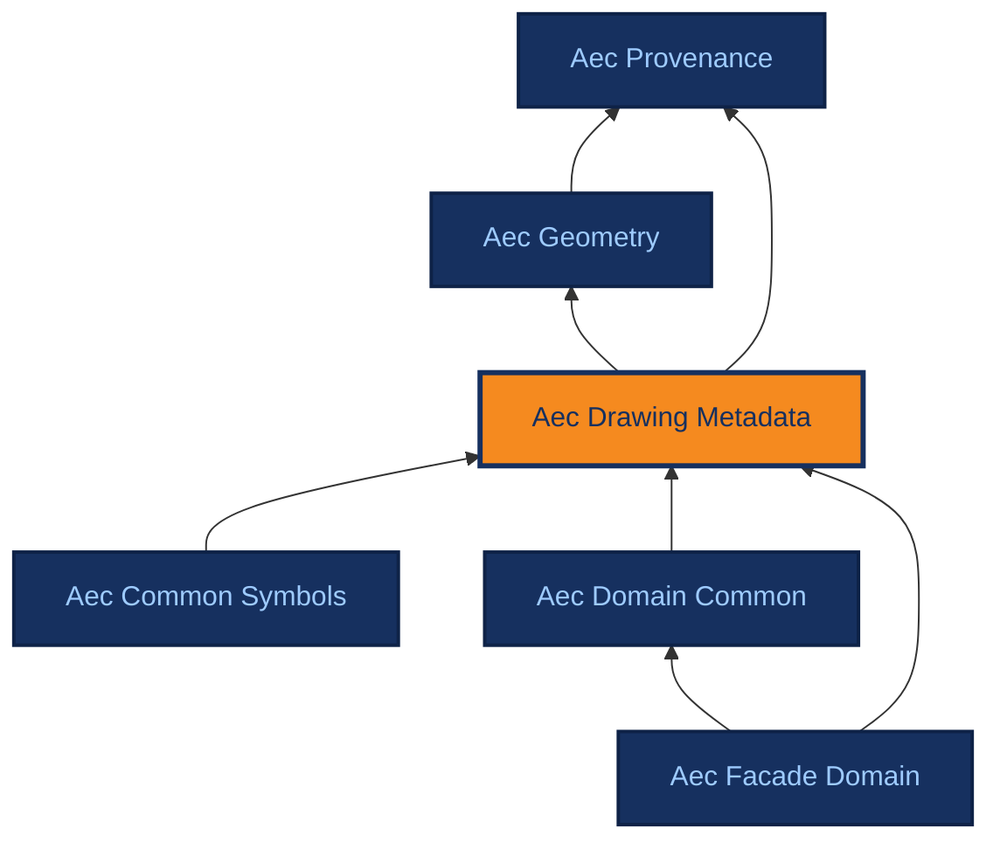

# Aec Drawing Metadata

Version 5.0.0 (latest)

<ul>
<li><a href="./" class="adiro-version-current" aria-current="page">5.0.0 (latest)</a></li>
<li><a href="4.0.1/">4.0.1</a></li>
<li><a href="4.0.0/">4.0.0</a></li>
<li><a href="3.0.0/">3.0.0</a></li>
<li><a href="2.0.0/">2.0.0</a></li>
</ul>

[{ .ontocanvas-icon } Open in OntoCanvas](https://alelom.github.io/OntoCanvas/?onto=https://w3id.org/adiro/aec_drawing_metadata.html){ .md-button target=_blank }
[:material-file-document-outline: TTL source](https://w3id.org/adiro/aec_drawing_metadata.ttl){ .md-button }
[:material-file-code: pyLODE HTML](https://w3id.org/adiro/aec_drawing_metadata.html){ .md-button }

The core drawing vocabulary. It describes the structure of a drawing sheet: its layouts, title block, revisions, and the fields read from them. It imports the provenance and geometry modules, and the discipline modules build on it.

- **IRI:** `https://w3id.org/adiro/aec_drawing_metadata`
- **Versioned IRI:** `https://w3id.org/adiro/aec_drawing_metadata/5.0.0`
- **Imports:** `aec_geometry`, `aec_provenance`

## Interactive view

<iframe src="https://alelom.github.io/OntoCanvas/?onto=https://w3id.org/adiro/aec_drawing_metadata.html" title="Aec Drawing Metadata in OntoCanvas" loading="lazy" style="width: 100%; height: 480px; border: 1px solid var(--md-default-fg-color--lightest); border-radius: 4px;"></iframe>

## Dependencies

Arrows point from an ontology to the ontologies it imports; the current ontology is highlighted.

## Classes

### Detail {#Detail}

A large-scale zoomed-in drawing of a specific construction assembly or connection, showing how individual components fit together with dense material callouts and dimensions. Can be vertical or horizontal.

- **IRI:** `https://w3id.org/adiro/aec_drawing_metadata#Detail`
- **Sub class of:** [Layout content type](#LayoutContentType)
- **Restrictions:** [hasOrientation](#hasOrientation) exactly 1 [Orientation](#OrientationValue)
- **isComputerVisionLabel:** true

*Example images:*

### Drawing element {#DrawingElement}

Element depicted on a drawing. Contained by Layout. Can be a Facade system or Facade component, or other domain-specific symbols, or generic symbols like dimensions, grids, etc.

- **IRI:** `https://w3id.org/adiro/aec_drawing_metadata#DrawingElement`
- **isComputerVisionLabel:** false

### Drawing identifier mention {#DrawingIdentifierMention}

One evidenced occurrence of drawing-identifier (sheet-identifier) text on a source drawing, distinct from the DrawingSheet that the text may denote. Source-text evidence and an immutable source identity are admission requirements for exported UC-03 mentions. Precise localisation is required for navigation, not for an independently accepted sheet resolution: an unlocalisable text block may retain its accepted denotesDrawingSheet edge without a fabricated bounding box or clickable link. Unresolved candidates remain in extraction evidence; no geometry cardinality axiom is imposed.

- **IRI:** `https://w3id.org/adiro/aec_drawing_metadata#DrawingIdentifierMention`
- **Sub class of:** [Drawing element](#DrawingElement)
- **isComputerVisionLabel:** true

### Drawing Sheet {#DrawingSheet}

Top-level container for a drawing. Contains Layout(s).

- **IRI:** `https://w3id.org/adiro/aec_drawing_metadata#DrawingSheet`
- **Restrictions:**
    - [contains](#contains) exactly 1 [Titleblock](#Titleblock)
    - [contains](#contains) min 0 [Key Plan](#KeyPlan)
    - [contains](#contains) min 0 [Legend](#Legend)
    - [contains](#contains) min 0 [Note](#Note)
    - [contains](#contains) min 0 [Revision table](#RevisionTable)
    - [contains](#contains) min 1 [Layout](#Layout)
    - [drawingIdentifier](#drawingIdentifier) min 0 `xsd:string`
    - [drawingScale](#drawingScale) min 0 `xsd:string`
    - [drawingTitle](#drawingTitle) min 0 `xsd:string`
- **isComputerVisionLabel:** false

### DrawingPackage {#DrawingPackage}

A grouping of DrawingSheets within a Project, e.g. a volume or submission package.

- **IRI:** `https://w3id.org/adiro/aec_drawing_metadata#DrawingPackage`
- **isComputerVisionLabel:** false

### DrawingRevision {#DrawingRevision}

A specific revision of a DrawingSheet. Carries revision-specific metadata: code, issue date, status, and role-differentiated person attribution.

- **IRI:** `https://w3id.org/adiro/aec_drawing_metadata#DrawingRevision`
- **isComputerVisionLabel:** false

### Elevation {#Elevation}

A flat, frontal orthographic view of a building facade or interior face, showing surface appearance, window positions, and heights without revealing internal construction.

- **IRI:** `https://w3id.org/adiro/aec_drawing_metadata#Elevation`
- **Sub class of:** [Layout content type](#LayoutContentType)
- **isComputerVisionLabel:** true

*Example images:*

### Image {#Image}

An image embedded within a note region on a drawing sheet.

- **IRI:** `https://w3id.org/adiro/aec_drawing_metadata#Image`
- **Sub class of:** [Note](#Note)
- **isComputerVisionLabel:** true

### Inline layout and sheet reference {#InlineLayoutSheetReference}

A complete inline textual expression relating layout number(s) to a sheet number, such as '1, 3, 5 & 7/S601'. The component mentions retain their own identities; accepted Layout targets are connected separately by inlineReferencesLayout. Expected composition: one sheet-identifier mention and at least one layout-identifier mention, attached with contains; this is checked as an application-profile condition, not asserted as an OWL restriction.

- **IRI:** `https://w3id.org/adiro/aec_drawing_metadata#InlineLayoutSheetReference`
- **Sub class of:** [Reference expression](#ReferenceExpression)
- **isComputerVisionLabel:** true

### Key Plan {#KeyPlan}

A small locator diagram on a drawing sheet showing where the sheet's subject sits within the wider building or site, typically with the relevant area hatched or outlined. A graphical region rather than a text field: its value is the diagram, so it is modelled here as a detectable region alongside Legend and RevisionTable, not as an asserted title-block property. Contained either by a Titleblock, where it is printed inside the title-block strip, or directly by a DrawingSheet where it stands alone on the page; both placements occur and both are optional.

- **IRI:** `https://w3id.org/adiro/aec_drawing_metadata#KeyPlan`
- **Sub class of:** [MetadataContainer](#MetadataContainer)
- **isComputerVisionLabel:** true

*Example images:*

### Layout {#Layout}

Drawing layout - contained by DrawingSheet. Contains DrawingElement(s), annotations, drawing type, and content.

- **IRI:** `https://w3id.org/adiro/aec_drawing_metadata#Layout`
- **Restrictions:**
    - [contains](#contains) min 0 [Drawing element](#DrawingElement)
    - [hasProperty](#hasProperty) exactly 1 [Layout content type](#LayoutContentType)
    - [layoutIdentifier](#layoutIdentifier) min 0 `xsd:string`
    - [layoutScale](#layoutScale) min 0 `xsd:string`
    - [layoutTitle](#layoutTitle) min 0 `xsd:string`
- **isComputerVisionLabel:** true

*Example images:*

### Layout content type {#LayoutContentType}

Type of content included in a layout.

- **IRI:** `https://w3id.org/adiro/aec_drawing_metadata#LayoutContentType`
- **isComputerVisionLabel:** false

### Layout identifier mention {#LayoutIdentifierMention}

One evidenced occurrence of layout-identifier text (a small integer or letter), distinct from a target Layout. A complete inline reference may contain several such occurrences, attached with contains; no target is inferred from matching text alone.

- **IRI:** `https://w3id.org/adiro/aec_drawing_metadata#LayoutIdentifierMention`
- **Sub class of:** [Drawing element](#DrawingElement)
- **isComputerVisionLabel:** true

### Legend {#Legend}

A legend containing mapping information between symbols and a text signifier.

- **IRI:** `https://w3id.org/adiro/aec_drawing_metadata#Legend`
- **Sub class of:** [MetadataContainer](#MetadataContainer)
- **isComputerVisionLabel:** true

*Example images:*

### MetadataContainer {#MetadataContainer}

Supporting visual region on a drawing sheet (titleblock, legend, etc.). Renamed from :Metadata to avoid confusion with semantic metadata properties on DrawingSheet.

- **IRI:** `https://w3id.org/adiro/aec_drawing_metadata#MetadataContainer`
- **isComputerVisionLabel:** false

### Note {#Note}

Superclass for annotations on a drawing sheet that are not part of the drawing geometry, including textual notes and images.

- **IRI:** `https://w3id.org/adiro/aec_drawing_metadata#Note`
- **Sub class of:** [MetadataContainer](#MetadataContainer)
- **isComputerVisionLabel:** true

### Organisation {#Organisation}

A legal entity named in a title block — client, originator, legal owner or responsible department. Modelled as a class rather than a string so that one organisation recurring across many sheets is a single individual, which is what makes cross-sheet questions answerable. Aligns to ct:Organisation (ISO 21597-1) and IfcActorSelect; note the ISO spelling differs.

- **IRI:** `https://w3id.org/adiro/aec_drawing_metadata#Organisation`
- **isComputerVisionLabel:** false

### Orientation {#OrientationValue}

Enumerated orientation values used with hasOrientation.

- **IRI:** `https://w3id.org/adiro/aec_drawing_metadata#OrientationValue`
- **One of:**
    - [Undefined](#Undefined)
    - [Horizontal](#Horizontal)
    - [Vertical](#Vertical)
- **isComputerVisionLabel:** false

### Person {#Person}

A named individual associated with a DrawingRevision in some role (author, checker, approver). The role is expressed by the object property, not by subclassing.

- **IRI:** `https://w3id.org/adiro/aec_drawing_metadata#Person`
- **isComputerVisionLabel:** false

### Perspective {#Perspective}

A three-dimensional pictorial view of a building or assembly showing depth and spatial relationships, used where orthographic drawings cannot convey form.

- **IRI:** `https://w3id.org/adiro/aec_drawing_metadata#Perspective`
- **Sub class of:** [Layout content type](#LayoutContentType)
- **isComputerVisionLabel:** true

*Example images:*

### Plan {#Plan}

A horizontal cut through a building viewed from above, showing the arrangement of spaces, walls, doors, and openings at a given floor level.

- **IRI:** `https://w3id.org/adiro/aec_drawing_metadata#Plan`
- **Sub class of:** [Layout content type](#LayoutContentType)
- **isComputerVisionLabel:** true

*Example images:*

### Project {#Project}

A project under which DrawingSheets are grouped.

- **IRI:** `https://w3id.org/adiro/aec_drawing_metadata#Project`
- **isComputerVisionLabel:** false

### Reference expression {#ReferenceExpression}

A complete source reference expression, whether graphical, inline or a standalone sheet-number reference. This superclass groups those forms for queries; it does not require a second individual around any of them.

- **IRI:** `https://w3id.org/adiro/aec_drawing_metadata#ReferenceExpression`
- **Sub class of:** [Drawing element](#DrawingElement)
- **isComputerVisionLabel:** true

### Revision table {#RevisionTable}

A table recording the documented change history of the drawing sheet, with columns for revision number, date, and description of each amendment.

- **IRI:** `https://w3id.org/adiro/aec_drawing_metadata#RevisionTable`
- **Sub class of:** [MetadataContainer](#MetadataContainer)
- **isComputerVisionLabel:** true

*Example images:*

### Section {#Section}

Section drawing. Has a required property of orientation, which can be vertical or horizontal.

- **IRI:** `https://w3id.org/adiro/aec_drawing_metadata#Section`
- **Sub class of:** [Layout content type](#LayoutContentType)
- **Restrictions:** [hasOrientation](#hasOrientation) exactly 1 [Orientation](#OrientationValue)
- **isComputerVisionLabel:** true

*Example images:*

### Standalone sheet reference {#StandaloneSheetReference}

A drawing-identifier occurrence that itself constitutes a complete reference. One individual is both the DrawingIdentifierMention and the ReferenceExpression: no duplicate wrapper, self-directed hasDrawingIdentifierMention edge or second geometry is needed. An ungrouped mention is not automatically standalone merely because its parent has not been identified.

- **IRI:** `https://w3id.org/adiro/aec_drawing_metadata#StandaloneSheetReference`
- **Sub class of:**
    - [Drawing identifier mention](#DrawingIdentifierMention)
    - [Reference expression](#ReferenceExpression)
- **isComputerVisionLabel:** true

### StatusCode {#StatusCode}

Controlled-vocabulary status assigned to a DrawingRevision, e.g. IFC (Issued for Construction), IFR (Issued for Review), AFC (Approved for Construction).

- **IRI:** `https://w3id.org/adiro/aec_drawing_metadata#StatusCode`
- **isComputerVisionLabel:** false

### Table {#Table}

A table containing structured information, for example a schedule of elements.

- **IRI:** `https://w3id.org/adiro/aec_drawing_metadata#Table`
- **Sub class of:** [Layout content type](#LayoutContentType)
- **isComputerVisionLabel:** true

*Example images:*

### Text {#TextualNote}

A free-form block of text, such as numbered lists or paragraphs, containing general requirements, assumptions, or keyed notes that apply to the drawing.

- **IRI:** `https://w3id.org/adiro/aec_drawing_metadata#TextualNote`
- **Sub class of:** [Note](#Note)
- **isComputerVisionLabel:** true

*Example images:*

### Titleblock {#Titleblock}

Titleblock containing information about the drawing, for example project name, drawing title, drawing number, etc. May itself contain a KeyPlan, Legend or RevisionTable, which are commonly printed inside the title-block strip rather than standing alone on the page; all three are optional, and each may alternatively be contained directly by the DrawingSheet.

- **IRI:** `https://w3id.org/adiro/aec_drawing_metadata#Titleblock`
- **Sub class of:** [MetadataContainer](#MetadataContainer)
- **Restrictions:**
    - [contains](#contains) min 0 [Key Plan](#KeyPlan)
    - [contains](#contains) min 0 [Legend](#Legend)
    - [contains](#contains) min 0 [Revision table](#RevisionTable)
- **isComputerVisionLabel:** true

*Example images:*

## Object Properties

### appearsOnLayout {#appearsOnLayout}

Source Layout on which a reference expression (inline, standalone or graphical) occurs, when membership is supported by evidence. For a ReferenceSymbol it is the same fact as hasReferenceSymbol read from the symbol; it is not asserted when the evidence supports only a page location.

- **IRI:** `https://w3id.org/adiro/aec_drawing_metadata#appearsOnLayout`
- **Domain:** [Reference expression](#ReferenceExpression)
- **Range:** [Layout](#Layout)

### asserts client {#assertsClient}

The organisation commissioning the work — the client or employer — as named by this title block. Universal on AEC title blocks and absent from ISO 7200, which provides only a legal-owner field. Distinct from assertsOriginator, which names the organisation that produced the sheet: on an in-house drawing both may print the same name, so the distinction is carried by the property, not by the value.

- **IRI:** `https://w3id.org/adiro/aec_drawing_metadata#assertsClient`
- **Domain:** [Titleblock](#Titleblock)
- **Range:** [Organisation](#Organisation)
- **extraction hint:** Often the most prominent organisation name on the sheet, sometimes a logo rather than text. Frequently in its own cell above or beside the originator's block.

### asserts metadata for {#assertsMetadataFor}

Links a titleblock region to the drawing sheet whose metadata it asserts. Range is DrawingSheet rather than a separate Document class: the sheet is the unit UC-01 established as searchable, and introducing a competing Document class would deepen an unresolved placement question rather than settle it.

- **IRI:** `https://w3id.org/adiro/aec_drawing_metadata#assertsMetadataFor`
- **Domain:** [Titleblock](#Titleblock)
- **Range:** [Drawing Sheet](#DrawingSheet)
- **extraction hint:** Not extracted. Asserted by the pipeline when a titleblock region is detected on a sheet.

### asserts originator {#assertsOriginator}

The organisation that produced the drawing — the originator in ISO 19650-2 terms, and one segment of the information-container identifier. This is the practice or consultancy whose name and logo appear as author of the sheet. Distinct from assertsClient, which names who commissioned the work.

- **IRI:** `https://w3id.org/adiro/aec_drawing_metadata#assertsOriginator`
- **Domain:** [Titleblock](#Titleblock)
- **Range:** [Organisation](#Organisation)
- **extraction hint:** Usually the organisation whose logo sits in or beside the title block, and whose code appears in the drawing-number originator segment.

### belongsToPackage {#belongsToPackage}

Associates a DrawingSheet with the DrawingPackage it belongs to.

- **IRI:** `https://w3id.org/adiro/aec_drawing_metadata#belongsToPackage`
- **Domain:** [Drawing Sheet](#DrawingSheet)
- **Range:** [DrawingPackage](#DrawingPackage)

### belongsToProject {#belongsToProject}

Associates a DrawingSheet with the Project it belongs to.

- **IRI:** `https://w3id.org/adiro/aec_drawing_metadata#belongsToProject`
- **Domain:** [Drawing Sheet](#DrawingSheet)
- **Range:** [Project](#Project)

### contains {#contains}

Direct containment: indicates physical containment of something within a parent thing (e.g. object in a box), or the containment of a text part within a text expression (e.g. a sheet-identifier mention inside an inline reference). Min cardinality 0 by default (can contain).

- **IRI:** `https://w3id.org/adiro/aec_drawing_metadata#contains`
- **Domain:** `owl:Thing`
- **Range:** `owl:Thing`

### denotesDrawingSheet {#denotesDrawingSheet}

The accepted DrawingSheet identity denoted by one sheet-number occurrence. It does not assert that a Layout target or an output-PDF navigation link was resolved. A mention is expected to have at most one accepted sheet; this is an application-profile condition, not an OWL functional axiom, because a functional axiom would make a reasoner merge two sheets instead of reporting the conflict.

- **IRI:** `https://w3id.org/adiro/aec_drawing_metadata#denotesDrawingSheet`
- **Domain:** [Drawing identifier mention](#DrawingIdentifierMention)
- **Range:** [Drawing Sheet](#DrawingSheet)

### hasCoordinateFrame {#hasCoordinateFrame}

The coordinate frame (aec_geometry:CoordinateFrame) that a drawing sheet's page geometry is expressed in - the exact PDF/page, unit and named coordinate space its bounding boxes are relative to. Owned by the sheet and shared by the geometries on that page; a sheet may carry different frames for different file versions or output PDFs.

- **IRI:** `https://w3id.org/adiro/aec_drawing_metadata#hasCoordinateFrame`
- **Domain:** [Drawing Sheet](#DrawingSheet)
- **Range:** `geom:CoordinateFrame`

### hasLayout {#hasLayout}

Named containment: a DrawingSheet contains one or more Layouts.

- **IRI:** `https://w3id.org/adiro/aec_drawing_metadata#hasLayout`
- **Sub property of:** [contains](#contains)
- **Domain:** [Drawing Sheet](#DrawingSheet)
- **Range:** [Layout](#Layout)

### hasLayoutContentType {#hasLayoutContentType}

Named characterisation: a Layout has exactly one LayoutContentType.

- **IRI:** `https://w3id.org/adiro/aec_drawing_metadata#hasLayoutContentType`
- **Sub property of:** [hasProperty](#hasProperty)
- **Domain:** [Layout](#Layout)
- **Range:** [Layout content type](#LayoutContentType)

### hasOrientation {#hasOrientation}

Orientation value for layouts where orientation is applicable.

- **IRI:** `https://w3id.org/adiro/aec_drawing_metadata#hasOrientation`
- **Domain:** ([Section](#Section) or [Detail](#Detail))
- **Range:** [Orientation](#OrientationValue)

### hasProperty {#hasProperty}

Subject is characterised by a property, or quality. Used for example to indicate qualitative things like 'it is vertical' or 'it has a colour blue'.

- **IRI:** `https://w3id.org/adiro/aec_drawing_metadata#hasProperty`
- **Domain:** `owl:Thing`
- **Range:** `owl:Thing`

### hasRevision {#hasRevision}

A DrawingSheet compositionally contains its DrawingRevisions. To navigate from a revision back to its sheet, use the SPARQL inverse path ^metadata:hasRevision - ADIRO declares no named inverse properties and no owl:inverseOf axioms (see GitHub issue #21).

- **IRI:** `https://w3id.org/adiro/aec_drawing_metadata#hasRevision`
- **Sub property of:** [contains](#contains)
- **Domain:** [Drawing Sheet](#DrawingSheet)
- **Range:** [DrawingRevision](#DrawingRevision)

### hasStatusCode {#hasStatusCode}

The controlled-vocabulary StatusCode assigned to a DrawingRevision.

- **IRI:** `https://w3id.org/adiro/aec_drawing_metadata#hasStatusCode`
- **Sub property of:** [hasProperty](#hasProperty)
- **Domain:** [DrawingRevision](#DrawingRevision)
- **Range:** [StatusCode](#StatusCode)

### inlineReferencesLayout {#inlineReferencesLayout}

An accepted target Layout of an inline layout/sheet reference. Multiple supported targets may be asserted; unresolved members do not acquire target edges.

- **IRI:** `https://w3id.org/adiro/aec_drawing_metadata#inlineReferencesLayout`
- **Domain:** [Inline layout and sheet reference](#InlineLayoutSheetReference)
- **Range:** [Layout](#Layout)

### isApprovedBy {#isApprovedBy}

The Person who approved this DrawingRevision.

- **IRI:** `https://w3id.org/adiro/aec_drawing_metadata#isApprovedBy`
- **Domain:** [DrawingRevision](#DrawingRevision)
- **Range:** [Person](#Person)

### isAuthoredBy {#isAuthoredBy}

The Person who authored this DrawingRevision.

- **IRI:** `https://w3id.org/adiro/aec_drawing_metadata#isAuthoredBy`
- **Domain:** [DrawingRevision](#DrawingRevision)
- **Range:** [Person](#Person)

### isCheckedBy {#isCheckedBy}

The Person who checked this DrawingRevision.

- **IRI:** `https://w3id.org/adiro/aec_drawing_metadata#isCheckedBy`
- **Domain:** [DrawingRevision](#DrawingRevision)
- **Range:** [Person](#Person)

## Datatype Properties

### assertsCrossReferenceNumber {#assertsCrossReferenceNumber}

A second (or third) identifier the title block prints for the same sheet, issued by a system other than the one drawingIdentifier is read from — a design-team-internal number, a client/EDMS document number, or a sketch/site-advice reference. Stored whole and verbatim, not parsed into segments; which system issued it is not modelled as a controlled vocabulary here, so that distinction is carried by extractionHint only.

- **IRI:** `https://w3id.org/adiro/aec_drawing_metadata#assertsCrossReferenceNumber`
- **Domain:** [Titleblock](#Titleblock)
- **Range:** `xsd:string`
- **extraction hint:** A second coded number near or below the primary drawing number, often prefixed by the issuing system's initials (e.g. a sketch/site-advice code, or an EDMS platform's own document ID). Do not conflate with drawingIdentifier — capture only when a sheet prints more than one numbering system.

### drawingIdentifier {#drawingIdentifier}

Sheet-level identifier, e.g. 'ST-201'. Also known as 'drawing number'.

- **IRI:** `https://w3id.org/adiro/aec_drawing_metadata#drawingIdentifier`
- **Domain:** [Drawing Sheet](#DrawingSheet)
- **Range:** `xsd:string`
- **isComputerVisionLabel:** true

### drawingScale {#drawingScale}

The scale of a DrawingSheet as a whole, e.g. '1:50', or a note such as 'NTS' or 'As shown'. It is most often printed in the title block, and can also appear in a general note or another area outside any layout. It is the sheet's nominal or predominant scale, not a claim about every layout on it: where a Layout prints its own scale, that layoutScale is the more specific value for that drawing. A layout's scale is not copied into drawingScale, because a sheet can gain layouts and the scale of one of them would then no longer describe the sheet. A sub-property of hasScale, so every drawingScale value is also a hasScale value of the sheet.

- **IRI:** `https://w3id.org/adiro/aec_drawing_metadata#drawingScale`
- **Sub property of:** [hasScale](#hasScale)
- **Domain:** [Drawing Sheet](#DrawingSheet)
- **Range:** `xsd:string`
- **extraction hint:** Most often read from the title block, in the cell captioned 'Scale' (German 'Maßstab'), sometimes given together with the sheet size ('1:50 @ A1'). It can also be printed in a general note or another area outside any layout (for example 'ALL DRAWINGS 1:50 UNLESS NOTED'); decide from the context that it applies to the sheet as a whole. Capture only the scale ('1:50'); where it prints 'NTS' or 'As shown' instead of a ratio, capture that verbatim. A scale printed beside an individual drawing is that layout's layoutScale, not this, and is not repeated here.
- **isComputerVisionLabel:** true

### drawingTitle {#drawingTitle}

Title of the drawing sheet.

- **IRI:** `https://w3id.org/adiro/aec_drawing_metadata#drawingTitle`
- **Domain:** [Drawing Sheet](#DrawingSheet)
- **Range:** `xsd:string`
- **isComputerVisionLabel:** true

### hasScale {#hasScale}

Scale notation, e.g. '1:50'. Applies to a DrawingSheet where one scale governs the whole sheet, and to a Layout where the sheet carries several drawings at different scales — a detail at 1:5 beside a plan at 1:100 is ordinary. Where a Layout carries its own value it is the more specific one and describes that drawing; the sheet-level value, where both are present, is the sheet's nominal or predominant scale rather than a claim about every layout on it.

- **IRI:** `https://w3id.org/adiro/aec_drawing_metadata#hasScale`
- **Domain:** ([Drawing Sheet](#DrawingSheet) or [Layout](#Layout))
- **Range:** `xsd:string`

### issueDate {#issueDate}

The date this revision was issued.

- **IRI:** `https://w3id.org/adiro/aec_drawing_metadata#issueDate`
- **Domain:** [DrawingRevision](#DrawingRevision)
- **Range:** `xsd:date`

### layoutIdentifier {#layoutIdentifier}

Identifier for a Layout within its parent DrawingSheet. Also known as 'layout number'. Typically a small integer or letter ('1', '2', 'A').

- **IRI:** `https://w3id.org/adiro/aec_drawing_metadata#layoutIdentifier`
- **Domain:** [Layout](#Layout)
- **Range:** `xsd:string`
- **isComputerVisionLabel:** true

### layoutScale {#layoutScale}

The scale printed in an individual Layout's own caption, e.g. '1:5' for a detail on a sheet whose plan is drawn at 1:100, or a note such as 'NTS' or 'As shown'. Where a Layout carries one, it is the more specific value and describes that drawing; the sheet-level drawingScale is only the sheet's nominal scale. Where a Layout prints no scale, no layoutScale is recorded: it is left empty, not filled from the sheet. A sub-property of hasScale, so every layoutScale value is also a hasScale value of the layout.

- **IRI:** `https://w3id.org/adiro/aec_drawing_metadata#layoutScale`
- **Sub property of:** [hasScale](#hasScale)
- **Domain:** [Layout](#Layout)
- **Range:** `xsd:string`
- **extraction hint:** Printed beside its layout rather than in the title block, usually at the end of the caption line after the title ('3  MULLION HEAD  1:5') or on a line beneath it ('SCALE 1:5'). Capture only the scale: that caption decomposes across three properties on the same Layout — layoutIdentifier '3', layoutTitle 'MULLION HEAD', layoutScale '1:5'. Where the caption prints 'NTS' or 'As shown' instead of a ratio, capture that verbatim; where it prints no scale, record nothing. Do not confuse with drawingScale, the scale of the sheet as a whole, and do not repeat this value there.
- **isComputerVisionLabel:** true

### layoutTitle {#layoutTitle}

The caption naming an individual Layout, distinct from the sheet-level drawingTitle. A sheet routinely carries several drawings — details, sections, plans at different scales — each with its own printed title such as 'Mullion Head Detail' or 'Ground Floor Plan'. Pairs with layoutIdentifier as title-to-number: the identifier says which layout, this says what it depicts.

- **IRI:** `https://w3id.org/adiro/aec_drawing_metadata#layoutTitle`
- **Domain:** [Layout](#Layout)
- **Range:** `xsd:string`
- **extraction hint:** Printed adjacent to its layout rather than in the title block — usually directly beneath or above the drawing, often with the layout number and scale in the same caption line ('3  MULLION HEAD  1:5'). Capture only the descriptive part: that caption decomposes across three properties on the same Layout — layoutIdentifier '3', layoutTitle 'MULLION HEAD', layoutScale '1:5'. Do not confuse with drawingTitle, which is the single sheet-level title inside the title block.
- **isComputerVisionLabel:** true

### organisationName {#organisationName}

The name of an organisation as printed. Parallels personName. Verbatim: not normalised, expanded or translated at extraction time.

- **IRI:** `https://w3id.org/adiro/aec_drawing_metadata#organisationName`
- **Domain:** [Organisation](#Organisation)
- **Range:** `xsd:string`
- **extraction hint:** Transcribe exactly as printed, including any legal suffix.

### packageName {#packageName}

Name of the drawing package.

- **IRI:** `https://w3id.org/adiro/aec_drawing_metadata#packageName`
- **Domain:** [DrawingPackage](#DrawingPackage)
- **Range:** `xsd:string`

### personName {#personName}

Name of the person.

- **IRI:** `https://w3id.org/adiro/aec_drawing_metadata#personName`
- **Domain:** [Person](#Person)
- **Range:** `xsd:string`

### projectName {#projectName}

Name of the project.

- **IRI:** `https://w3id.org/adiro/aec_drawing_metadata#projectName`
- **Domain:** [Project](#Project)
- **Range:** `xsd:string`

### projectNumber {#projectNumber}

Project number.

- **IRI:** `https://w3id.org/adiro/aec_drawing_metadata#projectNumber`
- **Domain:** [Project](#Project)
- **Range:** `xsd:string`

### refersToDrawingId {#refersToDrawingId}

References another Drawing by using a drawing identifier, like a drawing number.

- **IRI:** `https://w3id.org/adiro/aec_drawing_metadata#refersToDrawingId`
- **Domain:** [Text](#TextualNote)
- **Range:** `xsd:string`

### revisionCode {#revisionCode}

The code identifying a specific revision, e.g. 'A', 'B', 'P01'.

- **IRI:** `https://w3id.org/adiro/aec_drawing_metadata#revisionCode`
- **Domain:** [DrawingRevision](#DrawingRevision)
- **Range:** `xsd:string`

### sheetSize {#sheetSize}

Sheet size designation, e.g. 'A1', 'A0'. Named for the sheet of paper, which has a size; the printed fields of the drawing itself say 'drawing' (drawingIdentifier, drawingTitle, drawingScale). 'Drawing size' is a synonym of this term, not a second term.

- **IRI:** `https://w3id.org/adiro/aec_drawing_metadata#sheetSize`
- **Domain:** [Drawing Sheet](#DrawingSheet)
- **Range:** `xsd:string`

### statusLabel {#statusLabel}

Display label for the status code, e.g. 'IFC', 'IFR', 'AFC'.

- **IRI:** `https://w3id.org/adiro/aec_drawing_metadata#statusLabel`
- **Domain:** [StatusCode](#StatusCode)
- **Range:** `xsd:string`

## Annotation Properties

### depiction {#depiction}

- **IRI:** `http://xmlns.com/foaf/0.1/depiction`

### example image {#exampleImage}

Links a class or relationship to an image that shows it. The value is the absolute https IRI of an image file in the module's exampleImage folder (https://w3id.org/adiro/<module>/exampleImage/<LocalName>_NN.<ext>, NN being the two-digit order starting at 01). Carries no reasoning weight, but can be used by downstream consumers like machine-learning workflows or annotation tools. How to add an image: see https://w3id.org/adiro/contribute/example-images/

- **IRI:** `https://w3id.org/adiro/aec_drawing_metadata#exampleImage`
- **Sub property of:** [depiction](#depiction)
- **Range:** `xsd:anyURI`

### extraction hint {#extractionHint}

Free-text guidance for an information-extraction model on where and how a field typically appears on a drawing sheet (adjacent captions, cell grouping, formatting). Consumed by the generated extraction profile, not by reasoning.

- **IRI:** `https://w3id.org/adiro/aec_drawing_metadata#extractionHint`
- **Range:** `xsd:string`

### isComputerVisionLabel {#isComputerVisionLabel}

When true, this class or datatype property can be used as a label by annotators in computer-vision annotation tooling; when false, it cannot. A class label is a shape drawn around what the class depicts (solid contour in the diagram when true, dashed when false). A datatype-property label is a box drawn around the printed text of that field, such as a layout's title; the box belongs to the class that names the property in an owl:onProperty restriction, which is also how the property is reached from that class. Says nothing about other applications. Carries no reasoning weight.

- **IRI:** `https://w3id.org/adiro/aec_drawing_metadata#isComputerVisionLabel`
- **Range:** `xsd:boolean`

### isComputerVisionOptionalLabel {#isComputerVisionOptionalLabel}

Presentation hint for computer-vision annotation tooling: when true, the class is presented apart from the required labels (on the trailing side of the label panel rather than the default leading side) and may be left out by annotators, for example a discipline picked as an attribute of a drawing rather than drawn as a shape. Independent of isComputerVisionLabel. Carries no reasoning weight.

- **IRI:** `https://w3id.org/adiro/aec_drawing_metadata#isComputerVisionOptionalLabel`
- **Range:** `xsd:boolean`

## Named Individuals

### Horizontal {#Horizontal}

Horizontal orientation.

- **IRI:** `https://w3id.org/adiro/aec_drawing_metadata#Horizontal`
- **Type:** [Orientation](#OrientationValue)
- **isComputerVisionLabel:** true

### Undefined {#Undefined}

Orientation not specified.

- **IRI:** `https://w3id.org/adiro/aec_drawing_metadata#Undefined`
- **Type:** [Orientation](#OrientationValue)
- **isComputerVisionLabel:** true

### Vertical {#Vertical}

Vertical orientation.

- **IRI:** `https://w3id.org/adiro/aec_drawing_metadata#Vertical`
- **Type:** [Orientation](#OrientationValue)
- **isComputerVisionLabel:** true
