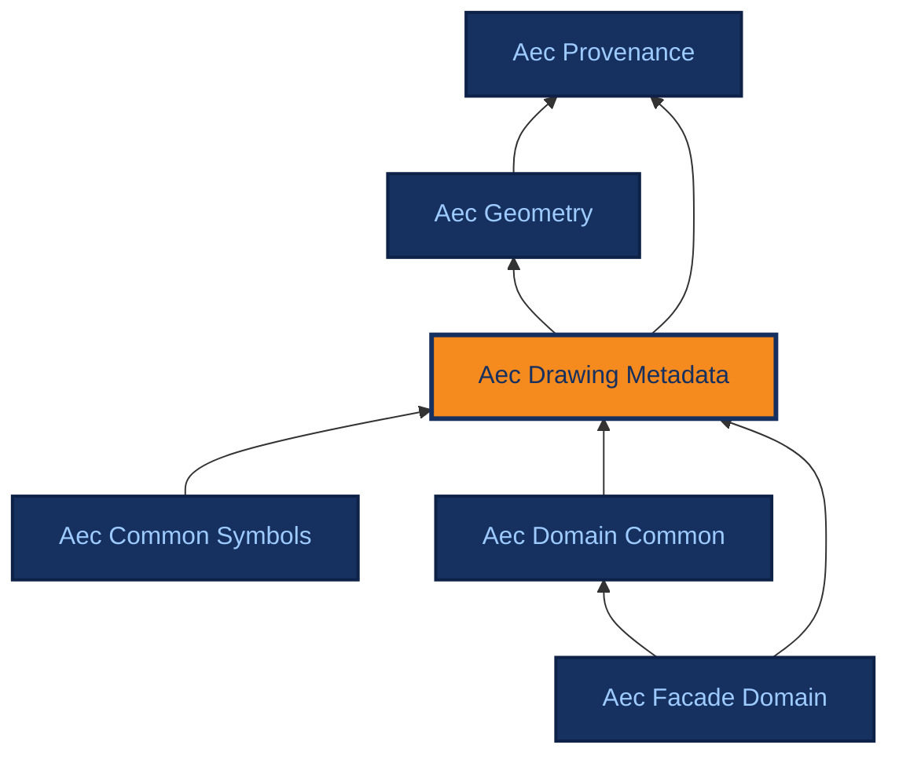

---
search:
  exclude: true
---

# Aec Drawing Metadata

Version 6.0.0 (adiro_drawing_metadata 7.0.1 available)

<ul>
<li><a href="../adiro_drawing_metadata/">adiro_drawing_metadata 7.0.1 (latest)</a></li>
<li><a href="../adiro_drawing_metadata/7.0.0/">adiro_drawing_metadata 7.0.0</a></li>
<li><a href="./" class="adiro-version-current" aria-current="page">6.0.0 (final)</a></li>
<li><a href="5.0.1/">5.0.1</a></li>
<li><a href="5.0.0/">5.0.0</a></li>
<li><a href="4.0.1/">4.0.1</a></li>
<li><a href="4.0.0/">4.0.0</a></li>
<li><a href="3.0.0/">3.0.0</a></li>
<li><a href="2.0.0/">2.0.0</a></li>
</ul>

[{ .ontocanvas-icon } Open in OntoCanvas](https://burohappoldmachinelearning.github.io/OntoCanvas/?onto=https://w3id.org/adiro/aec_drawing_metadata.html){ .md-button target=_blank }
[:material-file-document-outline: TTL source](https://w3id.org/adiro/aec_drawing_metadata.ttl){ .md-button }
[:material-file-code: pyLODE HTML](https://w3id.org/adiro/aec_drawing_metadata.html){ .md-button }

!!! warning "Deprecated"

    This module is deprecated and receives no further changes. It is replaced by [`adiro_drawing_metadata`](adiro_drawing_metadata.md), which continues its version numbering. Every release of it stays published at its own IRI.

The core drawing vocabulary. It describes the structure of a drawing sheet: its layouts, title block, revisions, and the fields read from them. It imports the provenance module (which also holds the file, the page and the agents) and the geometry module (where a title block's region is located), and the discipline modules build on it.

- **IRI:** `https://w3id.org/adiro/aec_drawing_metadata`
- **Versioned IRI:** `https://w3id.org/adiro/aec_drawing_metadata/6.0.0`
- **Imports:** `aec_geometry`, `aec_provenance`

## Interactive view

<iframe src="https://burohappoldmachinelearning.github.io/OntoCanvas/?onto=https://w3id.org/adiro/aec_drawing_metadata.html" title="Aec Drawing Metadata in OntoCanvas" loading="lazy" style="width: 100%; height: 480px; border: 1px solid var(--md-default-fg-color--lightest); border-radius: 4px;"></iframe>

## Dependencies

Arrows point from an ontology to the ontologies it imports; the current ontology is highlighted.

## Classes

### Detail {#Detail}

A large-scale zoomed-in drawing of a specific construction assembly or connection, showing how individual components fit together with dense material callouts and dimensions. Can be vertical or horizontal.

- **IRI:** `https://w3id.org/adiro/aec_drawing_metadata#Detail`
- **Sub class of:** [Layout content type](#LayoutContentType)
- **Restrictions:** [hasOrientation](#hasOrientation) exactly 1 [Orientation](#OrientationValue)
- **isComputerVisionLabel:** true

*Example images:*

### Drawing element {#DrawingElement}

Element depicted on a drawing. Contained by [Layout](#Layout). Can be a Facade system or Facade component, or other domain-specific symbols, or generic symbols like dimensions, grids, etc. It may carry a BoundingBox, its region on the page (geom:hasBoundingBox).

- **IRI:** `https://w3id.org/adiro/aec_drawing_metadata#DrawingElement`
- **Restrictions:** `geom:hasBoundingBox` min 0 `geom:BoundingBox`
- **isComputerVisionLabel:** false

### Drawing identifier mention {#DrawingIdentifierMention}

One evidenced occurrence of drawing-identifier (sheet-identifier) text on a source drawing, distinct from the [DrawingSheet](#DrawingSheet) that the text may denote. Source-text evidence and an immutable source identity are admission requirements for exported UC-03 mentions. Precise localisation is required for navigation, not for an independently accepted sheet resolution: an unlocalisable text block may retain its accepted [denotesDrawingSheet](#denotesDrawingSheet) edge without a fabricated bounding box or clickable link. Unresolved candidates remain in extraction evidence; no geometry cardinality axiom is imposed.

- **IRI:** `https://w3id.org/adiro/aec_drawing_metadata#DrawingIdentifierMention`
- **Sub class of:** [Drawing element](#DrawingElement)
- **isComputerVisionLabel:** true

*Example images:*

### Drawing Sheet {#DrawingSheet}

Top-level container for a drawing. Contains Layout(s).

- **IRI:** `https://w3id.org/adiro/aec_drawing_metadata#DrawingSheet`
- **Restrictions:**
    - [contains](#contains) exactly 1 [Titleblock](#Titleblock)
    - [contains](#contains) min 0 [Key Plan](#KeyPlan)
    - [contains](#contains) min 0 [Legend](#Legend)
    - [contains](#contains) min 0 [Note](#Note)
    - [contains](#contains) min 0 [Revision table](#RevisionTable)
    - [contains](#contains) min 1 [Layout](#Layout)
    - [drawingIdentifier](#drawingIdentifier) min 0 `xsd:string`
    - [drawingScale](#drawingScale) min 0 `xsd:string`
    - [drawingTitle](#drawingTitle) min 0 `xsd:string`
- **isComputerVisionLabel:** false

*Example images:*

### DrawingPackage {#DrawingPackage}

A grouping of [DrawingSheet](#DrawingSheet)s within a [Project](#Project), e.g. a volume or submission package.

- **IRI:** `https://w3id.org/adiro/aec_drawing_metadata#DrawingPackage`
- **isComputerVisionLabel:** false

### DrawingRevision {#DrawingRevision}

A specific revision of a [DrawingSheet](#DrawingSheet). Carries revision-specific metadata: code, issue date, status, and role-differentiated person attribution.

- **IRI:** `https://w3id.org/adiro/aec_drawing_metadata#DrawingRevision`
- **isComputerVisionLabel:** false

### Elevation {#Elevation}

A flat, frontal orthographic view of a building facade or interior face, showing surface appearance, window positions, and heights without revealing internal construction.

- **IRI:** `https://w3id.org/adiro/aec_drawing_metadata#Elevation`
- **Sub class of:** [Layout content type](#LayoutContentType)
- **isComputerVisionLabel:** true

*Example images:*

### Image {#Image}

An image embedded within a note region on a drawing sheet.

- **IRI:** `https://w3id.org/adiro/aec_drawing_metadata#Image`
- **Sub class of:** [Note](#Note)
- **isComputerVisionLabel:** true

### Inline layout and sheet reference {#InlineLayoutSheetReference}

A complete inline textual expression relating layout number(s) to a sheet number, such as '1, 3, 5 & 7/S601'. The component mentions retain their own identities; accepted [Layout](#Layout) targets are connected separately by [inlineReferencesLayout](#inlineReferencesLayout). Expected composition: one sheet-identifier mention and at least one layout-identifier mention, attached with contains; this is checked as an application-profile condition, not asserted as an OWL restriction.

- **IRI:** `https://w3id.org/adiro/aec_drawing_metadata#InlineLayoutSheetReference`
- **Sub class of:** [Reference expression](#ReferenceExpression)
- **isComputerVisionLabel:** true

*Example images:*

### Key Plan {#KeyPlan}

A small locator diagram on a drawing sheet showing where the sheet's subject sits within the wider building or site, typically with the relevant area hatched or outlined. A graphical region rather than a text field: its value is the diagram, so it is modelled here as a detectable region alongside [Legend](#Legend) and [RevisionTable](#RevisionTable), not as an asserted title-block property. Contained either by a [Titleblock](#Titleblock), where it is printed inside the title-block strip, or directly by a [DrawingSheet](#DrawingSheet) where it stands alone on the page; both placements occur and both are optional.

- **IRI:** `https://w3id.org/adiro/aec_drawing_metadata#KeyPlan`
- **Sub class of:** [MetadataContainer](#MetadataContainer)
- **isComputerVisionLabel:** true

*Example images:*

### Layout {#Layout}

Drawing layout - contained by [DrawingSheet](#DrawingSheet). Contains [DrawingElement](#DrawingElement)(s), annotations, drawing type, and content. It may carry a BoundingBox, its region on the page (geom:hasBoundingBox).

- **IRI:** `https://w3id.org/adiro/aec_drawing_metadata#Layout`
- **Restrictions:**
    - [contains](#contains) min 0 [Drawing element](#DrawingElement)
    - [hasProperty](#hasProperty) exactly 1 [Layout content type](#LayoutContentType)
    - [layoutIdentifier](#layoutIdentifier) min 0 `xsd:string`
    - [layoutScale](#layoutScale) min 0 `xsd:string`
    - [layoutTitle](#layoutTitle) min 0 `xsd:string`
    - `geom:hasBoundingBox` min 0 `geom:BoundingBox`
- **isComputerVisionLabel:** true

*Example images:*

### Layout content type {#LayoutContentType}

Type of content included in a layout.

- **IRI:** `https://w3id.org/adiro/aec_drawing_metadata#LayoutContentType`
- **isComputerVisionLabel:** false

### Layout identifier mention {#LayoutIdentifierMention}

One evidenced occurrence of layout-identifier text (a small integer or letter), distinct from a target [Layout](#Layout). A complete inline reference may contain several such occurrences, attached with contains; no target is inferred from matching text alone.

- **IRI:** `https://w3id.org/adiro/aec_drawing_metadata#LayoutIdentifierMention`
- **Sub class of:** [Drawing element](#DrawingElement)
- **isComputerVisionLabel:** true

*Example images:*

### Legend {#Legend}

A legend containing mapping information between symbols and a text signifier.

- **IRI:** `https://w3id.org/adiro/aec_drawing_metadata#Legend`
- **Sub class of:** [MetadataContainer](#MetadataContainer)
- **isComputerVisionLabel:** true

*Example images:*

### MetadataContainer {#MetadataContainer}

Supporting visual region on a drawing sheet (titleblock, legend, etc.). Renamed from :Metadata to avoid confusion with semantic metadata properties on [DrawingSheet](#DrawingSheet). Every container (the title block, a revision table, a legend, a key plan, a note) may carry a BoundingBox, its region on the page, which what is read from it is located by (geom:hasBoundingBox); each subclass inherits this.

- **IRI:** `https://w3id.org/adiro/aec_drawing_metadata#MetadataContainer`
- **Restrictions:** `geom:hasBoundingBox` min 0 `geom:BoundingBox`
- **isComputerVisionLabel:** false

### Note {#Note}

Superclass for annotations on a drawing sheet that are not part of the drawing geometry, including textual notes and images.

- **IRI:** `https://w3id.org/adiro/aec_drawing_metadata#Note`
- **Sub class of:** [MetadataContainer](#MetadataContainer)
- **isComputerVisionLabel:** true

### Orientation {#OrientationValue}

Enumerated orientation values used with [hasOrientation](#hasOrientation).

- **IRI:** `https://w3id.org/adiro/aec_drawing_metadata#OrientationValue`
- **One of:**
    - [Undefined](#Undefined)
    - [Horizontal](#Horizontal)
    - [Vertical](#Vertical)
- **isComputerVisionLabel:** false

### Perspective {#Perspective}

A three-dimensional pictorial view of a building or assembly showing depth and spatial relationships, used where orthographic drawings cannot convey form.

- **IRI:** `https://w3id.org/adiro/aec_drawing_metadata#Perspective`
- **Sub class of:** [Layout content type](#LayoutContentType)
- **isComputerVisionLabel:** true

*Example images:*

### Plan {#Plan}

A horizontal cut through a building viewed from above, showing the arrangement of spaces, walls, doors, and openings at a given floor level.

- **IRI:** `https://w3id.org/adiro/aec_drawing_metadata#Plan`
- **Sub class of:** [Layout content type](#LayoutContentType)
- **isComputerVisionLabel:** true

*Example images:*

### Project {#Project}

A project under which [DrawingSheet](#DrawingSheet)s are grouped.

- **IRI:** `https://w3id.org/adiro/aec_drawing_metadata#Project`
- **isComputerVisionLabel:** false

### Reference expression {#ReferenceExpression}

A complete source reference expression, whether graphical, inline or a standalone sheet-number reference. This superclass groups those forms for queries; it does not require a second individual around any of them.

- **IRI:** `https://w3id.org/adiro/aec_drawing_metadata#ReferenceExpression`
- **Sub class of:** [Drawing element](#DrawingElement)
- **isComputerVisionLabel:** true

### Revision table {#RevisionTable}

A table recording the documented change history of the drawing sheet, with columns for revision number, date, and description of each amendment.

- **IRI:** `https://w3id.org/adiro/aec_drawing_metadata#RevisionTable`
- **Sub class of:** [MetadataContainer](#MetadataContainer)
- **isComputerVisionLabel:** true

*Example images:*

### Section {#Section}

Section drawing. Has a required property of orientation, which can be vertical or horizontal.

- **IRI:** `https://w3id.org/adiro/aec_drawing_metadata#Section`
- **Sub class of:** [Layout content type](#LayoutContentType)
- **Restrictions:** [hasOrientation](#hasOrientation) exactly 1 [Orientation](#OrientationValue)
- **isComputerVisionLabel:** true

*Example images:*

### Standalone sheet reference {#StandaloneSheetReference}

A drawing-identifier occurrence that itself constitutes a complete reference. One individual is both the [DrawingIdentifierMention](#DrawingIdentifierMention) and the [ReferenceExpression](#ReferenceExpression): no duplicate wrapper, self-directed hasDrawingIdentifierMention edge or second geometry is needed. An ungrouped mention is not automatically standalone merely because its parent has not been identified.

- **IRI:** `https://w3id.org/adiro/aec_drawing_metadata#StandaloneSheetReference`
- **Sub class of:**
    - [Drawing identifier mention](#DrawingIdentifierMention)
    - [Reference expression](#ReferenceExpression)
- **isComputerVisionLabel:** true

*Example images:*

### StatusCode {#StatusCode}

Controlled-vocabulary status assigned to a [DrawingRevision](#DrawingRevision), e.g. IFC (Issued for Construction), IFR (Issued for Review), AFC (Approved for Construction).

- **IRI:** `https://w3id.org/adiro/aec_drawing_metadata#StatusCode`
- **isComputerVisionLabel:** false

### Table {#Table}

A table containing structured information, for example a schedule of elements.

- **IRI:** `https://w3id.org/adiro/aec_drawing_metadata#Table`
- **Sub class of:** [Layout content type](#LayoutContentType)
- **isComputerVisionLabel:** true

*Example images:*

### Text {#TextualNote}

A free-form block of text, such as numbered lists or paragraphs, containing general requirements, assumptions, or keyed notes that apply to the drawing.

- **IRI:** `https://w3id.org/adiro/aec_drawing_metadata#TextualNote`
- **Sub class of:** [Note](#Note)
- **isComputerVisionLabel:** true

*Example images:*

### Titleblock {#Titleblock}

Titleblock containing information about the drawing, for example project name, drawing title, drawing number, etc. May itself contain a [KeyPlan](#KeyPlan), [Legend](#Legend) or [RevisionTable](#RevisionTable), which are commonly printed inside the title-block strip rather than standing alone on the page; all three are optional, and each may alternatively be contained directly by the [DrawingSheet](#DrawingSheet).

- **IRI:** `https://w3id.org/adiro/aec_drawing_metadata#Titleblock`
- **Sub class of:** [MetadataContainer](#MetadataContainer)
- **Restrictions:**
    - [contains](#contains) min 0 [Key Plan](#KeyPlan)
    - [contains](#contains) min 0 [Legend](#Legend)
    - [contains](#contains) min 0 [Revision table](#RevisionTable)
- **isComputerVisionLabel:** true

*Example images:*

## Object Properties

### asserts client {#assertsClient}

The organisation commissioning the work — the client or employer — as named by this title block. Universal on AEC title blocks and absent from ISO 7200, which provides only a legal-owner field. Distinct from [assertsOriginator](#assertsOriginator), which names the organisation that produced the sheet: on an in-house drawing both may print the same name, so the distinction is carried by the property, not by the value.

- **IRI:** `https://w3id.org/adiro/aec_drawing_metadata#assertsClient`
- **Domain:** [Titleblock](#Titleblock)
- **Range:** `aprov:Organisation`
- **extraction hint:** Often the most prominent organisation name on the sheet, sometimes a logo rather than text. Frequently in its own cell above or beside the originator's block.

### asserts metadata for {#assertsMetadataFor}

Links a titleblock region to the drawing sheet whose metadata it asserts. Range is [DrawingSheet](#DrawingSheet) rather than a separate Document class: the sheet is the unit UC-01 established as searchable, and introducing a competing Document class would deepen an unresolved placement question rather than settle it.

- **IRI:** `https://w3id.org/adiro/aec_drawing_metadata#assertsMetadataFor`
- **Domain:** [Titleblock](#Titleblock)
- **Range:** [Drawing Sheet](#DrawingSheet)
- **extraction hint:** Not extracted. Asserted by the pipeline when a titleblock region is detected on a sheet.

### asserts originator {#assertsOriginator}

The organisation that produced the drawing — the originator in ISO 19650-2 terms, and one segment of the information-container identifier. This is the practice or consultancy whose name and logo appear as author of the sheet. Distinct from [assertsClient](#assertsClient), which names who commissioned the work.

- **IRI:** `https://w3id.org/adiro/aec_drawing_metadata#assertsOriginator`
- **Domain:** [Titleblock](#Titleblock)
- **Range:** `aprov:Organisation`
- **extraction hint:** Usually the organisation whose logo sits in or beside the title block, and whose code appears in the drawing-number originator segment.

### assertsPackage {#assertsPackage}

The drawing package this title block names, when it names one: a claim read off the printed region, like [assertsProject](#assertsProject). Optional: a title block may or may not name a package, so there is no cardinality. The fact that a drawing is filed in a package is [belongsToPackage](#belongsToPackage); the two can differ, and the difference is what a query can report.

- **IRI:** `https://w3id.org/adiro/aec_drawing_metadata#assertsPackage`
- **Domain:** [Titleblock](#Titleblock)
- **Range:** [DrawingPackage](#DrawingPackage)
- **extraction hint:** Present on some title blocks only: a package, volume or submission cell, often next to the project. Do not invent one when the cell is absent.

### assertsProject {#assertsProject}

The project this title block names: a claim read off the printed region, like [assertsClient](#assertsClient). The fact that a drawing is filed under a project is [belongsToProject](#belongsToProject); the two can differ (a drawing filed under another project than its title block names), and the difference is what a query can report.

- **IRI:** `https://w3id.org/adiro/aec_drawing_metadata#assertsProject`
- **Domain:** [Titleblock](#Titleblock)
- **Range:** [Project](#Project)
- **extraction hint:** The project cell of the title block, a name, a number or both; the same project is named on every drawing of the project.

### assertsRevision {#assertsRevision}

A revision that this revision table lists: a claim read off the printed table, one link per row, so a table listing revisions A, B and C asserts three. It does not say which revision is the latest, and it does not replace [hasRevision](#hasRevision), which states that a drawing has the revision; assertsRevision records which printed table a revision was read from. Reach the table from a revision with the inverse path ^assertsRevision.

- **IRI:** `https://w3id.org/adiro/aec_drawing_metadata#assertsRevision`
- **Domain:** [Revision table](#RevisionTable)
- **Range:** [DrawingRevision](#DrawingRevision)
- **extraction hint:** One assertion per row of the table. Do not infer the latest revision from the order of the rows: it differs between drawings.

### belongsToPackage {#belongsToPackage}

Associates a [DrawingSheet](#DrawingSheet) with the [DrawingPackage](#DrawingPackage) it belongs to.

- **IRI:** `https://w3id.org/adiro/aec_drawing_metadata#belongsToPackage`
- **Domain:** [Drawing Sheet](#DrawingSheet)
- **Range:** [DrawingPackage](#DrawingPackage)

### belongsToProject {#belongsToProject}

Associates a [DrawingSheet](#DrawingSheet) with the [Project](#Project) it belongs to.

- **IRI:** `https://w3id.org/adiro/aec_drawing_metadata#belongsToProject`
- **Domain:** [Drawing Sheet](#DrawingSheet)
- **Range:** [Project](#Project)

### contains {#contains}

Direct containment: indicates physical containment of something within a parent thing (e.g. object in a box), or the containment of a text part within a text expression (e.g. a sheet-identifier mention inside an inline reference). Min cardinality 0 by default (can contain).

- **IRI:** `https://w3id.org/adiro/aec_drawing_metadata#contains`
- **Domain:** `owl:Thing`
- **Range:** `owl:Thing`

### denotesDrawingSheet {#denotesDrawingSheet}

The accepted [DrawingSheet](#DrawingSheet) identity denoted by one sheet-number occurrence. It does not assert that a [Layout](#Layout) target or an output-PDF navigation link was resolved. A mention is expected to have at most one accepted sheet; this is an application-profile condition, not an OWL functional axiom, because a functional axiom would make a reasoner merge two sheets instead of reporting the conflict.

- **IRI:** `https://w3id.org/adiro/aec_drawing_metadata#denotesDrawingSheet`
- **Domain:** [Drawing identifier mention](#DrawingIdentifierMention)
- **Range:** [Drawing Sheet](#DrawingSheet)

### hasLayout {#hasLayout}

Named containment: a [DrawingSheet](#DrawingSheet) contains one or more [Layout](#Layout)s.

- **IRI:** `https://w3id.org/adiro/aec_drawing_metadata#hasLayout`
- **Sub property of:** [contains](#contains)
- **Domain:** [Drawing Sheet](#DrawingSheet)
- **Range:** [Layout](#Layout)

### hasLayoutContentType {#hasLayoutContentType}

Named characterisation: a [Layout](#Layout) has exactly one [LayoutContentType](#LayoutContentType).

- **IRI:** `https://w3id.org/adiro/aec_drawing_metadata#hasLayoutContentType`
- **Sub property of:** [hasProperty](#hasProperty)
- **Domain:** [Layout](#Layout)
- **Range:** [Layout content type](#LayoutContentType)

### hasOrientation {#hasOrientation}

Orientation value for layouts where orientation is applicable.

- **IRI:** `https://w3id.org/adiro/aec_drawing_metadata#hasOrientation`
- **Domain:** ([Section](#Section) or [Detail](#Detail))
- **Range:** [Orientation](#OrientationValue)

### hasProperty {#hasProperty}

Subject is characterised by a property, or quality. Used for example to indicate qualitative things like 'it is vertical' or 'it has a colour blue'.

- **IRI:** `https://w3id.org/adiro/aec_drawing_metadata#hasProperty`
- **Domain:** `owl:Thing`
- **Range:** `owl:Thing`

### hasRevision {#hasRevision}

A [DrawingSheet](#DrawingSheet) compositionally contains its [DrawingRevision](#DrawingRevision)s. To navigate from a revision back to its sheet, use the SPARQL inverse path ^metadata:hasRevision - ADIRO declares no named inverse properties and no owl:inverseOf axioms (see GitHub issue #21).

- **IRI:** `https://w3id.org/adiro/aec_drawing_metadata#hasRevision`
- **Sub property of:** [contains](#contains)
- **Domain:** [Drawing Sheet](#DrawingSheet)
- **Range:** [DrawingRevision](#DrawingRevision)

### hasStatusCode {#hasStatusCode}

The controlled-vocabulary [StatusCode](#StatusCode) assigned to a [DrawingRevision](#DrawingRevision).

- **IRI:** `https://w3id.org/adiro/aec_drawing_metadata#hasStatusCode`
- **Sub property of:** [hasProperty](#hasProperty)
- **Domain:** [DrawingRevision](#DrawingRevision)
- **Range:** [StatusCode](#StatusCode)

### inlineReferencesLayout {#inlineReferencesLayout}

An accepted target [Layout](#Layout) of an inline layout/sheet reference. Multiple supported targets may be asserted; unresolved members do not acquire target edges.

- **IRI:** `https://w3id.org/adiro/aec_drawing_metadata#inlineReferencesLayout`
- **Domain:** [Inline layout and sheet reference](#InlineLayoutSheetReference)
- **Range:** [Layout](#Layout)

### isApprovedBy {#isApprovedBy}

The Person who approved a drawing or a revision of it. On a [DrawingSheet](#DrawingSheet) it is the person the drawing names as having approved it; on a [DrawingRevision](#DrawingRevision) it is the person who approved that revision, who can differ from the one named for the drawing. No cardinality: a drawing may name several people and an extraction may find none, so a drawing with no recorded person is reported by a data-validation check, not by an OWL axiom (see GitHub issue #179).

- **IRI:** `https://w3id.org/adiro/aec_drawing_metadata#isApprovedBy`
- **Domain:** ([Drawing Sheet](#DrawingSheet) or [DrawingRevision](#DrawingRevision))
- **Range:** `aprov:Person`

### isAuthoredBy {#isAuthoredBy}

The Person who authored a drawing or a revision of it. On a [DrawingSheet](#DrawingSheet) it is the person the drawing names as having drawn it; on a [DrawingRevision](#DrawingRevision) it is the person who authored that revision, who can differ from the one named for the drawing. A drawing that records no author of its own is read as authored by the authors of its revisions (the property path isAuthoredBy | [hasRevision](#hasRevision)/isAuthoredBy); this is a reading convention, not an entailment, so a drawing that records its own author keeps just that author. No cardinality: a drawing may name several people and an extraction may find none, so a drawing with no recorded person is reported by a data-validation check, not by an OWL axiom (see GitHub issue #179).

- **IRI:** `https://w3id.org/adiro/aec_drawing_metadata#isAuthoredBy`
- **Domain:** ([Drawing Sheet](#DrawingSheet) or [DrawingRevision](#DrawingRevision))
- **Range:** `aprov:Person`

### isCheckedBy {#isCheckedBy}

The Person who checked a drawing or a revision of it. On a [DrawingSheet](#DrawingSheet) it is the person the drawing names as having checked it; on a [DrawingRevision](#DrawingRevision) it is the person who checked that revision, who can differ from the one named for the drawing. No cardinality: a drawing may name several people and an extraction may find none, so a drawing with no recorded person is reported by a data-validation check, not by an OWL axiom (see GitHub issue #179).

- **IRI:** `https://w3id.org/adiro/aec_drawing_metadata#isCheckedBy`
- **Domain:** ([Drawing Sheet](#DrawingSheet) or [DrawingRevision](#DrawingRevision))
- **Range:** `aprov:Person`

### isOnPage {#isOnPage}

The page of a file that a drawing is on (an aprov:FilePage). One drawing can be on a page of several files (the PDF export, a scan, an earlier version) and one file holds many drawings, so the page belongs to this link, not to the drawing and not to the file. The coordinate frames that read the page are reached with the inverse path ^describesPage of aec_geometry (ADIRO declares no named inverse properties).

- **IRI:** `https://w3id.org/adiro/aec_drawing_metadata#isOnPage`
- **Domain:** [Drawing Sheet](#DrawingSheet)
- **Range:** `aprov:FilePage`

## Datatype Properties

### assertsCrossReferenceNumber {#assertsCrossReferenceNumber}

A second (or third) identifier the title block prints for the same sheet, issued by a system other than the one [drawingIdentifier](#drawingIdentifier) is read from — a design-team-internal number, a client/EDMS document number, or a sketch/site-advice reference. Stored whole and verbatim, not parsed into segments; which system issued it is not modelled as a controlled vocabulary here, so that distinction is carried by [extractionHint](#extractionHint) only.

- **IRI:** `https://w3id.org/adiro/aec_drawing_metadata#assertsCrossReferenceNumber`
- **Domain:** [Titleblock](#Titleblock)
- **Range:** `xsd:string`
- **extraction hint:** A second coded number near or below the primary drawing number, often prefixed by the issuing system's initials (e.g. a sketch/site-advice code, or an EDMS platform's own document ID). Do not conflate with drawingIdentifier — capture only when a sheet prints more than one numbering system.

### drawingIdentifier {#drawingIdentifier}

Sheet-level identifier, e.g. 'ST-201'. Also known as 'drawing number'.

- **IRI:** `https://w3id.org/adiro/aec_drawing_metadata#drawingIdentifier`
- **Domain:** [Drawing Sheet](#DrawingSheet)
- **Range:** `xsd:string`
- **isComputerVisionLabel:** true

### drawingScale {#drawingScale}

The scale of a [DrawingSheet](#DrawingSheet) as a whole, e.g. '1:50', or a note such as 'NTS' or 'As shown'. It is most often printed in the title block, and can also appear in a general note or another area outside any layout. It is the sheet's nominal or predominant scale, not a claim about every layout on it: where a [Layout](#Layout) prints its own scale, that [layoutScale](#layoutScale) is the more specific value for that drawing. A layout's scale is not copied into drawingScale, because a sheet can gain layouts and the scale of one of them would then no longer describe the sheet. A sub-property of [hasScale](#hasScale), so every drawingScale value is also a hasScale value of the sheet.

- **IRI:** `https://w3id.org/adiro/aec_drawing_metadata#drawingScale`
- **Sub property of:** [hasScale](#hasScale)
- **Domain:** [Drawing Sheet](#DrawingSheet)
- **Range:** `xsd:string`
- **extraction hint:** Most often read from the title block, in the cell captioned 'Scale' (German 'Maßstab'), sometimes given together with the sheet size ('1:50 @ A1'). It can also be printed in a general note or another area outside any layout (for example 'ALL DRAWINGS 1:50 UNLESS NOTED'); decide from the context that it applies to the sheet as a whole. Capture only the scale ('1:50'); where it prints 'NTS' or 'As shown' instead of a ratio, capture that verbatim. A scale printed beside an individual drawing is that layout's layoutScale, not this, and is not repeated here.
- **isComputerVisionLabel:** true

### drawingTitle {#drawingTitle}

Title of the drawing sheet.

- **IRI:** `https://w3id.org/adiro/aec_drawing_metadata#drawingTitle`
- **Domain:** [Drawing Sheet](#DrawingSheet)
- **Range:** `xsd:string`
- **isComputerVisionLabel:** true

### hasScale {#hasScale}

Scale notation, e.g. '1:50'. Applies to a [DrawingSheet](#DrawingSheet) where one scale governs the whole sheet, and to a [Layout](#Layout) where the sheet carries several drawings at different scales — a detail at 1:5 beside a plan at 1:100 is ordinary. Where a Layout carries its own value it is the more specific one and describes that drawing; the sheet-level value, where both are present, is the sheet's nominal or predominant scale rather than a claim about every layout on it.

- **IRI:** `https://w3id.org/adiro/aec_drawing_metadata#hasScale`
- **Domain:** ([Drawing Sheet](#DrawingSheet) or [Layout](#Layout))
- **Range:** `xsd:string`

### issueDate {#issueDate}

The date a drawing or a revision of it was issued. On a [DrawingSheet](#DrawingSheet) it is the date the title block prints for the drawing (the date of its current issue); on a [DrawingRevision](#DrawingRevision) it is the date that revision was issued. It is also the date authored: ADIRO has no separate authoring-date property.

- **IRI:** `https://w3id.org/adiro/aec_drawing_metadata#issueDate`
- **Domain:** ([Drawing Sheet](#DrawingSheet) or [DrawingRevision](#DrawingRevision))
- **Range:** `xsd:date`

### layoutIdentifier {#layoutIdentifier}

Identifier for a [Layout](#Layout) within its parent [DrawingSheet](#DrawingSheet). Also known as 'layout number'. Typically a small integer or letter ('1', '2', 'A').

- **IRI:** `https://w3id.org/adiro/aec_drawing_metadata#layoutIdentifier`
- **Domain:** [Layout](#Layout)
- **Range:** `xsd:string`
- **isComputerVisionLabel:** true

### layoutScale {#layoutScale}

The scale printed in an individual [Layout](#Layout)'s own caption, e.g. '1:5' for a detail on a sheet whose plan is drawn at 1:100, or a note such as 'NTS' or 'As shown'. Where a Layout carries one, it is the more specific value and describes that drawing; the sheet-level [drawingScale](#drawingScale) is only the sheet's nominal scale. Where a Layout prints no scale, no layoutScale is recorded: it is left empty, not filled from the sheet. A sub-property of [hasScale](#hasScale), so every layoutScale value is also a hasScale value of the layout.

- **IRI:** `https://w3id.org/adiro/aec_drawing_metadata#layoutScale`
- **Sub property of:** [hasScale](#hasScale)
- **Domain:** [Layout](#Layout)
- **Range:** `xsd:string`
- **extraction hint:** Printed beside its layout rather than in the title block, usually at the end of the caption line after the title ('3  MULLION HEAD  1:5') or on a line beneath it ('SCALE 1:5'). Capture only the scale: that caption decomposes across three properties on the same Layout — layoutIdentifier '3', layoutTitle 'MULLION HEAD', layoutScale '1:5'. Where the caption prints 'NTS' or 'As shown' instead of a ratio, capture that verbatim; where it prints no scale, record nothing. Do not confuse with drawingScale, the scale of the sheet as a whole, and do not repeat this value there.
- **isComputerVisionLabel:** true

### layoutTitle {#layoutTitle}

The caption naming an individual [Layout](#Layout), distinct from the sheet-level [drawingTitle](#drawingTitle). A sheet routinely carries several drawings — details, sections, plans at different scales — each with its own printed title such as 'Mullion Head Detail' or 'Ground Floor Plan'. Pairs with [layoutIdentifier](#layoutIdentifier) as title-to-number: the identifier says which layout, this says what it depicts.

- **IRI:** `https://w3id.org/adiro/aec_drawing_metadata#layoutTitle`
- **Domain:** [Layout](#Layout)
- **Range:** `xsd:string`
- **extraction hint:** Printed adjacent to its layout rather than in the title block — usually directly beneath or above the drawing, often with the layout number and scale in the same caption line ('3  MULLION HEAD  1:5'). Capture only the descriptive part: that caption decomposes across three properties on the same Layout — layoutIdentifier '3', layoutTitle 'MULLION HEAD', layoutScale '1:5'. Do not confuse with drawingTitle, which is the single sheet-level title inside the title block.
- **isComputerVisionLabel:** true

### organisationName {#organisationName}

The name of an organisation as printed. Parallels [personName](#personName). Verbatim: not normalised, expanded or translated at extraction time.

- **IRI:** `https://w3id.org/adiro/aec_drawing_metadata#organisationName`
- **Domain:** `aprov:Organisation`
- **Range:** `xsd:string`
- **extraction hint:** Transcribe exactly as printed, including any legal suffix.

### packageName {#packageName}

Name of the drawing package.

- **IRI:** `https://w3id.org/adiro/aec_drawing_metadata#packageName`
- **Domain:** [DrawingPackage](#DrawingPackage)
- **Range:** `xsd:string`

### personName {#personName}

Name of the person.

- **IRI:** `https://w3id.org/adiro/aec_drawing_metadata#personName`
- **Domain:** `aprov:Person`
- **Range:** `xsd:string`

### projectName {#projectName}

Name of the project.

- **IRI:** `https://w3id.org/adiro/aec_drawing_metadata#projectName`
- **Domain:** [Project](#Project)
- **Range:** `xsd:string`

### projectNumber {#projectNumber}

Project number.

- **IRI:** `https://w3id.org/adiro/aec_drawing_metadata#projectNumber`
- **Domain:** [Project](#Project)
- **Range:** `xsd:string`

### refersToDrawingId {#refersToDrawingId}

References another Drawing by using a drawing identifier, like a drawing number.

- **IRI:** `https://w3id.org/adiro/aec_drawing_metadata#refersToDrawingId`
- **Domain:** [Text](#TextualNote)
- **Range:** `xsd:string`

### revisionCode {#revisionCode}

The code identifying a specific revision, e.g. 'A', 'B', 'P01'.

- **IRI:** `https://w3id.org/adiro/aec_drawing_metadata#revisionCode`
- **Domain:** [DrawingRevision](#DrawingRevision)
- **Range:** `xsd:string`

### sheetSize {#sheetSize}

Sheet size designation, e.g. 'A1', 'A0'. Named for the sheet of paper, which has a size; the printed fields of the drawing itself say 'drawing' ([drawingIdentifier](#drawingIdentifier), [drawingTitle](#drawingTitle), [drawingScale](#drawingScale)). 'Drawing size' is a synonym of this term, not a second term.

- **IRI:** `https://w3id.org/adiro/aec_drawing_metadata#sheetSize`
- **Domain:** [Drawing Sheet](#DrawingSheet)
- **Range:** `xsd:string`

### statusLabel {#statusLabel}

Display label for the status code, e.g. 'IFC', 'IFR', 'AFC'.

- **IRI:** `https://w3id.org/adiro/aec_drawing_metadata#statusLabel`
- **Domain:** [StatusCode](#StatusCode)
- **Range:** `xsd:string`

## Annotation Properties

### depiction {#depiction}

- **IRI:** `http://xmlns.com/foaf/0.1/depiction`

### example image {#exampleImage}

Links a class or relationship to an image that shows it. The value is the absolute https IRI of an image file in the module's exampleImage folder (https://w3id.org/adiro/<module>/exampleImage/<LocalName>_NN.<ext>, NN being the two-digit order starting at 01). Carries no reasoning weight, but can be used by downstream consumers like machine-learning workflows or annotation tools. How to add an image: see https://w3id.org/adiro/contribute/example-images/

- **IRI:** `https://w3id.org/adiro/aec_drawing_metadata#exampleImage`
- **Sub property of:** [depiction](#depiction)
- **Range:** `xsd:anyURI`

### extraction hint {#extractionHint}

Free-text guidance for an information-extraction model on where and how a field typically appears on a drawing sheet (adjacent captions, cell grouping, formatting). Consumed by the generated extraction profile, not by reasoning.

- **IRI:** `https://w3id.org/adiro/aec_drawing_metadata#extractionHint`
- **Range:** `xsd:string`

### isComputerVisionLabel {#isComputerVisionLabel}

When true, this class or datatype property can be used as a label by annotators in computer-vision annotation tooling; when false, it cannot. A class label is a shape drawn around what the class depicts (solid contour in the diagram when true, dashed when false). A datatype-property label is a box drawn around the printed text of that field, such as a layout's title; the box belongs to the class that names the property in an owl:onProperty restriction, which is also how the property is reached from that class. Says nothing about other applications. Carries no reasoning weight.

- **IRI:** `https://w3id.org/adiro/aec_drawing_metadata#isComputerVisionLabel`
- **Range:** `xsd:boolean`

### isComputerVisionOptionalLabel {#isComputerVisionOptionalLabel}

Presentation hint for computer-vision annotation tooling: when true, the class is presented apart from the required labels (on the trailing side of the label panel rather than the default leading side) and may be left out by annotators, for example a discipline picked as an attribute of a drawing rather than drawn as a shape. Independent of [isComputerVisionLabel](#isComputerVisionLabel). Carries no reasoning weight.

- **IRI:** `https://w3id.org/adiro/aec_drawing_metadata#isComputerVisionOptionalLabel`
- **Range:** `xsd:boolean`

## Named Individuals

### Horizontal {#Horizontal}

Horizontal orientation.

- **IRI:** `https://w3id.org/adiro/aec_drawing_metadata#Horizontal`
- **Type:** [Orientation](#OrientationValue)
- **isComputerVisionLabel:** true

### Undefined {#Undefined}

Orientation not specified.

- **IRI:** `https://w3id.org/adiro/aec_drawing_metadata#Undefined`
- **Type:** [Orientation](#OrientationValue)
- **isComputerVisionLabel:** true

### Vertical {#Vertical}

Vertical orientation.

- **IRI:** `https://w3id.org/adiro/aec_drawing_metadata#Vertical`
- **Type:** [Orientation](#OrientationValue)
- **isComputerVisionLabel:** true

## Concepts

### Titleblock Field Scheme {#TitleblockFieldScheme}

The controlled vocabulary of title-block field kinds an extraction pipeline looks for. Each member concept carries the names/synonyms (per language) the field is printed under, generic public example values where useful, its expected value type, and the ADIRO property a validated assertion of it maps to.

- **IRI:** `https://w3id.org/adiro/aec_drawing_metadata#TitleblockFieldScheme`
- **Scope note:** Content provenance (public/private policy). Every skos:prefLabel, skos:altLabel and skos:example in this scheme is generic and public: standard AEC field names, their common German equivalents, and non-identifying example values (scales, status/revision/discipline codes). No project-specific name, synonym or value appears here - project-specific keys stay in the per-project titleblock_keys_to_ensure.json overlay and are joined to these concepts by IRI (aprov:mapsToFieldProperty / the concept's own IRI as adiro_uri). Per-item dcterms:source citations to a published source dataset will be added when the anonymised title-block dataset is public. The private key inventory and its per-item public/vs/project-specific classification are tracked off-repo, internally; the modelling rationale is in field-kind Discussion #72.
- **Note:** Synonym-uniqueness contract (for the JSON-vs-ADIRO consistency check): within this scheme a given skos:altLabel string, in a given language, denotes at most one field kind. A per-project synonym that collides with an altLabel of a different field kind is therefore a genuine conflict, not an ADIRO-internal ambiguity. Note the sentinel :UnidentifiedField below is intentionally NOT a member of this scheme, so it is never itself searched for.

#### Approved By Field {#ApprovedByField}

The individual who approved/authorised the drawing for issue.

- **IRI:** `https://w3id.org/adiro/aec_drawing_metadata#ApprovedByField`
- **In scheme:** [Titleblock Field Scheme](#TitleblockFieldScheme)
- **Preferred labels:** "Approved By" (en), "Genehmigt" (de)
- **Alternative labels:** "approved" (en), "authorised" (en)
- **expectedRange:** `aprov:Person`
- **mapsToFieldProperty:** [isApprovedBy](#isApprovedBy)

#### Checked By Field {#CheckedByField}

The individual who checked the drawing.

- **IRI:** `https://w3id.org/adiro/aec_drawing_metadata#CheckedByField`
- **In scheme:** [Titleblock Field Scheme](#TitleblockFieldScheme)
- **Preferred labels:** "Checked By" (en), "Geprüft" (de)
- **Alternative labels:** "checked" (en), "Gepr." (de)
- **expectedRange:** `aprov:Person`
- **mapsToFieldProperty:** [isCheckedBy](#isCheckedBy)

#### Client Field {#ClientField}

The party commissioning the works - the organisation the drawing is produced for.

- **IRI:** `https://w3id.org/adiro/aec_drawing_metadata#ClientField`
- **In scheme:** [Titleblock Field Scheme](#TitleblockFieldScheme)
- **Preferred labels:** "Client" (en), "Auftraggeber" (de)
- **Alternative labels:** "client" (en), "employer" (en), "for" (en), "Bauherr" (de)
- **expectedRange:** `aprov:Organisation`
- **mapsToFieldProperty:** [asserts client](#assertsClient)

#### Cross Reference Number Field {#CrossReferenceNumberField}

An alternative or external identifier for the drawing - e.g. a client, design-team or document-management-system (EDMS) reference number, distinct from the drawing's own number.

- **IRI:** `https://w3id.org/adiro/aec_drawing_metadata#CrossReferenceNumberField`
- **In scheme:** [Titleblock Field Scheme](#TitleblockFieldScheme)
- **Preferred labels:** "Cross-Reference Number" (en)
- **Alternative labels:** "Alternative Ref. No." (en), "Design Team Drawing Number" (en), "EDMS document number" (en), "SA/SK No." (en), "client reference number" (en)
- **expectedRange:** `xsd:string`
- **mapsToFieldProperty:** [assertsCrossReferenceNumber](#assertsCrossReferenceNumber)

#### Discipline Field {#DisciplineField}

The engineering/design discipline the drawing belongs to, e.g. Architecture, Structures, Mechanical.

- **IRI:** `https://w3id.org/adiro/aec_drawing_metadata#DisciplineField`
- **Comment:** No dedicated ADIRO property yet (no mapsToFieldProperty); a candidate to model - possibly reusing aec_domain_common:Discipline - tracked with the wider title-block relationship work (GitHub issue #69).
- **In scheme:** [Titleblock Field Scheme](#TitleblockFieldScheme)
- **Preferred labels:** "Discipline" (en), "Fachbereich" (de)
- **Alternative labels:** "discipline" (en), "Gewerk" (de)
- **Examples:** "A", "M", "S"
- **expectedRange:** `xsd:string`

#### Drawing Number Field {#DrawingNumberField}

The identifier assigned to the drawing sheet within its numbering system.

- **IRI:** `https://w3id.org/adiro/aec_drawing_metadata#DrawingNumberField`
- **In scheme:** [Titleblock Field Scheme](#TitleblockFieldScheme)
- **Preferred labels:** "Drawing Number" (en), "Zeichnungsnummer" (de)
- **Alternative labels:** "Drawing No." (en), "Dwg No." (en), "drawing number" (en)
- **Examples:** "ST-201"
- **expectedRange:** `xsd:string`
- **mapsToFieldProperty:** [drawingIdentifier](#drawingIdentifier)

#### Drawing Package Field {#DrawingPackageField}

The package, volume or submission grouping the drawing belongs to.

- **IRI:** `https://w3id.org/adiro/aec_drawing_metadata#DrawingPackageField`
- **In scheme:** [Titleblock Field Scheme](#TitleblockFieldScheme)
- **Preferred labels:** "Drawing Package" (en)
- **Alternative labels:** "Component / Package" (en), "Package" (en), "volume" (en)
- **expectedRange:** `xsd:string`
- **mapsToFieldProperty:** [packageName](#packageName)

#### Drawing Title Field {#DrawingTitleField}

The descriptive title of the individual drawing or sheet.

- **IRI:** `https://w3id.org/adiro/aec_drawing_metadata#DrawingTitleField`
- **In scheme:** [Titleblock Field Scheme](#TitleblockFieldScheme)
- **Preferred labels:** "Drawing Title" (en), "Zeichnungstitel" (de)
- **Alternative labels:** "Sheet Title" (en), "drawing title" (en), "title" (en), "view title" (en)
- **expectedRange:** `xsd:string`
- **mapsToFieldProperty:** [drawingTitle](#drawingTitle)

#### Drawn By Field {#DrawnByField}

The individual who drew/authored the drawing, as distinct from the originating organisation (see Originator Field).

- **IRI:** `https://w3id.org/adiro/aec_drawing_metadata#DrawnByField`
- **In scheme:** [Titleblock Field Scheme](#TitleblockFieldScheme)
- **Preferred labels:** "Drawn By" (en), "Gezeichnet" (de)
- **Alternative labels:** "Author" (en), "drawn" (en), "Bearb." (de), "Verfasser" (de)
- **expectedRange:** `aprov:Person`
- **mapsToFieldProperty:** [isAuthoredBy](#isAuthoredBy)

#### Issue Date Field {#IssueDateField}

The date the drawing (or its current revision) was issued.

- **IRI:** `https://w3id.org/adiro/aec_drawing_metadata#IssueDateField`
- **In scheme:** [Titleblock Field Scheme](#TitleblockFieldScheme)
- **Preferred labels:** "Issue Date" (en), "Datum" (de)
- **Alternative labels:** "Date" (en), "date" (en), "issued" (en)
- **expectedRange:** `xsd:date`
- **mapsToFieldProperty:** [issueDate](#issueDate)

#### Originator Field {#OriginatorField}

The organisation that authored/produced the drawing (the consultant or design practice), as distinct from the individual who drew it (see Drawn By Field).

- **IRI:** `https://w3id.org/adiro/aec_drawing_metadata#OriginatorField`
- **In scheme:** [Titleblock Field Scheme](#TitleblockFieldScheme)
- **Preferred labels:** "Originator" (en), "Planverfasser" (de)
- **Alternative labels:** "consultant" (en), "drawn by (company)" (en), "originator" (en)
- **expectedRange:** `aprov:Organisation`
- **mapsToFieldProperty:** [asserts originator](#assertsOriginator)

#### Project Number Field {#ProjectNumberField}

The number assigned to the project the drawing belongs to.

- **IRI:** `https://w3id.org/adiro/aec_drawing_metadata#ProjectNumberField`
- **In scheme:** [Titleblock Field Scheme](#TitleblockFieldScheme)
- **Preferred labels:** "Project Number" (en), "Projektnummer" (de)
- **Alternative labels:** "Proj. No." (en), "Project No." (en)
- **expectedRange:** `xsd:string`
- **mapsToFieldProperty:** [projectNumber](#projectNumber)

#### Project Title Field {#ProjectTitleField}

The name of the project the drawing belongs to.

- **IRI:** `https://w3id.org/adiro/aec_drawing_metadata#ProjectTitleField`
- **In scheme:** [Titleblock Field Scheme](#TitleblockFieldScheme)
- **Preferred labels:** "Project Title" (en), "Bauvorhaben" (de)
- **Alternative labels:** "Project" (en), "Projekt" (de)
- **expectedRange:** `xsd:string`
- **mapsToFieldProperty:** [projectName](#projectName)

#### Revision Code Field {#RevisionCodeField}

The revision identifier of the drawing (or its current revision), e.g. 'A', 'P01', '00'.

- **IRI:** `https://w3id.org/adiro/aec_drawing_metadata#RevisionCodeField`
- **In scheme:** [Titleblock Field Scheme](#TitleblockFieldScheme)
- **Preferred labels:** "Revision Code" (en), "Revisionsstand" (de)
- **Alternative labels:** "Rev" (en), "Rev." (en), "Revision" (en), "Index" (de)
- **Examples:** "00", "A", "P01"
- **expectedRange:** `xsd:string`
- **mapsToFieldProperty:** [revisionCode](#revisionCode)

#### Scale Field {#ScaleField}

The drawing scale - a ratio such as 1:50, or a note such as NTS ('not to scale') or 'as shown'.

- **IRI:** `https://w3id.org/adiro/aec_drawing_metadata#ScaleField`
- **In scheme:** [Titleblock Field Scheme](#TitleblockFieldScheme)
- **Preferred labels:** "Scale" (en), "Maßstab" (de)
- **Alternative labels:** "NTS" (en), "as shown" (en), "scale" (en)
- **Examples:** "1:100", "1:50", "NTS"
- **expectedRange:** `xsd:string`
- **mapsToFieldProperty:** [drawingScale](#drawingScale)

#### Sheet Size Field {#SheetSizeField}

The paper/sheet size designation of the drawing.

- **IRI:** `https://w3id.org/adiro/aec_drawing_metadata#SheetSizeField`
- **In scheme:** [Titleblock Field Scheme](#TitleblockFieldScheme)
- **Preferred labels:** "Sheet Size" (en), "Blattgröße" (de)
- **Alternative labels:** "Format" (en), "Size" (en)
- **Examples:** "A0", "A1"
- **expectedRange:** `xsd:string`
- **mapsToFieldProperty:** [sheetSize](#sheetSize)

#### Status Field {#StatusField}

The issue status / suitability of the drawing, e.g. IFC (Issued for Construction), IFR (Issued for Review), AFC (Approved for Construction).

- **IRI:** `https://w3id.org/adiro/aec_drawing_metadata#StatusField`
- **In scheme:** [Titleblock Field Scheme](#TitleblockFieldScheme)
- **Preferred labels:** "Status" (en)
- **Alternative labels:** "Issue" (en), "Suitability" (en), "status code" (en), "Status" (de)
- **Examples:** "AFC", "IFC", "IFR"
- **expectedRange:** `xsd:string`
- **mapsToFieldProperty:** [statusLabel](#statusLabel)

### Concepts in no scheme

#### Unidentified Field {#UnidentifiedField}

Sentinel field kind for an extracted title-block field whose kind could not be matched to any member of the [TitleblockFieldScheme](#TitleblockFieldScheme). A FieldAssertion asserting this kind keeps the printed caption (aprov:capturedCaption) and the raw value so nothing is lost, and is deliberately not promoted to a direct property (it carries no aprov:mapsToFieldProperty). The proportion of assertions bound to it is a red-flag / coverage metric: a high rate signals either missing ADIRO coverage for a real field or a failure upstream in extraction. Not a member of any field-kind scheme, so it is never itself a field the pipeline searches for.

- **IRI:** `https://w3id.org/adiro/aec_drawing_metadata#UnidentifiedField`
