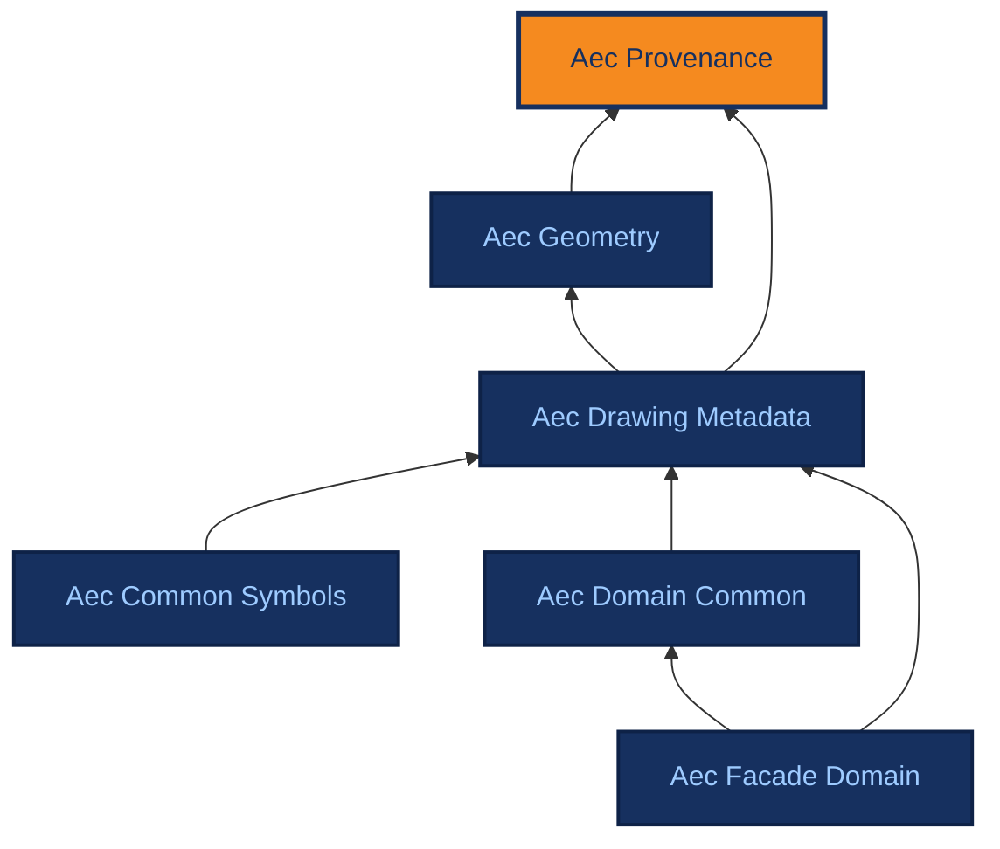

# Aec Provenance

Version 1.0.1 (latest)

<ul>
<li><a href="./" class="adiro-version-current" aria-current="page">1.0.1 (latest)</a></li>
<li><a href="1.0.0/">1.0.0</a></li>
</ul>

[{ .ontocanvas-icon } Open in OntoCanvas](https://alelom.github.io/OntoCanvas/?onto=https://w3id.org/adiro/aec_provenance.html){ .md-button target=_blank }
[:material-file-document-outline: TTL source](https://w3id.org/adiro/aec_provenance.ttl){ .md-button }
[:material-file-code: pyLODE HTML](https://w3id.org/adiro/aec_provenance.html){ .md-button }

Foundational, domain-neutral module for provenance. It lets any value inferred from a drawing be recorded as an assertion that carries its own source, confidence, and how it was produced, aligned to W3C PROV-O. The drawing modules import it.

- **IRI:** `https://w3id.org/adiro/aec_provenance`
- **Versioned IRI:** `https://w3id.org/adiro/aec_provenance/1.0.1`

## Interactive view

<iframe src="https://alelom.github.io/OntoCanvas/?onto=https://w3id.org/adiro/aec_provenance.html" title="Aec Provenance in OntoCanvas" loading="lazy" style="width: 100%; height: 480px; border: 1px solid var(--md-default-fg-color--lightest); border-radius: 4px;"></iframe>

## Dependencies

Arrows point from an ontology to the ontologies it imports; the current ontology is highlighted.

## Classes

### Activity {#Activity}

Typing stub for the PROV-O term of the same name, declared locally so this module stays self-contained and the reasoning CI resolves offline. A stub is a name, not a definition: the authoritative axioms live at the source that rdfs:isDefinedBy points at. Disjoint with prov:Entity in PROV-O - see prov:Entity above.

- **IRI:** `http://www.w3.org/ns/prov#Activity`

### Agent {#Agent}

Typing stub for the PROV-O term of the same name, declared locally so this module stays self-contained and the reasoning CI resolves offline. A stub is a name, not a definition: the authoritative axioms live at the source that rdfs:isDefinedBy points at.

- **IRI:** `http://www.w3.org/ns/prov#Agent`

### Document (ISO 21597-1) {#Document}

Typing stub for the ISO 21597-1 (ICDD) term Document, edition 1: an abstract reference to a document inside or outside a container. A stub is a name, not a definition: the authoritative axioms live at the source that rdfs:isDefinedBy points at.

- **IRI:** `https://standards.iso.org/iso/21597/-1/ed-1/en/Container#Document`

### Drawing File {#DrawingFile}

A reference to a document in which drawings are stored: not the bytes, but what identifies and locates them (name, media type, content hash, where it is stored, when and by whom it was made and last changed, how many pages it has). The content hash is its identity; the storage location is a fact that changes when the file is moved, and more than one is allowed (copies). A subclass of the ISO 21597-1 Document, which is likewise a reference.

- **IRI:** `https://w3id.org/adiro/aec_provenance#DrawingFile`
- **Sub class of:**
    - [Document (ISO 21597-1)](#Document)
    - [Entity](#Entity)

### Entity {#Entity}

Typing stub for the PROV-O term of the same name, declared locally so this module stays self-contained and the reasoning CI resolves offline. A stub is a name, not a definition: the authoritative axioms live at the source that rdfs:isDefinedBy points at. PROV-O declares prov:Entity owl:disjointWith prov:Activity, which is why the alignment below is seated carefully: a FieldAssertion is the Entity produced, an InferenceMeta is the Activity that produced it, and nothing may be both.

- **IRI:** `http://www.w3.org/ns/prov#Entity`

### Field Assertion {#FieldAssertion}

A single reified assertion that some source makes a value-claim about a field kind. Reifying the claim (rather than attaching the value straight to a subject) lets each printed occurrence carry its own provenance - which region asserted it (assertedBy), what produced it (hasInferenceMeta), and with what confidence (hasConfidence) - independently of the value it states. The value is a literal (hasLiteralValue) for datatype-valued fields or an entity (hasValueEntity) for object-valued fields. Validated assertions are promoted to direct statements on the subject downstream; conflicting assertions across sources are surfaced, not silently merged. A kind of InferredEntity, so it carries the shared provenance/confidence; in PROV-O terms the prov:Entity an extraction produced, which is why the PROV alignment is seated across two classes rather than all on one.

- **IRI:** `https://w3id.org/adiro/aec_provenance#FieldAssertion`
- **Sub class of:** [Inferred Entity](#InferredEntity)

### File Page {#FilePage}

One page of one DrawingFile, counted from 1; a single-page or raster file has page 1. It holds what is true of the page itself: its number, the file it belongs to, its rotation and its display size in points. A drawing is linked to the page it is on, and a coordinate frame reads the page in one coordinate convention.

- **IRI:** `https://w3id.org/adiro/aec_provenance#FilePage`
- **Sub class of:** [Entity](#Entity)

### Inference Meta {#InferenceMeta}

Provenance metadata for an inferred or extracted assertion: what produced it (inferredBy / inferredWith), the source it was derived from (inferredFrom), and when (inferredAt). Modelled as a separate object so several assertions can share one inference record and so provenance can be added without touching the value. Analogous to DANO's DrawingElementMeta, but aligned to PROV-O: this is the prov:Activity that produced the assertion, NOT a prov:Entity. PROV-O declares those two owl:disjointWith, so the distinction is load-bearing rather than stylistic.

- **IRI:** `https://w3id.org/adiro/aec_provenance#InferenceMeta`
- **Sub class of:** [Activity](#Activity)

### Inferred Entity {#InferredEntity}

Anything ADIRO infers or extracts that carries its own provenance and confidence - the shared superclass of everything an inference/extraction step produces as a first-class, provenance-bearing individual. A field-value claim (FieldAssertion, here) is one; a spatial localisation (a BoundingBox, in aec_geometry) is another. It exists so that hasInferenceMeta and hasConfidence apply uniformly to any such product, not only to a field-value claim: a detected box is an inferred entity with its own producer and score, distinct from the confidence in the value read at that box. In PROV-O terms this is the prov:Entity an inference activity generated. The producing step can be a model or a person: a human annotation (a box drawn by hand, a field typed in) is an inference step performed by a person, recorded with inferredBy that person (an aprov:Person) and no inferredWith, and it carries a confidence only if one is given. A model's output and a person's label are told apart by who inferredBy is.

- **IRI:** `https://w3id.org/adiro/aec_provenance#InferredEntity`
- **Sub class of:** [Entity](#Entity)

### Organisation {#Organisation}

A legal entity: the client, the originator, a legal owner or a responsible department named on a drawing, or the organisation that made or saved a file. Modelled as a class rather than a string so that one organisation recurring across many drawings is a single individual, which is what makes cross-drawing questions answerable.

- **IRI:** `https://w3id.org/adiro/aec_provenance#Organisation`
- **Sub class of:**
    - [Organisation (ISO 21597-1)](#Organisation)
    - [Party](#Party)

### Organisation (ISO 21597-1) {#Organisation}

Typing stub for the ISO 21597-1 (ICDD) term Organisation, edition 1. A stub is a name, not a definition: the authoritative axioms live at the source that rdfs:isDefinedBy points at.

- **IRI:** `https://standards.iso.org/iso/21597/-1/ed-1/en/Container#Organisation`

### Party {#Party}

A person or an organisation: whoever made, saved or is named on something. Abstract: every party is exactly a Person or an Organisation, never both and never neither (their disjoint union), as in ISO 21597-1. Software that produced a file is not a party; a PROV activity records it.

- **IRI:** `https://w3id.org/adiro/aec_provenance#Party`
- **Sub class of:**
    - [Agent](#Agent)
    - [Party (ISO 21597-1)](#Party)

### Party (ISO 21597-1) {#Party}

Typing stub for the ISO 21597-1 (ICDD) term Party, edition 1: the generalisation of an organisation and a person. A stub is a name, not a definition: the authoritative axioms live at the source that rdfs:isDefinedBy points at.

- **IRI:** `https://standards.iso.org/iso/21597/-1/ed-1/en/Container#Party`

### Person {#Person}

A named individual: a person named on a drawing (the author, a checker, an approver) or who made or saved a file. Transcribed as printed, so possibly only initials. The role is expressed by the property that points to the person, not by subclassing.

- **IRI:** `https://w3id.org/adiro/aec_provenance#Person`
- **Sub class of:**
    - [Party](#Party)
    - [Person (ISO 21597-1)](#Person)

### Person (ISO 21597-1) {#Person}

Typing stub for the ISO 21597-1 (ICDD) term Person, edition 1. A stub is a name, not a definition: the authoritative axioms live at the source that rdfs:isDefinedBy points at.

- **IRI:** `https://standards.iso.org/iso/21597/-1/ed-1/en/Container#Person`

## Object Properties

### assertedAbout {#assertedAbout}

The subject the claim is ABOUT - the thing a validated assertion is promoted onto. Distinct from assertedBy, which records where the claim was read FROM: a drawn-by name is read from a title-block region (assertedBy) but is a claim about a particular DrawingRevision (assertedAbout), and a sheet has many revisions, so the subject cannot be recovered from the region alone. Without it, mapsToFieldProperty names a property but nothing names the individual to hang it on, and promotion is not expressible. No rdfs:range is asserted: the subjects differ per field kind - Titleblock, DrawingSheet, DrawingRevision, DrawingPackage, Project - and a narrower range would entail those subjects are of a type they are not.

- **IRI:** `https://w3id.org/adiro/aec_provenance#assertedAbout`
- **Domain:** [Field Assertion](#FieldAssertion)

### assertedBy {#assertedBy}

The source that makes this assertion - typically the drawing region it was read from (e.g. a Titleblock or a Layout). This is the provenance that lets the same field kind asserted by different regions be distinguished (e.g. a sheet's scale read from the title block versus the same sheet's scale read from a general note), which a fixed domain on a per-field property cannot express.

- **IRI:** `https://w3id.org/adiro/aec_provenance#assertedBy`
- **Domain:** [Field Assertion](#FieldAssertion)

### assertsFieldKind {#assertsFieldKind}

The field kind (a SKOS concept in a field-kind scheme, e.g. a title-block field such as Scale or Client) that this assertion is about. Keeping the kind as a referenced concept - rather than a bespoke property per field - is what lets names/synonyms live on the concept and keeps the number of relationships small.

- **IRI:** `https://w3id.org/adiro/aec_provenance#assertsFieldKind`
- **Domain:** [Field Assertion](#FieldAssertion)
- **Range:** `skos:Concept`

### belongsToFile {#belongsToFile}

The DrawingFile that a FilePage is a page of. To go from a file to its pages, use the inverse path ^aprov:belongsToFile (ADIRO declares no named inverse properties).

- **IRI:** `https://w3id.org/adiro/aec_provenance#belongsToFile`
- **Domain:** [File Page](#FilePage)
- **Range:** [Drawing File](#DrawingFile)

### fileCreatedBy {#fileCreatedBy}

The party that made the file in the storage system, usually whoever saved it. Not the drawing's author, which is isAuthoredBy in aec_drawing_metadata; a close match to, not the same as, Dublin Core creator and ICDD createdBy.

- **IRI:** `https://w3id.org/adiro/aec_provenance#fileCreatedBy`
- **Domain:** [Drawing File](#DrawingFile)
- **Range:** [Party](#Party)

### fileModifiedBy {#fileModifiedBy}

A party that modified the file in the storage system. More than one is allowed.

- **IRI:** `https://w3id.org/adiro/aec_provenance#fileModifiedBy`
- **Domain:** [Drawing File](#DrawingFile)
- **Range:** [Party](#Party)

### hasInferenceMeta {#hasInferenceMeta}

Links an inferred entity (a FieldAssertion, a BoundingBox, ...) to the InferenceMeta describing what produced it, from where, and when. Aligned to prov:wasGeneratedBy: the entity (a prov:Entity) was generated by the inference (a prov:Activity).

- **IRI:** `https://w3id.org/adiro/aec_provenance#hasInferenceMeta`
- **Sub property of:** [wasGeneratedBy](#wasGeneratedBy)
- **Domain:** [Inferred Entity](#InferredEntity)
- **Range:** [Inference Meta](#InferenceMeta)

### hasValueEntity {#hasValueEntity}

For object-valued field kinds, the entity that is the asserted value - e.g. a Person or Organisation. Used instead of hasLiteralValue when the field references a thing rather than states a string, which is what makes cross-sheet questions ('everything checked by X') answerable.

- **IRI:** `https://w3id.org/adiro/aec_provenance#hasValueEntity`
- **Domain:** [Field Assertion](#FieldAssertion)

### inferredBy {#inferredBy}

The actor, organisation or software that produced this inference: a person (an aprov:Person) when a human annotated, a software agent when a model predicted. Aligned to prov:wasAssociatedWith - the agent the inference activity was associated with.

- **IRI:** `https://w3id.org/adiro/aec_provenance#inferredBy`
- **Sub property of:** [wasAssociatedWith](#wasAssociatedWith)
- **Domain:** [Inference Meta](#InferenceMeta)
- **Range:** [Agent](#Agent)

### inferredFrom {#inferredFrom}

The source the value was derived from - e.g. the origin file, page or region. Aligned to prov:used - the activity used this source.

- **IRI:** `https://w3id.org/adiro/aec_provenance#inferredFrom`
- **Sub property of:** [used](#used)
- **Domain:** [Inference Meta](#InferenceMeta)

### inferredWith {#inferredWith}

The algorithm or model (ideally with version) used to produce this inference. Distinct from inferredBy, which names the responsible actor; inferredWith names the tool. Aligned to prov:used - the activity used this model.

- **IRI:** `https://w3id.org/adiro/aec_provenance#inferredWith`
- **Sub property of:** [used](#used)
- **Domain:** [Inference Meta](#InferenceMeta)

### used {#used}

Typing stub for the PROV-O term of the same name, declared locally so this module stays self-contained and the reasoning CI resolves offline. A stub is a name, not a definition: the authoritative axioms live at the source that rdfs:isDefinedBy points at. (rdfs:domain prov:Activity, rdfs:range prov:Entity)

- **IRI:** `http://www.w3.org/ns/prov#used`

### wasAssociatedWith {#wasAssociatedWith}

Typing stub for the PROV-O term of the same name, declared locally so this module stays self-contained and the reasoning CI resolves offline. A stub is a name, not a definition: the authoritative axioms live at the source that rdfs:isDefinedBy points at. (rdfs:domain prov:Activity, rdfs:range prov:Agent)

- **IRI:** `http://www.w3.org/ns/prov#wasAssociatedWith`

### wasGeneratedBy {#wasGeneratedBy}

Typing stub for the PROV-O term of the same name, declared locally so this module stays self-contained and the reasoning CI resolves offline. A stub is a name, not a definition: the authoritative axioms live at the source that rdfs:isDefinedBy points at. (rdfs:domain prov:Entity, rdfs:range prov:Activity)

- **IRI:** `http://www.w3.org/ns/prov#wasGeneratedBy`

## Datatype Properties

### capturedCaption {#capturedCaption}

The caption/label text exactly as printed on the drawing for this assertion (e.g. 'Verfasser', 'Dwg. Desc.'). Retained even when the field kind is uncertain, so the ground truth of what was on the sheet is never lost and mapping can be revisited later.

- **IRI:** `https://w3id.org/adiro/aec_provenance#capturedCaption`
- **Domain:** [Field Assertion](#FieldAssertion)
- **Range:** `xsd:string`

### contentHash {#contentHash}

The hash of the bytes of the file, as a hexadecimal string. It identifies the content: two files with the same hash and algorithm are the same bytes, wherever they are stored, and a hash that no longer matches means an extraction was made from other bytes.

- **IRI:** `https://w3id.org/adiro/aec_provenance#contentHash`
- **Domain:** [Drawing File](#DrawingFile)
- **Range:** `xsd:string`

### displayHeightPt {#displayHeightPt}

The effective height of the page in points after the recorded page mapping (rotation and cropping); supports bounds checks on coordinates. The measured size of this page of this file, not the paper format the drawing is meant for (sheetSize).

- **IRI:** `https://w3id.org/adiro/aec_provenance#displayHeightPt`
- **Domain:** [File Page](#FilePage)
- **Range:** `xsd:decimal`

### displayWidthPt {#displayWidthPt}

The effective width of the page in points after the recorded page mapping (rotation and cropping); supports bounds checks on coordinates. The measured size of this page of this file, not the paper format the drawing is meant for (sheetSize).

- **IRI:** `https://w3id.org/adiro/aec_provenance#displayWidthPt`
- **Domain:** [File Page](#FilePage)
- **Range:** `xsd:decimal`

### endedAtTime {#endedAtTime}

Typing stub for the PROV-O term of the same name, declared locally so this module stays self-contained and the reasoning CI resolves offline. A stub is a name, not a definition: the authoritative axioms live at the source that rdfs:isDefinedBy points at. (rdfs:domain prov:Activity, rdfs:range xsd:dateTime). ADIRO's own :inferredAt declares rdfs:range xsd:dateTime, so the precision is asserted where it belongs - on the term this suite owns.

- **IRI:** `http://www.w3.org/ns/prov#endedAtTime`

### fileCreatedAt {#fileCreatedAt}

When the file was created, as the storage system records it. Not the drawing's issue date (issueDate).

- **IRI:** `https://w3id.org/adiro/aec_provenance#fileCreatedAt`
- **Domain:** [Drawing File](#DrawingFile)
- **Range:** `xsd:dateTime`

### fileModifiedAt {#fileModifiedAt}

When the file was last modified, as the storage system records it.

- **IRI:** `https://w3id.org/adiro/aec_provenance#fileModifiedAt`
- **Domain:** [Drawing File](#DrawingFile)
- **Range:** `xsd:dateTime`

### fileName {#fileName}

The name of the file, with its extension, as the storage system gives it.

- **IRI:** `https://w3id.org/adiro/aec_provenance#fileName`
- **Domain:** [Drawing File](#DrawingFile)
- **Range:** `xsd:string`

### fileSize {#fileSize}

The size of the file in bytes.

- **IRI:** `https://w3id.org/adiro/aec_provenance#fileSize`
- **Domain:** [Drawing File](#DrawingFile)
- **Range:** `xsd:nonNegativeInteger`

### hasConfidence {#hasConfidence}

Confidence of the inference behind an inferred entity, as a decimal in [0,1]: the score a model gives, or, for a human annotation, absent (or 1 when the annotator is taken as certain). Applies to any InferredEntity - the confidence in a field-value claim (FieldAssertion) and the confidence in a detected localisation (a BoundingBox in aec_geometry) are separate values, each carried on the individual it belongs to. Carried on the individual rather than on a triple, which keeps confidence in the graph without requiring RDF-star or statement reification. The range is an OWL 2 datatype restriction on xsd:decimal with minInclusive 0 and maxInclusive 1, so the [0,1] bound is asserted rather than only described in prose. Note this cannot fire in CI today: the reasoning gate runs over the T-Box in src/ and the repository holds no instance data, so the bound becomes enforceable when an A-Box exists (GitHub issue #22).

- **IRI:** `https://w3id.org/adiro/aec_provenance#hasConfidence`
- **Domain:** [Inferred Entity](#InferredEntity)
- **Range:** _anonymous class_

### hashAlgorithm {#hashAlgorithm}

The algorithm that produced the contentHash, for example sha256.

- **IRI:** `https://w3id.org/adiro/aec_provenance#hashAlgorithm`
- **Domain:** [Drawing File](#DrawingFile)
- **Range:** `xsd:string`

### hasLiteralValue {#hasLiteralValue}

For datatype-valued field kinds, the literal value asserted, kept verbatim (not normalised, expanded or translated at extraction time).

- **IRI:** `https://w3id.org/adiro/aec_provenance#hasLiteralValue`
- **Domain:** [Field Assertion](#FieldAssertion)
- **Range:** `rdfs:Literal`

### inferredAt {#inferredAt}

The time the inference was produced. Aligned to prov:endedAtTime - when the inference activity ended.

- **IRI:** `https://w3id.org/adiro/aec_provenance#inferredAt`
- **Sub property of:** [endedAtTime](#endedAtTime)
- **Domain:** [Inference Meta](#InferenceMeta)
- **Range:** `xsd:dateTime`

### mediaType {#mediaType}

The IANA media type of the file, for example application/pdf or image/tiff.

- **IRI:** `https://w3id.org/adiro/aec_provenance#mediaType`
- **Domain:** [Drawing File](#DrawingFile)
- **Range:** `xsd:string`

### pageCount {#pageCount}

The number of pages of the file: 1 for a single-page or raster file.

- **IRI:** `https://w3id.org/adiro/aec_provenance#pageCount`
- **Domain:** [Drawing File](#DrawingFile)
- **Range:** `xsd:positiveInteger`

### pageNumber {#pageNumber}

The number of the page within its file, counted from 1; a single-page or raster file has page 1. A page can be written as an address with the page fragment of RFC 3778 (the file's address followed by #page=3), which counts from 1 as well. A zero-based index, where a program needs one, is this number minus one.

- **IRI:** `https://w3id.org/adiro/aec_provenance#pageNumber`
- **Domain:** [File Page](#FilePage)
- **Range:** `xsd:positiveInteger`

### pdfRotationDeg {#pdfRotationDeg}

The rotation recorded for the page, in degrees. The page_display_pt coordinates of a coordinate frame already include the recorded page mapping, so this is for interpretation and validation: do not apply the rotation to the coordinates again.

- **IRI:** `https://w3id.org/adiro/aec_provenance#pdfRotationDeg`
- **Domain:** [File Page](#FilePage)
- **Range:** `xsd:integer`

### storageLocation {#storageLocation}

Where a copy of the file is stored: an address in a document-management or cloud storage system, or a path as a file address. More than one is allowed, and a location changes when the file is moved; the contentHash is what stays the same.

- **IRI:** `https://w3id.org/adiro/aec_provenance#storageLocation`
- **Domain:** [Drawing File](#DrawingFile)
- **Range:** `xsd:anyURI`

## Annotation Properties

### expectedRange {#expectedRange}

On a field-kind concept: the expected type of its asserted value - a datatype (e.g. xsd:string, xsd:date) for literal-valued fields, or a class (e.g. Person, Organisation) for object-valued fields. Signals whether an assertion of this kind uses hasLiteralValue or hasValueEntity.

- **IRI:** `https://w3id.org/adiro/aec_provenance#expectedRange`

### mapsToFieldProperty {#mapsToFieldProperty}

On a field-kind concept: the canonical ADIRO property that a validated assertion of this field kind is promoted to (the bridge from the reified assertion to a direct statement on the subject). The subject is the assertion's assertedAbout, so a promotion is: ?a assertedAbout ?subject ; assertsFieldKind ?k . ?k mapsToFieldProperty ?p  =>  ?subject ?p <value>. Annotation only - the promotion is performed by tooling on validation, not by reasoning.

- **IRI:** `https://w3id.org/adiro/aec_provenance#mapsToFieldProperty`
