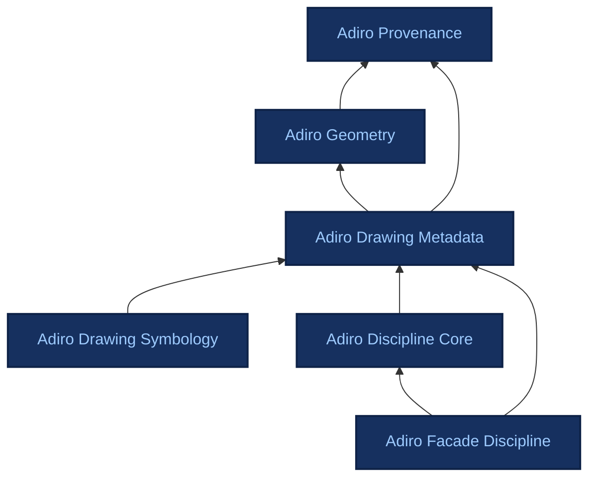

# Ontologies

Reference documentation for each ADIRO ontology, generated from the Turtle sources. Each page also links to an interactive HTML view (pyLODE) and to OntoCanvas.

## Dependencies

The ADIRO ontologies are modular and build on one another via `owl:imports`. Arrows point from an ontology to the ontologies it imports.

## Available ontologies

-   ### [Adiro Provenance](adiro_provenance.md)

    Foundational, domain-neutral module for provenance. It lets any value inferred from a drawing be recorded as an assertion that carries its own source, confidence, and how it was produced, aligned to W3C PROV-O. The drawing modules import it.

-   ### [Adiro Geometry](adiro_geometry.md)

    Foundational, domain-neutral module for geometry. It records where something sits on a drawing page as a bounding box, read against an explicit coordinate frame. Each box carries its own provenance and confidence. It reuses GeoSPARQL, is imported by the drawing modules, and is shared across use cases.

    *Imports: adiro_provenance*

-   ### [Adiro Drawing Metadata](adiro_drawing_metadata.md)

    The core drawing vocabulary. It describes the structure of a drawing sheet: its layouts, title block, revisions, and the fields read from them. It imports the provenance module (which also holds the file, the page and the agents) and the geometry module (where a title block's region is located), and the discipline modules build on it.

    *Imports: adiro_geometry, adiro_provenance*

-   ### [Adiro Drawing Symbology](adiro_drawing_symbology.md)

    The symbols and marks a drawing uses, shared by every discipline: reusable symbols and text that appear across disciplines, such as dimensions, grids, levels and references to another layout or drawing: the graphical reference symbol, the inline and standalone reference expressions, and the occurrences of drawing and layout identifiers they are made of. Every one is a kind of drawing element from the drawing-metadata module. The discipline modules build on them.

    *Imports: adiro_drawing_metadata*

-   ### [Adiro Discipline Core](adiro_discipline_core.md)

    The vocabulary that several discipline modules share: materials, section shapes and properties, structural components and loads, and the discipline classes. It sits between the drawing symbology and the discipline-specific modules, holding abstractions that more than one discipline reuses, so they are defined once.

    *Imports: adiro_drawing_metadata*

-   ### [Adiro Facade Discipline](adiro_facade_discipline.md)

    Facade-engineering concepts and symbols, such as curtain-wall systems and glazing units. It is a discipline-specific module at the end of the dependency chain, building on the shared drawing, symbology, and discipline-core vocabularies.

    *Imports: adiro_discipline_core, adiro_drawing_metadata*

