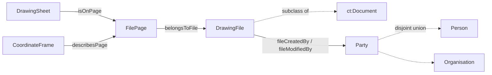

# The file a drawing is stored in: the model and its alignment

!!! info "Status"
    Released ([#192](https://github.com/BuroHappoldMachineLearning/ADIRO/issues/192)) in `adiro_provenance` 2.0.0, `adiro_geometry` 3.0.0
    and `adiro_drawing_metadata` 7.0.0, with the module rename of [#171](https://github.com/BuroHappoldMachineLearning/ADIRO/issues/171).
    [Where a file came from](#where-a-file-came-from) ([#229](https://github.com/BuroHappoldMachineLearning/ADIRO/issues/229)) is in `src/`
    as an unreleased change, published with the next release of `adiro_provenance`. The names below are those in `src/`.

A drawing lives in a file, and a PDF holds many drawings, one per page. ADIRO therefore keeps three things apart: the drawing,
the file it is stored in, and the page of that file it is on.

## The model



- **`DrawingFile`** is a **reference to a document**, not the bytes. It carries what identifies and locates the document: a
  name, a media type, a content hash and the algorithm that produced it, where it is stored, when it was created and last
  modified and by whom, and how many pages it has. The content hash is its identity (the bytes), and the location is a fact
  that changes when the file is moved. More than one location is allowed (copies). Where the file was **obtained from** is
  a separate fact, which does not change: see [Where a file came from](#where-a-file-came-from).
- **`FilePage`** is one page of one file: its page number, the file it belongs to, its rotation and its display size in points.
  A single-page file, and a raster, has page 1.
- **`CoordinateFrame`** is a `FilePage` read in one coordinate convention: the named space, the unit and the profile that
  defines it. A page can have more than one (the primary `page_display_pt` in points, and `px` for raster evidence), and each
  states only its convention, so nothing about the page is repeated.
- **`DrawingSheet`** is linked to the `FilePage` it is on by one property. The page belongs to that link, not to the drawing and
  not to the file: one drawing can exist in several files (the PDF export, a scan, an earlier version) and one file holds many
  drawings.
- **`Party`** (a person or an organisation), **`Person`** and **`Organisation`** are shared agent classes in
  `adiro_provenance`. `Party` is abstract and is the disjoint union of the other two, as in ISO 21597-1.

File metadata comes from the storage system, so it has no confidence and is not an `InferredEntity`; an extraction records the
file it read through its provenance. Nothing in the ontology requires a value, and the values (a client's paths, the people who
saved a file) belong to private data, not to this repository.

## Where a file came from

*(Added with [#229](https://github.com/BuroHappoldMachineLearning/ADIRO/issues/229).)* A file is often copied before it is
read: a public drawing is downloaded into an organisation's own storage, then processed from there. The copies' addresses are
`storageLocation` values; the place the file was obtained from is recorded apart from them, so it is not lost among the copies:

| Property | What it records | Changes when copies move |
|---|---|---|
| `sourceLocation` | the address the file's bytes were obtained from: a public archive's download address, or an organisation's own storage when that is the only origin known | no |
| `sourcePage` | the page at the origin that describes the file (a catalogue record, a landing page), often a more lasting address than the file's own | no |
| `storageLocation` | where a copy is kept; more than one | yes |

A file made from another file (a format conversion, a page split out of a PDF) has other bytes, so it has another content hash
and is another `DrawingFile`. It points back with `prov:wasDerivedFrom`, and only the original records a `sourceLocation`: the
origin of any derived file is found by following that link.

```turtle
:scan  a aprov:DrawingFile ; aprov:mediaType "image/tiff" ;
    aprov:sourceLocation "https://tile.loc.gov/storage-services/…/0001.tif"^^xsd:anyURI ;
    aprov:sourcePage     "https://www.loc.gov/item/…/"^^xsd:anyURI ;
    aprov:storageLocation "https://storage.example.org/drawings/0001.tif"^^xsd:anyURI .
:image a aprov:DrawingFile ; aprov:mediaType "image/png" ;
    prov:wasDerivedFrom :scan .
```

**Whether an address is confidential is a property of the value, not of the term.** An organisation's internal file has its
internal storage as its `sourceLocation`, and that is right in the organisation's own data. Data that is published names only
addresses on public hosts: the data checks (`data-validation/release/`, run with an allowlist of public hosts that whoever
releases the data supplies) report any `sourceLocation`, `sourcePage` or `storageLocation` on another host. The allowlist names
the public hosts, so no internal host name has to be written anywhere. In practice a release drops every `storageLocation`,
unless a copy is published on a public host. A warning (`data-validation/file-source.shacl.ttl`) reports a file with no
recorded origin, itself or through the files it was derived from.

## What moves out of `CoordinateFrame`

| Property today | Is a fact about | Goes to |
|---|---|---|
| `coordinateSpace`, `unit`, `profileRef` | the convention | stays on the frame |
| `pageIndex` | the page | `FilePage`, as a number from 1 (the zero-based index is derived) |
| `frameArtifactRef` (a string) | the file | replaced by `belongsToFile`, which reaches a `DrawingFile` with its content hash |
| `pdfRotationDeg` | the page | `FilePage` |
| `displayWidthPt`, `displayHeightPt` | the page, in points | `FilePage` |
| `hasCoordinateFrame` (drawing to frame, in `adiro_drawing_metadata`) | the link from a drawing to its frame | removed: the frames of a drawing are reached with `isOnPage` and `describesPage` |

The page size is the **measured** size of one page of one file after rotation and cropping, and is not `sheetSize`, which is
the paper format the drawing is meant for (for example "A1"). They can disagree, and the disagreement is information: an A1
drawing exported on an A3 page is a reduced copy, and a scan has a page size unrelated to the paper.

`adiro_drawing_metadata` keeps its import of `adiro_geometry`: every `MetadataContainer` (the title block, a revision table, a legend, a key plan, a note) every `Layout` and every `DrawingElement` may carry a `BoundingBox` (`hasBoundingBox`, stated as a `min 0` restriction on each), and that region is read in the frame of the page the drawing is on.

A page is named by its file and its number, so a page can be written as an address with the page fragment of RFC 3778
(`<file>#page=3`), whose pages also count from 1.

## Alignment to published vocabularies

ADIRO mints its own terms and relates them to published ones, in the order of the
[external ontology imports](external-ontology-imports.md) rule, with no `owl:imports`.

**Classes: subclass.** Each ADIRO class is a subclass of the term of ISO 21597-1 (ICDD, edition 1) that means the same, declared
locally as a stub that carries none of that standard's axioms:

| ADIRO class | Subclass of |
|---|---|
| `DrawingFile` | `ct:Document` (a reference to a document inside or outside a container) |
| `Party` | `ct:Party` |
| `Person` | `ct:Person` |
| `Organisation` | `ct:Organisation` |

The direction matters: every ADIRO person is an ICDD person, but an ICDD person does not carry ADIRO's narrower meaning (a person
named on a drawing, transcribed verbatim, possibly only initials). ADIRO keeps its own definitions and annotations on its own
terms, which adopting the ICDD classes would not allow. The ICDD namespace contains the edition (`…/21597/-1/ed-1/…`), so the
alignment is to edition 1, and a later edition adds one more line.

**Properties: `skos:closeMatch`.** Every ICDD property is functional (it takes one value), and `ct:createdBy` has the container as
its domain. A subproperty would make a renamed file, a second location or a second modifier inconsistent for a reader that
reasons with ICDD's axioms, so the alignment is an annotation, with local names that follow ICDD's where the meaning is the same.

| Need | ADIRO | ISO 21597-1 | Dublin Core terms (ISO 15836-2) | Other |
|---|---|---|---|---|
| name of the file | `fileName` | `ct:name` | `dcterms:title` | IFC document information: name |
| media type | `mediaType` | `ct:format` | `dcterms:format` | DCAT: media type |
| content hash and algorithm | `contentHash`, `hashAlgorithm` | `ct:checksum`, `ct:checksumAlgorithm` | none | |
| where it is stored | `storageLocation` | `ct:url` | none | DCAT: download URL; IFC: location |
| where it was obtained from | `sourceLocation` | none | `dcterms:source` | DCAT: download URL |
| the page describing it at its origin | `sourcePage` | none | none | DCAT: landing page |
| created, last modified | `fileCreatedAt`, `fileModifiedAt` | `ct:creationDate`, `ct:modificationDate` | `dcterms:created`, `dcterms:modified` | IFC: creation time, last revision time |
| created by, modified by | `fileCreatedBy`, `fileModifiedBy` (range `Party`) | `ct:createdBy`, `ct:modifiedBy` | `dcterms:creator`, `dcterms:contributor` | IFC: document owner, editors |
| number of pages | `pageCount` | none | `dcterms:extent` | |
| size in bytes | `fileSize` | none | `dcterms:extent` | DCAT: byte size |
| page of a file | `FilePage`, `pageNumber` | none | none | |

The file's "created by" is the person or organisation that made the file in the storage system, usually whoever saved it. It is not
the drawing's author, which is `isAuthoredBy`, and `dcterms:creator` and `ct:createdBy` are therefore a close match, not an exact one.

The standards with no published IRIs are mapped here in words, by name, without quoting their text:

- **ISO 19650-1 and -2**: an information container is a file or a part of a file, retrievable by name; the split of drawing, file
  and page is the same idea, and a status and a revision belong to the drawing and its revisions (`hasStatusCode`, `revisionCode`).
- **ISO 32000-2 (PDF)**: a page has a size (the page boxes) and a rotation, which `FilePage` mirrors.
- **ISO 5457 and ISO 216**: the paper formats behind `sheetSize` (an A1 sheet is about 2384 by 1684 points), against which a page
  size can be compared.
- **ISO 7200**: the data fields of a title block, which the title-block vocabulary already cites.

IFC document information (ISO 16739-1) is aligned by `skos:closeMatch` once the IRI of its OWL form for the current IFC version is
confirmed.

## An ICDD export

ICDD packages documents with their links. An ADIRO dataset can be written as a container without changing the ontology: each
`DrawingFile` becomes a document description through the table above (which a query over the `closeMatch` annotations can
produce), and a link element addresses a `FilePage` by its `#page=N` identifier. ICDD defines no page or region term of its own, so
`FilePage` fills that gap. Nothing builds this export today.

## Open points

- The IRI of IFC document information in its OWL form.
- Whether a file made by software (a plotting tool) is recorded by a person or organisation, or by a PROV activity.

Standards are cited by name; no text, definition, figure or dimension of any of them is reproduced here.
