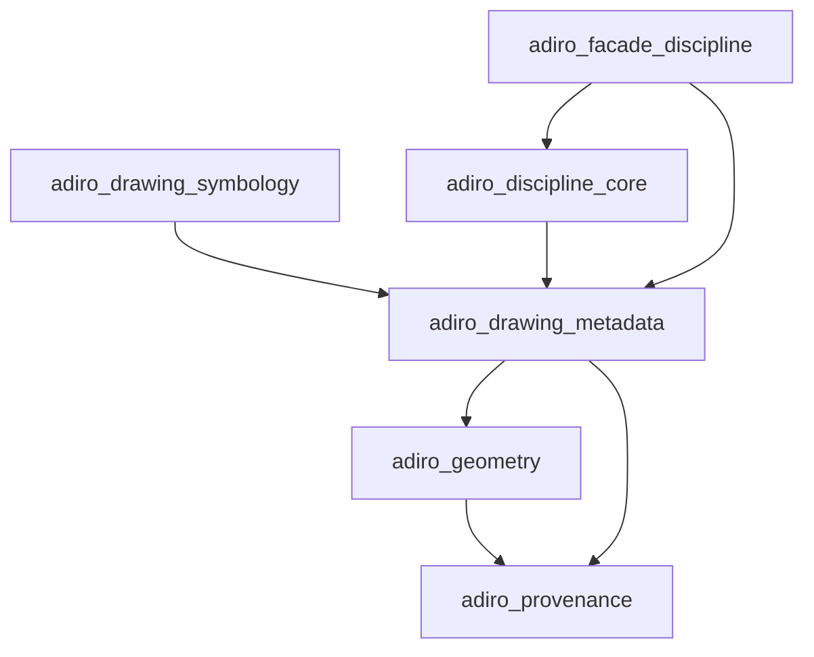

# Ontology modularization

ADIRO is a suite of six ontology modules. Each module has its own namespace, its own version and its own `owl:imports`, and is
released on its own. Two modules are foundational and know nothing about drawings; one holds the drawing itself; one holds the
symbols and marks every discipline shares; and two hold discipline vocabulary, a shared base and the facade discipline. A module
imports only what its own terms use, and every import, with its reason, is pinned in `config/module_imports.json`.

The terms of each module are listed on its page in the [ontologies index](../../../ontologies/index.md); this page says what each
module is for and why the suite is split this way.

## The modules

| Module | Prefix | Namespace | Imports | Role |
|---|---|---|---|---|
| `adiro_provenance` | `adprov:` | `https://w3id.org/adiro/adiro_provenance#` | none | Foundational, domain-neutral: how a value was inferred (assertions, their source, confidence and acceptance, aligned to PROV-O), the file and page a drawing is stored in, and the people and organisations named. |
| `adiro_geometry` | `adgeom:` | `https://w3id.org/adiro/adiro_geometry#` | `adiro_provenance` | Foundational, domain-neutral: where something sits on a page, as a bounding box read against an explicit coordinate frame. |
| `adiro_drawing_metadata` | `admeta:` | `https://w3id.org/adiro/adiro_drawing_metadata#` | `adiro_provenance`, `adiro_geometry` | The drawing: its layouts, title block, revisions, status, project and package, the drawing types, and `DrawingElement`, the class every drawn thing specialises. |
| `adiro_drawing_symbology` | `adsym:` | `https://w3id.org/adiro/adiro_drawing_symbology#` | `adiro_drawing_metadata` | The symbols, marks and text every discipline uses: dimensions, grids, the reference symbol and the expressions that refer to another layout or drawing. |
| `adiro_discipline_core` | `adcore:` | `https://w3id.org/adiro/adiro_discipline_core#` | `adiro_drawing_metadata` | The base the discipline modules share: the `Discipline` classes, materials, section shapes, structural components and loads, and the generic property classes. |
| `adiro_facade_discipline` | `adfacade:` | `https://w3id.org/adiro/adiro_facade_discipline#` | `adiro_drawing_metadata`, `adiro_discipline_core` | Facade engineering: facade systems and components (curtain walls, glazing units, brackets, …) and the facade-specific properties and functions. |

## Import hierarchy

An arrow points from a module to a module it imports. The same hierarchy is drawn in [UC-01 §7](../../use-cases/UC-01/UC-01-Titleblock-Based%20Drawing%20Search.md#7-module-alignment-summary)
and [UC-03 §7](../../use-cases/UC-03/UC-03-Reference%20Symbol%20Cross-Drawing%20Linking.md#7-module-alignment-summary).

## Design decisions

1. **The foundational modules are domain-neutral.** `adiro_provenance` and `adiro_geometry` say nothing about drawings, so a
   use case that records provenance or locates a region can use them without the drawing vocabulary. The drawing modules
   import them, not the reverse.
2. **`DrawingElement` is in `adiro_drawing_metadata`.** It is the class every drawn thing specialises, so every module that
   defines drawn things (the symbology and the discipline modules) imports `adiro_drawing_metadata` to reach it.
3. **The discipline modules do not import `adiro_drawing_symbology`.** None of their terms uses one of its terms, and a
   module imports only what it uses. A discipline module that needs a shared symbol imports it then, with the reason in
   `config/module_imports.json`.
4. **What more than one discipline reuses is in `adiro_discipline_core`**: the structural components, the section shapes and
   the generic property classes (`Material`, `Function`, …), which the facade and structural vocabularies share.
5. **What only one discipline needs is in its own module.** The facade property classes (`CWFrameMemberProperties`,
   `GlazingProperties`) and the facade functions (`Aesthetic`, `Airtightness`, …, subclasses of `adcore:Function`) are in
   `adiro_facade_discipline`.
6. **`DrawingSheet` carries no discipline-specific restriction**, so `adiro_drawing_metadata` stays neutral to every
   discipline.

## Renamed and deprecated modules

The modules were called `aec_*` until their final releases, and three of them were renamed again (`adiro_common_symbols`,
`adiro_domain_common` and `adiro_facade_domain`, now `adiro_drawing_symbology`, `adiro_discipline_core` and
`adiro_facade_discipline`); the deprecated predecessors and how to move data from them are in
[Moving from `aec_*` to `adiro_*`](../../../migrating-from-aec.md).
