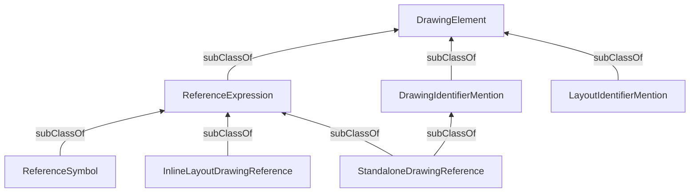
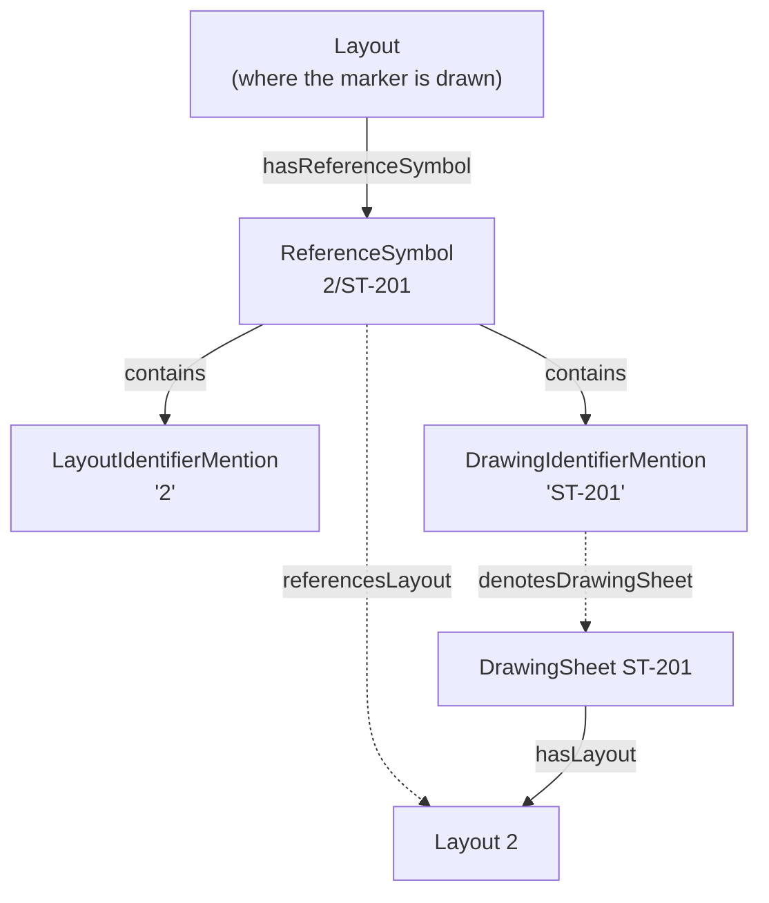
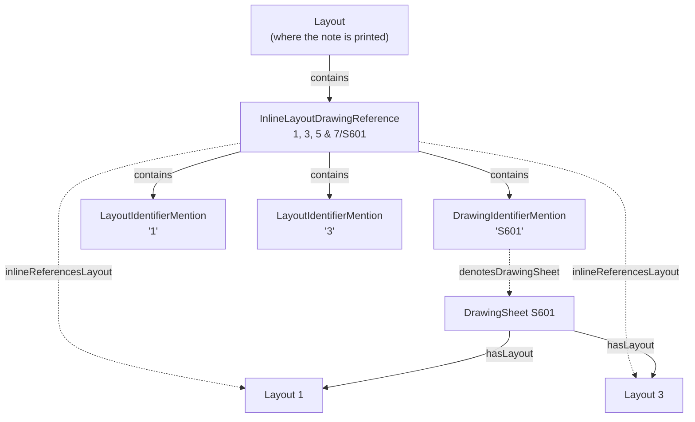
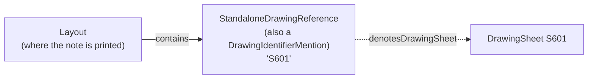

# UC-03 semantic references: expressions, occurrences and accepted targets

This page explains the UC-03 semantic extension tracked in
[#95](https://github.com/BuroHappoldMachineLearning/ADIRO/issues/95). It complements the
[UC-03 specification](../UC-03-Reference%20Symbol%20Cross-Sheet%20Linking.md).
The existing `adiro_drawing_symbology:ReferenceSymbol` and its Layout-to-Layout link remain in place, and every reference term is defined in the same module, `adiro_drawing_symbology` ([#277](https://github.com/BuroHappoldMachineLearning/ADIRO/issues/277)); `DrawingElement`, `Layout` and `DrawingSheet` stay in `adiro_drawing_metadata`. The new terms
describe source text occurrences and complete inline or standalone references that the original symbol-only
model could not distinguish.

## One source occurrence is not its target

| Source individual | Meaning | Accepted target edge |
|---|---|---|
| `adsym:DrawingIdentifierMention` | One occurrence of sheet-number text | `adsym:denotesDrawingSheet` to a `DrawingSheet`, when resolved |
| `adsym:LayoutIdentifierMention` | One occurrence of layout-number text | No direct target edge; it is a component of a complete expression |
| `adsym:ReferenceSymbol` | One graphical marker | Existing `adsym:referencesLayout` to an accepted target `Layout` |
| `adsym:InlineLayoutDrawingReference` | One complete inline expression | `adsym:inlineReferencesLayout` to each accepted target `Layout` |
| `adsym:StandaloneDrawingReference` | One sheet-number occurrence that is itself a complete reference | Inherited `adsym:denotesDrawingSheet` |

The classes and their superclasses; all of them are in `adiro_drawing_symbology` except `DrawingElement`, which is in
`adiro_drawing_metadata`:



`adsym:ReferenceExpression` groups the three complete forms for queries. A standalone reference has both
`DrawingIdentifierMention` and `ReferenceExpression` types through subclassing: **one occurrence, one individual**. It
does not need an outer wrapper, a self-directed `contains` edge or a duplicate box. An embedded sheet
number remains a component of its symbol or inline expression; absence of a known parent does not prove that
it is standalone.

This is the Semantic part of the [three-layer UC-03 model](uc03-three-layer-model.md); page regions and
processing history have separate responsibilities.

`admeta:contains`, with a typed mention as its object, expresses accepted composition, not target
resolution. The existing `admeta:hasLayout` states which Layout belongs to a DrawingSheet; a layout number
alone is not a globally unique Layout identity. The evidenced source Layout of any reference expression, inline or
standalone, is stated with `admeta:contains` from that Layout (a graphical marker through `adsym:hasReferenceSymbol`,
a sub-property of `contains`), and read from the expression's side with the inverse path `^admeta:contains`, as ADIRO
declares no named inverse properties ([#21](https://github.com/BuroHappoldMachineLearning/ADIRO/issues/21)). Likewise, `adsym:inlineReferencesLayout` is separate from the existing symbol-only
`adsym:referencesLayout`, so using an inline reference cannot accidentally infer that it is a graphical
symbol. Source membership is left unset when the evidence supports only a page location. *(Amended in
[UC-03 v0.7](../UC-03-Reference%20Symbol%20Cross-Sheet%20Linking.md#10-version-history): `appearsOnLayout` was removed.)*

## Worked examples

The three diagrams below show one reference of each form. A solid arrow is composition: `contains` and its
sub-property `hasReferenceSymbol`, and `hasLayout`. A dashed arrow is an accepted target edge, asserted only once the
target has been resolved and accepted; before that, the source individuals exist without it. No
`LayoutIdentifierMention` has a target edge of its own: the Layout a reference points to is recorded on the complete
expression.

**A graphical marker, `2/ST-201`.** The upper text of the marker is the layout number, the lower text the drawing
number.



A marker whose target is on the same drawing may print no drawing number; it then contains no
`DrawingIdentifierMention`, and at most one in any case (`data-validation/uc03-composition.shacl.ttl`).

**An inline reference, `1, 3, 5 & 7/S601`.** One drawing number is shared by four layout numbers; two of the four
are shown, with both of their targets accepted.



**A standalone reference, `SEE S601`.** The drawing number is the whole reference, so one individual is both the
mention and the expression, and its target is the drawing, not a Layout.



Each form has example images of its common varieties on the
[`adiro_drawing_symbology` page](../../../../ontologies/adiro_drawing_symbology.md): graphical markers of several
shapes, standalone references at a match line, in a legend, general notes, a schedule, a drawing index and a
"for continuation" note, and the mentions both inside a marker and inside inline text.

| Source | Individuals and relationships | What remains outside the accepted graph |
|---|---|---|
| Two separate printed `S601` references | Two distinct `StandaloneDrawingReference` individuals may each `denotesDrawingSheet` the same sheet | Their raw glyphs, text spans and selection histories remain separate evidence records |
| Marker `2/ST-201` | One `ReferenceSymbol`, with a `DrawingIdentifierMention` and `LayoutIdentifierMention`; the symbol `referencesLayout` only after the target Layout is resolved | Reading `2/ST-201` does not by itself prove target identity |
| Inline `1, 3, 5 & 7/S601` | One `InlineLayoutDrawingReference`, one shared `DrawingIdentifierMention` for `S601`, and up to four independently evidenced `LayoutIdentifierMention` individuals; each supported target uses `inlineReferencesLayout` | Component-to-target pairing, unresolved members and rejected candidates remain in structured evidence |

For example, after one inline member has been accepted:

```turtle
@prefix md: <https://w3id.org/adiro/adiro_drawing_metadata#> .
@prefix cs: <https://w3id.org/adiro/adiro_drawing_symbology#> .
@prefix ex: <https://example.org/adiro/demo#> .

ex:sheet-S601 a md:DrawingSheet ;
    md:hasLayout ex:layout-1-S601 .

ex:sheet-text-S601 a cs:DrawingIdentifierMention ;
    cs:denotesDrawingSheet ex:sheet-S601 .

ex:inline-reference-1 a cs:InlineLayoutDrawingReference ;
    md:contains ex:sheet-text-S601 ;
    cs:inlineReferencesLayout ex:layout-1-S601 .

ex:standalone-reference-2 a cs:StandaloneDrawingReference ;
    cs:denotesDrawingSheet ex:sheet-S601 .
```

No `contains` self-link or extra DrawingIdentifierMention individual is added for the standalone reference.
The inline's other printed members receive target edges only if their resolutions are accepted.

The expression `3/A6.02 AND 5/A7.01` is commonly recognised as two independent inline references in the
current UC-03 pipeline. Adjacency or the word “AND” alone does not make it one multi-sheet expression. That
pipeline example is not a global OWL cardinality rule.

Only an accepted resolution creates a target edge. An evidenced occurrence may exist while its target is
unknown. Admission requires source-text evidence and an immutable PDF/page/token identity. Precise text
localisation is a separate navigation requirement: an unlocalisable reconstructed text block may retain
an independently accepted sheet resolution with explicit geometry status and evidence, without a fabricated
BoundingBox or a clickable link. Such an occurrence is not automatically a StandaloneDrawingReference.
Rejected or ambiguous target candidates stay in evidence. These are application-profile validation rules,
not OWL geometry cardinality axioms. Geometry roles remain tracked in
[#93](https://github.com/BuroHappoldMachineLearning/ADIRO/issues/93).

## Existing terms and deliberate limits

- `admeta:TextualNote.refersToDrawingId` stores an identifier string on a free-form note. A
  `StandaloneDrawingReference` identifies a particular evidenced text occurrence and may have an accepted
  `DrawingSheet` identity. The two can coexist for different query needs; this work does not replace the
  existing note property or infer a target sheet from its string.
- The proposed general `referencesSheet` property is **not added** here. Graphical markers targeting a whole
  sheet are the narrower open case in [#38](https://github.com/BuroHappoldMachineLearning/ADIRO/issues/38).
  `denotesDrawingSheet` already expresses the accepted identity of an evidenced sheet-number occurrence.
- A bare layout identifier that is a complete reference by itself (for example a same-sheet "see detail 3") has no
  reference class yet. A layout counterpart of `StandaloneDrawingReference` is deferred with #38 and #20.
- No `ReferenceTargetBinding` class is introduced. Direct accepted target edges answer target-set queries;
  source-member-to-target pairings require stable member records in evidence, rather than an RDF node per
  pairing. A partial resolution asserts only its supported edges.
- `ReferenceSymbol` still has no raw-text datatype property. Whether raw extracted text belongs in that class
  remains under [#20](https://github.com/BuroHappoldMachineLearning/ADIRO/issues/20). Source text and its
  extraction history can be retained in immutable evidence without altering the symbol's resolved identity.
- `NavigationLink` remains an open delivery-model question. A semantic target is not proof that a clickable
  link was written to an output PDF; [#93](https://github.com/BuroHappoldMachineLearning/ADIRO/issues/93)
  covers its geometry and [#96](https://github.com/BuroHappoldMachineLearning/ADIRO/issues/96) covers output
  provenance. No navigation-link class or emission claim is added in this semantic change.

The new terms address the UC-03 occurrence and multi-reference questions in the
[specification](../UC-03-Reference%20Symbol%20Cross-Sheet%20Linking.md#4-competency-questions).
They are schema terms, not a deployed exporter, populated knowledge graph or successful PDF navigation run.

## Source admission follows the final branch

The final accepted extraction branch determines an occurrence's expression type and selected source region.
An earlier detector box does not override a later inline acceptance or non-symbol decision. A branch that
abstains, remains provisional or is rejected retains its observations in evidence; it is not promoted to
an accepted ReferenceSymbol or InlineLayoutDrawingReference. Independently accepted DrawingIdentifierMention facts
and Sheet resolution may remain. An accepted source LayoutIdentifierMention is retained even when its target is
missing or ambiguous; only its accepted target edge is withheld. Source composition and target resolution
are separate decisions.
